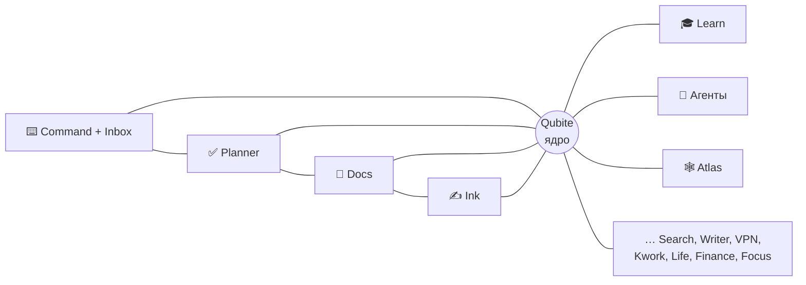
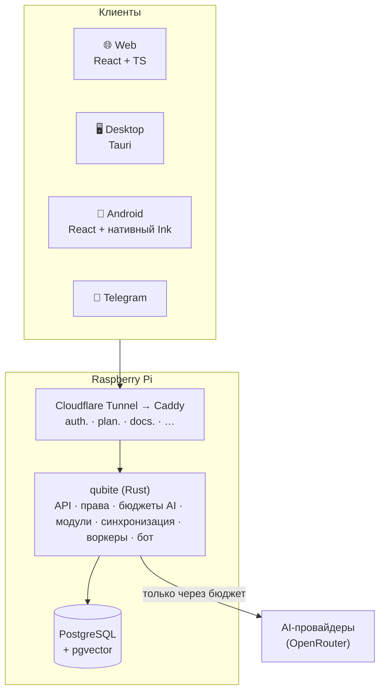

<div align="center">

# Qubite

### Твоя цифровая среда для учёбы, работы, мыслей и жизни — живая, связанная и под твоим контролем

**Заметки · Задачи · Рукописные конспекты · AI-помощники · Всё связано · Работает офлайн · Self-hosted**


[Что это](#-что-это) · [Как это ощущается](#-как-это-ощущается) · [Модули](#-модули) · [Статус](#-статус) · [Архитектура](#-архитектура) · [План](#-план) · [Документация](#-документация) · [Старый Qubite](#-старый-qubite)

</div>

---

## 💡 Что это

**Qubite** — одно приложение вместо десятка: быстрые мысли, задачи и проекты, документы, рукописные конспекты на планшете, учёба, а потом финансы, дневник и автоматизации. Всё лежит в одном месте и **связано между собой**: заметка знает свою задачу, задача — свой проект, конспект — свой урок.

С Qubite можно **разговаривать**: написать или сказать «завтра повторить графы», и он сам предложит задачу на завтра, привязанную к информатике. Но каждое действие можно сделать и руками, AI здесь — помощник, а не обязательный посредник.

| | |
|---|---|
| 🧠 **AI-first, но не AI-only** | Говори с системой естественным языком или делай всё руками |
| 📴 **Local-first** | Заметки, задачи и конспекты работают без интернета и синхронизируются потом |
| 🔗 **Всё связано** | Типизированные связи вместо папок; одна информация — много представлений |
| ✍️ **Перо — в основе** | Проект начался с желания писать конспекты на Android-планшете как в Procreate |
| 🔒 **Твои данные** | Свой сервер (Raspberry Pi), экспорт, бэкапы, приватные зоны, журнал AI |
| 💸 **Деньги под замком** | Платный AI не включается сам: только по разрешению и в пределах бюджета |
| 📱 **Все устройства** | Web, desktop (Linux → Windows/macOS), Android-телефон и планшет |

## ✨ Как это ощущается

Интерфейс сделан из **живого материала «Поток»**. Кнопки, переключатели и ползунки ведут себя как вязкий пластик: их можно потянуть, они растягиваются в своих пределах и упруго возвращаются. Выделение перетекает между пунктами, меню вырастает прямо из кнопки, а окно — из точки нажатия. Без «стекла», которое режет глаза, и плавно даже на слабом телефоне.

- **Палитра «Игрушечная»** — яркий цветной пластик на спокойной молочной основе. У каждого цвета своя роль:

  | Действие | Выбор | Мысль | Готово |
  |:---:|:---:|:---:|:---:|
  |  |  |  |  |
  | `#ff9852` | `#71cfff` | `#ffe163` | `#90dea5` |

- **Шрифты:** Unbounded для заголовков, Manrope для текста.
- **Помощники** — четыре персонажа из простых мягких фигур. Они следят за курсором, тянутся к полю, в которое ты пишешь, грустят при ошибке и тактично отворачиваются, когда ты показываешь пароль:
  - **Элик** (от электрона) ловит мысли и входящие — самый быстрый, всё время в движении;
  - **Прото** (от протона) ведёт проекты — двигает дела вперёд;
  - **Нейт** (от нейтрона) — мудрец для учёбы и дневника, спокойный, в очках и с блокнотом;
  - **Фоти** (от фотона) бережёт личное — свет и тепло;
  - и невидимый **Shade** — «тень», которая делает дела незаметно.

  У Qubite есть ядро, а помощники — частицы атома вокруг него.

Подробно — в [дизайн-системе](docs/design/DESIGN_SYSTEM.md) и [описании помощников](docs/design/COMPANIONS.md).

## 🧩 Модули



| Модуль | Что делает | Когда |
|---|---|---|
| ⌨️ **Qubite Command + Inbox** | Одно поле внизу экрана: пишешь или говоришь мысль (и из Telegram тоже), она попадает во «Входящие», а Qubite предлагает сделать из неё задачу, заметку или событие | **MVP, первым** |
| ✅ **Planner** | Проекты, задачи, сроки, Kanban, календарь, напоминания | MVP |
| 📄 **Docs** | Блочный редактор, связи, версии, Markdown, офлайн | MVP |
| ✍️ **Ink** | Рукописные конспекты на Android-планшете с адаптивной стабилизацией пера | MVP |
| 🛡️ **Owner Console** | Скрытая панель владельца: люди, права на модули, бюджеты AI, тумблеры платформы | MVP |
| 🎓 **Learn** | Уроки, ДЗ, карточки, квизы, турниры | позже |
| 🤖 **Агенты** | Память, навыки, Hermes, MCP для Codex/Claude | позже |
| 🔎 **Search · ✏️ Writer · 🌐 VPN · 💼 Kwork** | Переписываются из старого Qubite на Rust | позже |
| 📔 **Life · 💰 Finance · 🎯 Focus · 🎨 Studio** | Дневник, деньги, концентрация, рисование | большие релизы |
| 🏠 **Qubite Home** | Умный дом на Home Assistant, «мозг» — Shade AI, который берёт данные из Qubite | большой релиз |

Полный каталог с поддоменами и статусами — [docs/product/MODULES.md](docs/product/MODULES.md).

## 📍 Статус

> **Октябрь 2026: проект перезапущен.** Есть подробное ТЗ, архитектура и план. **Кода нового Qubite пока нет.**

| Что | Состояние |
|---|---|
| Документация, ТЗ, план | ✅ готово, ждёт просмотра владельцем |
| Старый Qubite | 🗄️ перенесён в [`legacy/qubite-v1/`](legacy/), все 321 тест проходят |
| Фундамент (Rust-сервер, web) | ⏳ следующий шаг |
| Живой дизайн, аккаунты, AI, Command | 📋 в плане |

Где остановились и какие вопросы открыты — [docs/project/STATUS.md](docs/project/STATUS.md).

## 🏗️ Архитектура



- **Сервер:** один Rust-бинарник — модульный монолит (axum, sqlx). Каждый модуль — отдельный crate с чёткими границами.
- **Данные:** PostgreSQL + pgvector на сервере, SQLite на устройствах, синхронизация с офлайн-очередью.
- **Интерфейс:** один React-интерфейс для web, desktop (Tauri) и Android; перо — нативное на Kotlin.
- **Доступ:** по умолчанию запрещено. Владелец вручную выдаёт модули и бюджеты; все проверки выполняет сервер.
- **Модули на поддоменах:** `auth.`, `plan.`, `docs.`, `search.` … на `qubiteapp.ru` / `qubiteapp.online`.

Подробно — [docs/architecture/OVERVIEW.md](docs/architecture/OVERVIEW.md).

## 🗺️ План

```text
0 Документация ✅ → 1 Фундамент → 2 Живой дизайн → 3 Аккаунты и доступ → 4 AI-основа
  → 5 Command + Inbox → 6 На Raspberry Pi → 7 Planner → 8 Docs → 9 Desktop и Android → 10 Ink
                                     (Ink-исследование на планшете — параллельно с самого начала)
```

[Дорожная карта](docs/plan/ROADMAP.md) · [Задачи](docs/plan/TASKS.md)

## 📚 Документация

| С чего начать | |
|---|---|
| [Видение продукта](docs/product/VISION.md) | Что такое Qubite и что входит в MVP |
| [Решения владельца](docs/product/DECISIONS.md) | Всё, что уже решено |
| [Архитектура](docs/architecture/OVERVIEW.md) | Как устроено |
| [Дизайн-система](docs/design/DESIGN_SYSTEM.md) | Как выглядит и ощущается |
| [Как работает агент](docs/engineering/AGENT_WORKFLOW.md) | Цикл задач, Definition of Done |
| [Вся документация](docs/README.md) | Карта всех документов |

## 🗄️ Старый Qubite

До перезапуска Qubite был платформой учебных турниров (Node.js + SQLite) с сервисами вокруг: поиск, проверка текста, VPN, Telegram-боты, парсер Kwork. Весь этот код сохранён в [`legacy/qubite-v1/`](legacy/) и постепенно переписывается модулями нового Qubite. Карта старого кода — [legacy/README.md](legacy/README.md).

## 🛠️ Разработка

Код появится в задачах фундамента. Целевые команды:

```bash
just setup   # зависимости и локальная БД
just dev     # сервер + web
just check   # формат, линтеры, тесты
```

Подробно — [docs/engineering/DEVELOPMENT.md](docs/engineering/DEVELOPMENT.md). Безопасность — [SECURITY.md](SECURITY.md).

---

<div align="center">

**Qubite** — персональная цифровая среда, которая хранит знания, действия и историю, помогает учиться, работать и создавать и растёт вместе с тобой.

Автор — Кирилл Кузмичев.

</div>
