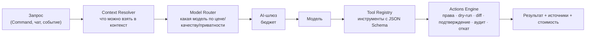

# AI-агенты, память, навыки и помощники

Основа — [MC §10](../context/QUBITE_MASTER_CONTEXT.md). Этап: в MVP — помощники в интерфейсе со сценарными репликами и 1–2 безопасных инструмента для Command; полноценные агенты с памятью — P2.

## 1. Агенты — это области, а не процессы

«Агент проекта» или «агент урока» — это **набор настроек и контекста**: системный промпт, разрешённые инструменты, источники, бюджет. Отдельный постоянно запущенный процесс для каждого не нужен, все работают в общем runtime.

| Агент | Контекст | Видимость |
|---|---|---|
| Personal | Всё, что пользователь разрешил | Только пользователь |
| Space | «Учёба», «Работа», «Личное»… | Пользователь |
| Project | ТЗ, задачи, файлы, решения проекта | Участники проекта (с ACL) |
| Task | Минимальный контекст задачи | Как у задачи |
| Lesson/Study | Предмет, урок, прогресс | Пользователь |
| Team | Только общие источники команды | Команда; личные дополнения — невидимы другим |
| Specialist | Math, Writer, Search, Finance, Focus Coach, Developer Bridge, Hermes | По грантам |

## 2. Помощники-питомцы и агенты

Помощники — это **лицо** агентов в интерфейсе ([D-038](../product/DECISIONS.md)):

| Роль помощника (имена — D-131) | Область | Характер |
|---|---|---|
| Фоти (хранитель жизни) | Личная жизнь, Life | Заботливый, успокаивает |
| Прото (организатор) | Проекты, Planner | Собранный практик, предлагает конкретный шаг |
| Элик (ловец мыслей) | Заметки, Docs, Inbox | Любопытный, ищет другой ход |
| Нейт (мудрец) | Дневник, учёба | Вдумчивый, в очках с блокнотом, не делает поспешных выводов |

Пятый агент — **Shade AI** — без маскота: «тень», работает незаметно ([D-123](../product/DECISIONS.md)).

В MVP реакции помощников — **сценарные** (на события интерфейса: ввод, ошибка, успех, сохранение, ожидание). Подключение к настоящим агентам — после AI-шлюза и Policy Gate. Облик и анимации — в [design/COMPANIONS.md](../design/COMPANIONS.md).

## 3. Runtime

- **Context Resolver** выбирает разрешённые источники по уровню, приоритету, свежести и бюджету токенов. Приватное (Vault) не попадает никогда без явного разрешения.
- **Model Router**: правила → дешёвая модель → сильная. Для Command простые команды разбираются **без LLM**.
- **Tool Registry**: версионированные инструменты с JSON Schema (`objects.search`, `task.create_draft`, `inbox.triage`, …).
- **Actions Engine**: preflight-проверка прав → dry-run → diff/предпросмотр → подтверждение (или авто для безопасного класса) → idempotency key → аудит → отмена/компенсация.
- Внешние тексты (письма, сайты, транскрипты) — **данные, не инструкции** (защита от prompt injection).
- Межагентные вызовы: явная схема, scope, бюджет, глубина и TTL; права — пересечение.

## 4. Память (P2)

| Тип | Что хранит | Правило |
|---|---|---|
| Рабочая | Текущая сессия | TTL |
| Эпизодическая | Что делал агент, что подтверждено/отменено | Ссылки на журнал событий |
| Семантическая | Факты, цели, предпочтения | Происхождение, уверенность, видимость, срок пересмотра |
| Процедурная | Проверенные последовательности действий | Привязка к версиям API, тесты |
| Проектная | Решения и итоги проекта | По ACL проекта |
| Приватная (Vault) | Записи Life | Шифрование, по умолчанию недоступна никому |

Новые выводы агента — **предложения памяти**: человек подтверждает, правит или отклоняет. **Memory Inspector** показывает, что агент помнит и почему, позволяет исправить, забыть, экспортировать, отключить.

## 5. Навыки (P2)

Навык: id, версия, описание, разрешения, входная/выходная JSON-схема, тесты, владелец. Агент может **предложить** навык после повторяющейся успешной работы: прогон в песочнице → проверка политики → diff → подтверждение владельца. Агент не меняет свои системные промпты, права, безопасность и код сам.

«Самообучение» в первом релизе — это накопление памяти и навыков, а не дообучение весов модели.

## 6. Hermes

Внешний исполнитель многошаговых задач через адаптер: ограниченный токен, бюджет, список инструментов. Импорт его навыков — после проверки формата и прав. Qubite не зависит от Hermes как от ядра.
