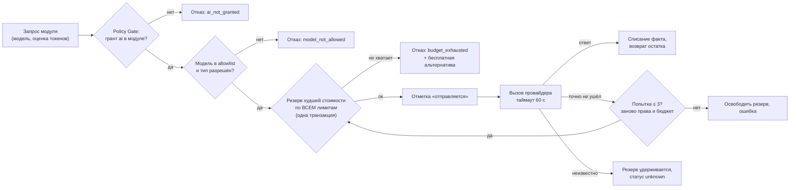

# AI-шлюз и контроль расходов

Задача: **ни один цент не тратится без разрешения**. Платный AI не открывается регистрацией, модулем, ссылкой или командой ([D-070](../product/DECISIONS.md)). Все вызовы моделей идут только через AI-шлюз (`qubite-ai`). Модулю запрещено обращаться к провайдеру напрямую: в Rust у него просто нет HTTP-клиента провайдера.

## 1. Путь вызова



## 2. Правила (решения владельца)

| Правило | Источник |
|---|---|
| Валюта — USD; суммы хранятся целыми микродолларами (`i64`, 1 $ = 1 000 000) | [D-071](../product/DECISIONS.md) |
| Лимиты: $ за день / месяц / всё время, запросы за час / день / месяц, токены; уровни: пользователь, модуль, модель, провайдер, пользователь×модуль | [D-071](../product/DECISIONS.md), [AC] |
| Периоды по часовому поясу платформы, по умолчанию `Asia/Yekaterinburg`; смена пояса не обнуляет накопленное; резерв остаётся в периоде, где создан | [D-072](../product/DECISIONS.md) |
| Резерв худшей стоимости **до** вызова; при параллельных запросах лимит не превышается (строки бюджета блокируются `SELECT … FOR UPDATE`) | [D-073](../product/DECISIONS.md) |
| Неизвестный результат (процесс упал после отметки «отправляется», таймаут) — резерв удерживается; если ответ придёт позже, расход учитывается один раз | [D-073](../product/DECISIONS.md) |
| Факт дороже оценки — учитывается полностью, модель блокируется для новых запросов до решения owner | [D-073](../product/DECISIONS.md) |
| Повторы — до 3, с задержкой 1 и 2 с, только при **доказанной неотправке**; перед каждой попыткой заново права и бюджет | [D-074](../product/DECISIONS.md) |
| Таймаут 60 с, настраивается; долгие операции (ASR, генерация) — отдельные настройки | [D-075](../product/DECISIONS.md) |
| Модель недоступна → пользователю **предлагается** другая; переключение вручную; тихой замены нет | [D-076](../product/DECISIONS.md) |
| При нулевом или неизвестном бюджете — отказ до вызова, объяснение и бесплатная альтернатива (например, сохранить мысль без AI-разбора) | [AC] |
| Цены моделей — из каталога провайдера с датой обновления; точность до сверки с биллингом не обещаем | [AC] |

## 3. Данные

```text
ai_providers(id, kind openrouter|openai|local|mock, base_url, key_secret_ref, enabled)
ai_models(id, provider_id, external_id, capabilities[], price_in_per_mtok, price_out_per_mtok, context, enabled, blocked_reason)
ai_limits(id, scope_kind user|module|model|provider|user_module, scope_ref, period day|month|all|hour, metric usd|requests|tokens, limit_value, version)
ai_usage_counters(limit_id, period_key, reserved, spent, updated_at)     -- одна строка на лимит×период
ai_calls(id, request_id unique, account_id, module_id, model_id, status queued|sending|succeeded|failed_not_sent|unknown|settled,
         attempts, estimate_usd, actual_usd, tokens_in, tokens_out, period_keys jsonb, created_at, settled_at, error_code)
ai_call_events(call_id, at, kind, details jsonb)     -- без текстов запросов и без секретов
```

Текст запроса и ответа **не** хранится в журнале расходов. Если модулю нужна история (чат), он хранит её у себя с обычными правами объекта.

## 4. Тесты, обязательные до подключения реального провайдера

- Mock-провайдер управляется из теста: успех, ошибка до отправки, обрыв после отправки, таймаут, ответ дороже оценки.
- 100 параллельных запросов от разных пользователей и процессов при лимите $1 и оценке $0,60 → ровно один резерв.
- Повтор с тем же `request_id` не списывает дважды.
- Отзыв гранта между попытками → следующая попытка не отправляется.
- Смена часового пояса и полночь не теряют резерв.
- В CI нет ключей провайдеров; реальные платные вызовы — только вручную владельцем.

## 5. Owner видит (AI Cost Center)

Расход по дням/пользователям/модулям/моделям, текущие резервы, вызовы со статусом `unknown`, заблокированные модели, методику расчёта. См. [OWNER_CONSOLE](../product/OWNER_CONSOLE.md).
