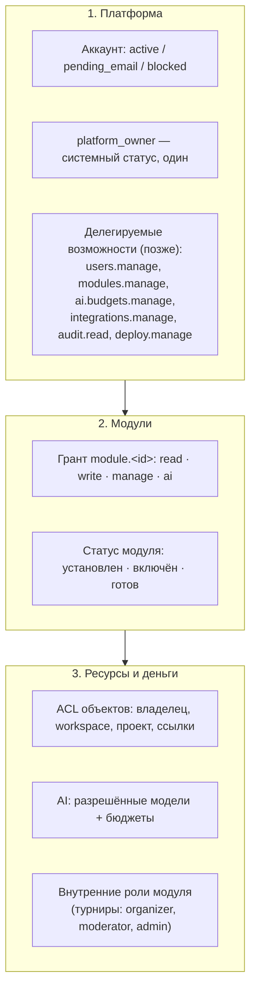

# Аккаунты, вход и права доступа

Основано на [политике владельца](../context/QUBITE_ACCESS_AND_OWNER_CONSOLE.md) и решениях [D-050…D-063](../product/DECISIONS.md). Главный принцип: **по умолчанию запрещено**, и все проверки выполняет **сервер**.

## 1. Три уровня прав



Уровни **независимы**: грант на Docs не даёт чужих документов, роль организатора турнира не даёт ничего вне турниров, owner тоже проходит проверку бюджета.

## 2. Решение доступа

> **Реализовано (ACC-001, 18.10.2026):** crate [`qubite-policy`](../../crates/qubite-policy/). `decide::<Read | Write | Manage | UseAi>(subject, module)` возвращает `Authorized<A>` — без него код модуля не вызвать (проверяет компилятор). Owner Console — `decide_owner` (только owner лично). Шаги 1–3 и 6 работают; шаг 4 (ACL объектов) появится в модулях, шаг 5 (бюджет) — в AI-001. Правила — [D-175](../product/DECISIONS.md).
>
> Как писать маршрут модуля: первым делом `let ok = modules::authorize::<Write>(&state, &session, "docs").await?;`. Фоновая задача сохраняет `ok.authority()` в payload, обработчик вызывает `authority.recheck::<Write>()` (задача останавливается при отзыве гранта, блокировке аккаунта и **отзыве сессии**, из которой поставлена; истечение сессии её не останавливает — [D-179](../product/DECISIONS.md)); долгое соединение — `ok.recheck()` перед каждым сообщением.

Каждый запрос — HTTP, WebSocket-сообщение, фоновая задача, вызов агента, плагина или MCP — проходит одну функцию:

```text
decide(subject, module, action, resource?, cost?) → Allow(ctx) | Deny(reason)
```

Порядок проверок:

1. **Субъект** активен: аккаунт не заблокирован, почта подтверждена, сессия/токен не отозваны и не истекли.
2. **Платформа**: не техработы (кроме owner), вход разрешён, способ входа не выключен.
3. **Модуль**: установлен, включён, готов; у субъекта есть грант на нужное действие (`read` / `write` / `manage`).
4. **Ресурс**: субъект — владелец объекта, или ему выдан доступ (ACL), или объект в его workspace с подходящей ролью. Приватные зоны (Life Vault) имеют явный запрет для всех, кроме владельца.
5. **AI и деньги** (если действие стоит денег): грант `ai` в модуле → модель в allowlist → бюджет зарезервирован ([AI_COST_GUARD](AI_COST_GUARD.md)).
6. **Делегирование**: если действует агент, плагин или API-ключ — права = **пересечение** прав инициатора, агента/ключа и инструмента.

Отказ возвращает машиночитаемую причину (`module_not_granted`, `budget_exhausted`, …) и человеческий текст. Скрытые разделы (Owner Console, скрытый модуль) возвращают `404`.

## 3. Аккаунты и вход

> **Реализовано (AUTH-001, 18.10.2026):** owner через CLI, вход по паролю, web-сессии, CSRF, лимиты, аудит — см. §3.1. **Почта (AUTH-002, 19.10.2026)** — §3.2. **Регистрация и приглашения (AUTH-003)** — §3.3. **Тумблеры платформы (ACC-002)** — §3.4. Остальные строки таблицы — следующие задачи AUTH-*.

| Тема | Правило |
|---|---|
| Создание owner | `qubite owner create --email …` при установке. Один owner (уникальный индекс в БД). HTTP-маршрута нет ([D-052](../product/DECISIONS.md)) |
| Пароли | Argon2id, параметры подобраны под Pi (замер), ограничение параллельных проверок |
| Сессии web | Случайный токен, в БД хранится только хеш; cookie `HttpOnly; Secure; SameSite=Lax; Domain=.<domain>`; CSRF-токен; бездействие → продление; «выйти везде» |
| Устройства | Android/desktop: системный браузер → Qubite Auth → PKCE → токен устройства (refresh + короткий access); отзыв в профиле |
| Почта | Обязательное подтверждение до входа; одноразовые коды/ссылки со сроком и лимитом попыток |
| Восстановление | Только через подтверждённую почту; отзывает все сессии; UUID аккаунта сохраняется |
| OAuth | Google, Яндекс, VK, Telegram. Вход — по сохранённому ID у провайдера. Привязка — из открытого аккаунта с подтверждением пароля. Совпадение почты **не** объединяет аккаунты. Неизвестный ID — регистрация по режиму платформы: открыта — аккаунт сразу (почта от провайдера), по приглашениям — `?invite=`, закрыта — нет ([D-189](../product/DECISIONS.md)) | — **реализовано в AUTH-004** ([D-195](../product/DECISIONS.md)): Яндекс и VK включены, Google и Telegram выключены по умолчанию; код + PKCE, вход одноразовый 10 минут и привязан к браузеру
| Регистрация | Режимы `closed` / `invite_only` (по умолчанию) / `open`; CAPTCHA при `open` |
| Приглашения | `email_bound` или `open_link`; одноразовые; срок 7 дней по умолчанию; отзыв; токен хранится хешем и показывается один раз |
| Тумблеры | Таблица `platform_settings` + аварийные env-переключатели, которые сильнее ([D-059](../product/DECISIONS.md)) |
| API-ключи (P2) | Для расширений, MCP, агентов: scope, срок, бюджет, отзыв; хеш в БД |

### 3.1. Как устроен вход сейчас (AUTH-001)

- **Owner:** `qubite owner create --email … [--name …] [--password-stdin]`. Пароль не передаётся аргументом (его видно в списке процессов): вводится дважды без эха или первой строкой stdin. Второй запуск — отказ. `qubite owner password` — новый пароль, все сессии owner закрываются.
- **Пароли:** Argon2id `m=19456, t=2, p=1` (OWASP), не короче 10 символов. Не больше 2 проверок одновременно; очередь на проверку не держит соединения с базой ([D-179](../product/DECISIONS.md)). Для несуществующей почты проверяется поддельный хеш — по времени ответа нельзя узнать, есть ли аккаунт. Ответ на неверный пароль и на чужую почту одинаковый.
- **Лимиты:** 5 неудач на почту и 30 с одного IP за 15 минут → `429` + `Retry-After`, пароль не проверяется. Попытки одной почты идут строго по очереди (блокировка в PostgreSQL) — параллельные запросы не обходят лимит. Удачный вход обнуляет счётчик почты. После 3 неудач по почте (или 10 с IP) нужна CAPTCHA (`401 captcha_required`, виджет — `login_captcha` в `GET /api/platform/status`); с пройденной CAPTCHA лимит по почте — 20, так что чужой человек не закроет вход owner. Без CAPTCHA (выключена или нет ключей) — 5, как раньше ([D-189](../product/DECISIONS.md)).
- **Сессия:** при входе — две cookie: `qubite_session` (`HttpOnly; Secure; SameSite=Lax; Path=/`, домен — `QUBITE_SESSION_COOKIE_DOMAIN`) и `qubite_csrf` (читает сайт). В базе — SHA-256 обоих токенов. Срок 30 дней, раз в 5 минут использования продлевается вместе с cookie ([D-170](../product/DECISIONS.md)).
- **CSRF:** любой изменяющий запрос (не GET/HEAD/OPTIONS) с живой сессией должен нести `X-CSRF-Token` = значение `qubite_csrf`, иначе `403 csrf_failed`. Исключение — сам вход (у него ещё нет сессии; чужой сайт не отправит JSON без CORS). Клиент `@qubite/api-client` добавляет заголовок сам.
- **Проверка:** каждый запрос с cookie сверяется с базой — отозванная, истёкшая сессия или заблокированный аккаунт перестают работать сразу; мёртвую cookie сервер стирает.
- **Приложения (AUTH-006):** браузер → `POST /api/auth/device/authorize` (из web-сессии, с CSRF) → `qubite://auth/callback?code=…&state=…` → `POST /api/auth/device/token` (`authorization_code` + `code_verifier`, PKCE S256). Access — 15 минут (`Authorization: Bearer`), refresh — одноразовый, сессия устройства — 30 дней с продлением. Повтор кода или refresh — сессия закрывается. Код действует, только пока открыта web-сессия, из которой его выдали ([D-179](../product/DECISIONS.md)). Устройства видны в общем списке сессий и закрываются оттуда ([D-177](../product/DECISIONS.md)).
- **Аудит:** `platform.owner_created`, `platform.setting_changed`, `account.registered`, `invitation.created`, `invitation.revoked`, `auth.email_verified`, `auth.password_reset`, `auth.device_authorized`, `auth.device_login`, `auth.refresh_reuse`, `auth.login`, `auth.logout`, `auth.session_revoked`, `auth.logout_everywhere`, `auth.password_changed`. Неудачные попытки — только в `login_attempts` (сутки).
- **Ошибки:** `{ "error": "<код>", "message": "<текст>" }`: `invalid_credentials`, `too_many_attempts`, `account_blocked`, `email_not_verified`, `invalid_code`, `registration_closed`, `invite_required`, `invalid_invite`, `captcha_failed`, `captcha_unavailable`, `login_disabled`, `login_method_disabled`, `maintenance`, `email_disabled`, `conflict`, `unauthenticated`, `csrf_failed`, `not_found`.

### 3.2. Почта: подтверждение и восстановление (AUTH-002)

- **Отправка:** crate `qubite-mail`, способ — `QUBITE_EMAIL_MODE` (`mock` | `resend` | `smtp`), отправитель `QUBITE_EMAIL_FROM` (по умолчанию `Qubite <no-reply@qubiteapp.ru>`). Ссылки в письмах ведут на `QUBITE_AUTH_URL` (`/verify-email?token=…`, `/reset-password?token=…`). Письмо уходит в фоне после записи в базу, до 3 попыток ([D-186](../product/DECISIONS.md)).
- **Письмо:** 6-значный код и кнопка-ссылка. В `email_challenges` — SHA-256 кода (вместе с ID записи) и токена ссылки. Подтверждение — сутки, пароль — 30 минут; 5 неверных кодов — код сгорает (проверка под `FOR UPDATE`, параллельные попытки считаются все); новое письмо отменяет прежний код; не чаще раза в минуту и не больше 5 в час на почту.
- **Маршруты:** `POST /api/auth/email/verify/request {email}` и `POST /api/auth/password/forgot {email}` → всегда `202` с одним текстом; `POST /api/auth/email/verify {email, code} | {token}` → `204`, аккаунт `pending_email` становится `active`; `POST /api/auth/password/reset {email, code, password} | {token, password}` → `200 {revoked}`: пароль сменён, все сессии и устройства закрыты, счётчик перебора по почте обнулён. Неверный, устаревший или использованный код — `400 invalid_code`; слабый пароль код не тратит.
- **Кому:** подтверждение — только `pending_email`, восстановление — только `active`. Заблокированным и несуществующим — ничего, но ответ тот же.

### 3.3. Регистрация и приглашения (AUTH-003)

- **Режим** — настройка платформы `registration.mode` (таблица `platform_settings`): `closed` — никто (и приглашения не работают), `invite_only` — по умолчанию, только с приглашением, `open` — любой, без приглашения — с CAPTCHA ([D-187](../product/DECISIONS.md)). Сайт узнаёт режим и ключ виджета из `GET /api/auth/registration`.
- **Регистрация:** `POST /api/auth/register {email, password, display_name?, invite?, captcha_token?}` → `202`. Аккаунт `pending_email`, письмо с кодом уходит сразу (§3.2); войти — после подтверждения. Модулей нет (D-054). Почта уже занята — тот же `202`, приглашение не тратится, владельцу почты — обычное письмо.
- **Приглашения:** код 12 знаков алфавита Крокфорда (`XXXX-XXXX-XXXX`, регистр, дефисы, O/0 и I/L/1 не важны), ссылка `QUBITE_AUTH_URL/register?invite=…`; в `invitations` — SHA-256. `email_bound` подходит только для своей почты и сразу уходит письмом; `open_link` — любому. Срок 1…30 дней (7 по умолчанию), одноразовое, отзыв. Строка блокируется на время регистрации — гонка по одной ссылке даёт одного победителя. Owner: `POST/GET /api/owner/invitations`, `DELETE /api/owner/invitations/{id}` (остальным 404).
- **CAPTCHA** (`qubite-captcha`): `captcha.provider` = `turnstile` (по умолчанию) / `smartcaptcha` / `off`; `QUBITE_CAPTCHA_DISABLED=true` сильнее. Ключи: `QUBITE_TURNSTILE_SITE_KEY` + `QUBITE_TURNSTILE_SECRET_KEY`, `QUBITE_SMARTCAPTCHA_SITE_KEY` + `QUBITE_SMARTCAPTCHA_SECRET_KEY`. Сервис не ответил или нет ключей — `503 captcha_unavailable` (регистрация не проходит без проверки).

### 3.4. Тумблеры платформы (ACC-002)

- **Где:** `qubite-auth::platform`, таблица `platform_settings` (строка на настройку, своя версия). Ключи и значения по умолчанию: `registration.mode` = `invite_only`, `login.enabled` = `true`, `maintenance.enabled` = `false`, `maintenance.message`, `login.methods.password|yandex|vk` = `true`, `login.methods.google|telegram` = `false`, `email.enabled` = `true`, `captcha.provider` = `turnstile`, `platform.timezone` = `Asia/Yekaterinburg` ([D-188](../product/DECISIONS.md)).
- **Env сильнее:** `QUBITE_AUTH_LOGIN_ENABLED`, `QUBITE_AUTH_REGISTRATION_ENABLED`, `QUBITE_AUTH_<PASSWORD|GOOGLE|YANDEX|VK|TELEGRAM>_ENABLED` = `false` выключают; `QUBITE_MAINTENANCE=true` включает техработы; `QUBITE_EMAIL_ENABLED=false`; `QUBITE_CAPTCHA_DISABLED=true`. `Effective` = тумблеры + env; Owner Console видит `locked_by_env`.
- **Owner не запирается:** всегда может войти по паролю и работает при техработах. Вход через провайдеров (AUTH-004): слой техработ перед каждым `/api/auth/oauth/*` переносит положение тумблеров в `qubite-oauth` (список, начало и уже начатый вход); `QUBITE_OAUTH_<P>_ENABLED` — стартовое положение тумблера.
- **Поведение:** «вход выключен» — новые входы и разрешение входа приложению (`403 login_disabled`), открытые сессии работают; способ выключен — `403 login_method_disabled`; техработы — слой после сессии отвечает `503 maintenance` (текст owner) на любой `/api/*`, кроме проверок сервера, `/api/platform/status`, входа, выхода и обмена токена приложения; почта выключена — письма не уходят, регистрация `503 email_disabled`. Проверки на входе — после верного пароля.
- **API:** `GET /api/platform/status` — для всех; `GET /api/owner/platform` — тумблеры с версиями, `PATCH /api/owner/platform {changes: [{key, value, version}]}` — целиком или ничего, устаревшая версия — `409 conflict`, аудит `platform.setting_changed` (было/стало).
- **Ещё нет:** открытые WebSocket и фоновые задачи техработы не замечают (Q-23); экран техработ — ACC-004.

## 4. Что получает новый пользователь

Только ([D-054](../product/DECISIONS.md)): вход, профиль, настройки аккаунта (включая настройки ощущений интерфейса), свои сессии и устройства, главная с пустыми состояниями, каталог модулей (с замками). **Никаких модулей и AI.**

Бесплатного базового набора нет: всё выдаёт владелец вручную, подписки и пробный период — позже ([D-172](../product/DECISIONS.md)). AI-лимит по умолчанию — ноль ([D-173](../product/DECISIONS.md)).

## 5. Турниры и роли модулей

Внутренние роли модуля хранятся в таблице этого модуля (`mod_tournaments_roles`) и проверяются **после** гранта на модуль. Грант `manage` на модуль турниров даёт доступ к его разделу «Управление», но не к Owner Console. Старые глобальные `organizer/moderator/admin` из legacy в новую модель не переносятся ([D-050](../product/DECISIONS.md): аккаунты создаются заново).

## 6. Обязательные негативные тесты

> №1, 2, 5–10 — [`crates/qubite-server/tests/policy.rs`](../../crates/qubite-server/tests/policy.rs) (ACC-001); №3, 4 — [`crates/qubite-ai/tests/gateway.rs`](../../crates/qubite-ai/tests/gateway.rs) (AI-001). Все 10 зелёные.

Из [политики](../context/QUBITE_ACCESS_AND_OWNER_CONSOLE.md), каждый — автоматический тест на сервере:

1. Новый пользователь не открывает закрытый модуль и не вызывает его API напрямую.
2. Модуль разрешён, AI запрещён → AI-эндпоинт, агент, MCP, фоновая задача получают отказ **без внешнего запроса**.
3. Модель разрешена, бюджет 0 или исчерпан → запрос не уходит к провайдеру.
4. Параллельные запросы не обходят лимит.
5. Участник/организатор турнира не получает прав owner и доступа к чужим проектам.
6. Отозванный грант или сессия прекращает доступ сразу, включая открытый WebSocket и запланированные задачи; поиск и кэш не раскрывают чужое.
7. Публичная ссылка и гость не имеют платных возможностей.
8. Плагин, Hermes, MCP, агент не повышают права выше инициатора.
9. Owner видит обычный интерфейс + Console; другие не видят Console и получают 404 на её API.
10. Владелец выдал Docs, но не Search/AI/Tournaments → пользователь видит и использует только Docs.

## 7. Хранение (черновик схемы)

```text
accounts(id uuid pk, email citext unique, email_verified_at, status, display_name, created_at, …)
platform_owner(singleton bool pk default true check(singleton), account_id fk unique)
credentials_password(account_id pk, hash, updated_at)
oauth_identities(provider, subject, account_id, linked_at, unique(provider, subject))
sessions(id, account_id, token_hash, kind web|device, device_name, created_at, last_seen_at, expires_at, revoked_at)
invitations(id, kind email_bound|open_link, email?, token_hash, created_by, expires_at, used_at, revoked_at)
email_challenges(id, account_id, purpose, code_hash, attempts, expires_at, used_at)
platform_settings(key pk, value jsonb, version, updated_by, updated_at)
modules(id pk, installed, state, readiness, visibility_without_access, settings jsonb, version)
module_grants(account_id, module_id, can_read, can_write, can_manage, can_ai, granted_by, granted_at, revoked_at, version)
api_keys(id, account_id, name, scopes jsonb, token_hash, budget_ref, expires_at, revoked_at)   -- P2
audit_log(id, at, actor, action, target, before jsonb, after jsonb, reason, request_id)
```

Финальная схема фиксируется в задачах AUTH-001…AUTH-006 и в [DATA_MODEL](DATA_MODEL.md).
