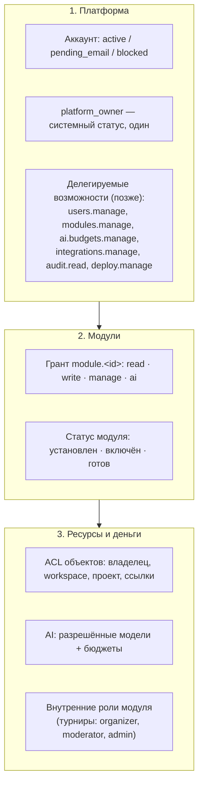

# Аккаунты, вход и права доступа

Основано на [политике владельца](../context/QUBITE_ACCESS_AND_OWNER_CONSOLE.md) и решениях [D-050…D-063](../product/DECISIONS.md). Главный принцип: **по умолчанию запрещено**, и все проверки выполняет **сервер**.

## 1. Три уровня прав



Уровни **независимы**: грант на Docs не даёт чужих документов, роль организатора турнира не даёт ничего вне турниров, owner тоже проходит проверку бюджета.

## 2. Решение доступа

Каждый запрос — HTTP, WebSocket-сообщение, фоновая задача, вызов агента, плагина или MCP — проходит одну функцию:

```text
decide(subject, module, action, resource?, cost?) → Allow(ctx) | Deny(reason)
```

Порядок проверок:

1. **Субъект** активен: аккаунт не заблокирован, почта подтверждена, сессия/токен не отозваны и не истекли.
2. **Платформа**: не техработы (кроме owner), вход разрешён, способ входа не выключен.
3. **Модуль**: установлен, включён, готов; у субъекта есть грант на нужное действие (`read` / `write` / `manage`).
4. **Ресурс**: субъект — владелец объекта, или ему выдан доступ (ACL), или объект в его workspace с подходящей ролью. Приватные зоны (Life Vault) имеют явный запрет для всех, кроме владельца.
5. **AI и деньги** (если действие стоит денег): грант `ai` в модуле → модель в allowlist → бюджет зарезервирован ([AI_COST_GUARD](AI_COST_GUARD.md)).
6. **Делегирование**: если действует агент, плагин или API-ключ — права = **пересечение** прав инициатора, агента/ключа и инструмента.

Отказ возвращает машиночитаемую причину (`module_not_granted`, `budget_exhausted`, …) и человеческий текст. Скрытые разделы (Owner Console, скрытый модуль) возвращают `404`.

## 3. Аккаунты и вход

| Тема | Правило |
|---|---|
| Создание owner | `qubite owner create --email …` при установке. Один owner (уникальный индекс в БД). HTTP-маршрута нет ([D-052](../product/DECISIONS.md)) |
| Пароли | Argon2id, параметры подобраны под Pi (замер), ограничение параллельных проверок |
| Сессии web | Случайный токен, в БД хранится только хеш; cookie `HttpOnly; Secure; SameSite=Lax; Domain=.<domain>`; CSRF-токен; бездействие → продление; «выйти везде» |
| Устройства | Android/desktop: системный браузер → Qubite Auth → PKCE → токен устройства (refresh + короткий access); отзыв в профиле |
| Почта | Обязательное подтверждение до входа; одноразовые коды/ссылки со сроком и лимитом попыток |
| Восстановление | Только через подтверждённую почту; отзывает все сессии; UUID аккаунта сохраняется |
| OAuth | Google, Яндекс, VK, Telegram. Вход — по сохранённому ID у провайдера. Привязка — из открытого аккаунта с подтверждением пароля. Совпадение почты **не** объединяет аккаунты |
| Регистрация | Режимы `closed` / `invite_only` (по умолчанию) / `open`; CAPTCHA при `open` |
| Приглашения | `email_bound` или `open_link`; одноразовые; срок 7 дней по умолчанию; отзыв; токен хранится хешем и показывается один раз |
| Тумблеры | Таблица `platform_settings` + аварийные env-переключатели, которые сильнее ([D-059](../product/DECISIONS.md)) |
| API-ключи (P2) | Для расширений, MCP, агентов: scope, срок, бюджет, отзыв; хеш в БД |

## 4. Что получает новый пользователь

Только ([D-054](../product/DECISIONS.md)): вход, профиль, настройки аккаунта (включая настройки ощущений интерфейса), свои сессии и устройства, главная с пустыми состояниями, каталог модулей (с замками). **Никаких модулей и AI.**

Нужен ли бесплатный базовый набор (например, Command/Inbox без AI) для всех новых пользователей — **OPEN**, спросить владельца перед задачей ACC-002.

## 5. Турниры и роли модулей

Внутренние роли модуля хранятся в таблице этого модуля (`mod_tournaments_roles`) и проверяются **после** гранта на модуль. Грант `manage` на модуль турниров даёт доступ к его разделу «Управление», но не к Owner Console. Старые глобальные `organizer/moderator/admin` из legacy в новую модель не переносятся ([D-050](../product/DECISIONS.md): аккаунты создаются заново).

## 6. Обязательные негативные тесты

Из [политики](../context/QUBITE_ACCESS_AND_OWNER_CONSOLE.md), каждый — автоматический тест на сервере:

1. Новый пользователь не открывает закрытый модуль и не вызывает его API напрямую.
2. Модуль разрешён, AI запрещён → AI-эндпоинт, агент, MCP, фоновая задача получают отказ **без внешнего запроса**.
3. Модель разрешена, бюджет 0 или исчерпан → запрос не уходит к провайдеру.
4. Параллельные запросы не обходят лимит.
5. Участник/организатор турнира не получает прав owner и доступа к чужим проектам.
6. Отозванный грант или сессия прекращает доступ сразу, включая открытый WebSocket и запланированные задачи; поиск и кэш не раскрывают чужое.
7. Публичная ссылка и гость не имеют платных возможностей.
8. Плагин, Hermes, MCP, агент не повышают права выше инициатора.
9. Owner видит обычный интерфейс + Console; другие не видят Console и получают 404 на её API.
10. Владелец выдал Docs, но не Search/AI/Tournaments → пользователь видит и использует только Docs.

## 7. Хранение (черновик схемы)

```text
accounts(id uuid pk, email citext unique, email_verified_at, status, display_name, created_at, …)
platform_owner(singleton bool pk default true check(singleton), account_id fk unique)
credentials_password(account_id pk, hash, updated_at)
oauth_identities(provider, subject, account_id, linked_at, unique(provider, subject))
sessions(id, account_id, token_hash, kind web|device, device_name, created_at, last_seen_at, expires_at, revoked_at)
invitations(id, kind email_bound|open_link, email?, token_hash, created_by, expires_at, used_at, revoked_at)
email_challenges(id, account_id, purpose, code_hash, attempts, expires_at, used_at)
platform_settings(key pk, value jsonb, version, updated_by, updated_at)
modules(id pk, installed, state, readiness, visibility_without_access, settings jsonb, version)
module_grants(account_id, module_id, can_read, can_write, can_manage, can_ai, granted_by, granted_at, revoked_at, version)
api_keys(id, account_id, name, scopes jsonb, token_hash, budget_ref, expires_at, revoked_at)   -- P2
audit_log(id, at, actor, action, target, before jsonb, after jsonb, reason, request_id)
```

Финальная схема фиксируется в задачах AUTH-001…AUTH-006 и в [DATA_MODEL](DATA_MODEL.md).
