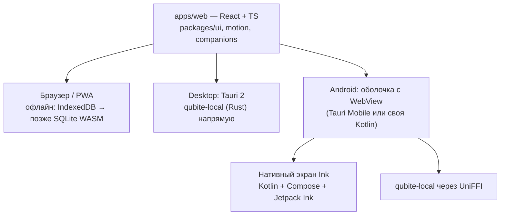

# Клиенты: web, desktop, Android

Решения владельца: web — React + TypeScript, desktop — Tauri, Android — Kotlin для Ink и тяжёлых частей, остальное — общий интерфейс ([D-003](../product/DECISIONS.md)).

## 1. Один интерфейс — три оболочки

- **Один дизайн везде**: компоненты, токены, анимации и помощники живут в `packages/`. Нативно делаем только то, где нужна системная скорость (перо) или системные API (Share, уведомления, фоновые задачи).
- **Адаптивность, а не растяжение**: телефон — быстрый ввод, задачи, Command; планшет — Ink и документы; ПК — панели, несколько документов.

## 2. Web / PWA

**Firefox — главный браузер владельца** ([D-114](../product/DECISIONS.md)): всё обязано работать в Firefox на ПК и Android. Никаких функций «только для Chrome»; e2e-тесты обязательно гоняются в Firefox.

- Vite, TanStack Router (маршруты по модулям и поддоменам), TanStack Query (кэш API).
- Сгенерированный клиент API из OpenAPI (`packages/api-client`).
- Офлайн в MVP: очередь операций в IndexedDB (обязательно для Command/Inbox), Service Worker для оболочки. Полная локальная БД в браузере — позже (OPEN, задача FND-005).

## 3. Desktop (Tauri 2)

- Первая платформа — **Linux** (владелец на CachyOS), затем Windows/macOS.
- `qubite-local` подключается как Rust-зависимость Tauri: SQLite, синхронизация, поиск.
- Глобальная горячая клавиша Command, системный трей, уведомления.
- Вход: системный браузер → Qubite Auth → PKCE → deep link `qubite://auth/callback`.

## 4. Android

- **OPEN (задача APP-002):** оболочка — Tauri 2 Mobile или своя на Kotlin с WebView. Критерии: задержка и плавность Ink-экрана, переходы между WebView и нативным экраном, жесты, размер APK, сложность сборки. Решаем прототипом, результат — ADR.
- **Ink — нативный** (Kotlin, Jetpack Compose, Jetpack Ink или альтернатива по замерам). Открывается из общего интерфейса как полноэкранный нативный экран и сохраняет штрихи через `qubite-local`.
- Share Sheet «Поделиться → Qubite», виджет быстрого ввода, уведомления.
- **Ярлыки модулей** ([D-125](../product/DECISIONS.md)): как VK Музыка у VK — отдельные иконки (Qubite Planner, Qubite Ink…) открывают основное приложение сразу в нужном модуле (Android shortcuts / дополнительные launcher-активности, на desktop — отдельные ярлыки). Модули грузятся по мере необходимости.
- **Перехват уведомлений телефона** (для Shade AI и Inbox) — в приложении Qubite, с явным разрешением и настройкой, какие приложения читать ([D-124](../product/DECISIONS.md)).
- Эталон производительности — Redmi 12.
- Сначала диагностика планшета владельца (INK-001): давление, наклон, частота, задержка — модель устройства не подтверждена.

## 5. Общие требования к клиентам

- Офлайн-захват и честные статусы синхронизации ([SYNC_AND_HISTORY](SYNC_AND_HISTORY.md)).
- Настройки ощущений (податливость, длительность, облегчённый режим, reduced motion) — синхронизируются.
- Секреты — в системном хранилище ключей.
- Тесты: Playwright для web, проверка сборки Tauri в CI, Android-тесты и ручная проверка на устройстве владельца.
