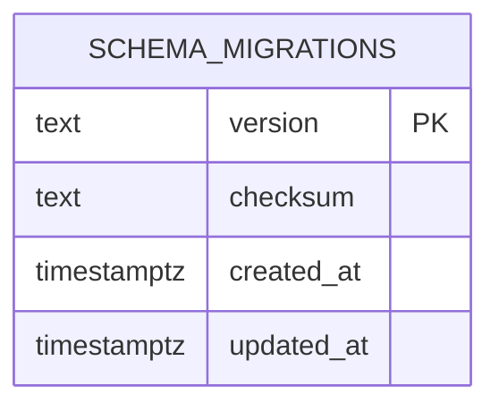

# Реализованный core foundation — QUB-CORE-001

12.10.2026. Engineering slice согласован пользователем как следующая задача; подтверждённый стек FastAPI/Python/Postgres из ADR-0001. `core/qubite` создан отдельно от Node/SQLite. Это foundation 0.1.0, не готовая universal platform/Auth.

## Границы и файлы

`app.py` — factory/typed health/readiness/OpenAPI, `config.py` — scoped Settings/secret-safe validation, `migrations.py` — explicit transactional SQL+ledger, `sql/0001_foundation.sql` — technical core namespace. `contracts/core-v1.json` — точный OpenAPI snapshot. Tests сравнивают его с app.openapi; изменение API требует одновременного обновления contract/evidence. Runtime dependencies pinned в core/requirements.lock; no ORM/domain model в этом slice.

API пути `GET /api/v1/health/live` (200), `/ready` (200/503), `/api/v1/openapi.json`; service qubite-core, api_version v1. Readiness no-store и read-only DB transaction; отсутствие настройки/недоступность/pending/unknown version/checksum drift/missing namespace не дают 200. Тексты driver exceptions/DSN/private query не выводятся в public response или CLI. Unknown legacy/owner/auth/tournament routes — 404, mutations health — 405. Public endpoints только диагностика, а не identity/policy engine.

## Конфигурация и authority

Только QUBITE_CORE_DATABASE_URL и QUBITE_CORE_DB_TIMEOUT_SECONDS (1..10 секунд connection timeout). SQL statement/lock timeout — 2 секунды. .env автоматически не загружается, DATABASE_PATH/DATABASE_URL и данные back/data не используются. URL PostgreSQL с explicit user/loopback IP/port и database qubite_core или qubite_core_<suffix>; `postgres`, templates, SQLite, remote/DNS/missing address/произвольные options запрещены. Ошибки и repr Settings не раскрывают URL.

Foundation сейчас local-only по DB адресам: remote DB/TLS provisioning отдельный deployment этап, пока не обещан. hostaddr задан явно, .pgpass выключен через passfile; PGSERVICE отклоняется, чтобы не подключаться по чужому service config. Не логировать connection_options (содержит пароль). HTTP startup/import/liveness не открывают DB/network; readiness открывает короткое read-only соединение. Runtime role может иметь только USAGE+SELECT на metadata, DDL role нужен только explicit migration. Pool/ORM/DB roles provisioning появятся по нагрузке/доменной схеме и installer gate.

## Техническая модель БД

Таблица qubite_meta.schema_migrations: version primary key, checksum SHA256 exact file bytes с hex CHECK, timestamps NOT NULL UTC-capable timestamptz. Ledger по протоколу append-only; индекса primary key достаточно для tiny version history, FK нет. Начальная 0001_foundation создаёт namespace qubite_core, но **не пользовательские/сервисные таблицы**. Logical DATA_MODEL по-прежнему целевой backlog.

`python -m qubite.migrations check|apply` — отдельная команда. apply acquires transaction-level advisory lock, сравнивает applied history с exact prefix shipped files, создаёт metadata и применяет pending SQL+ledger в одной transaction. Rollback при ошибке включает bootstrap/new DDL, предыдущее состояние не теряется. Повтор/no-op, две независимые connection migration calls, checksum drift/ahead/missing schema проверены на реальном PostgreSQL. Автоматических destructive down/repair/startup migrate нет. Checksums удостоверяют историю файлов; это не полный semantic diff любых будущих доменных таблиц.

[PostgreSQL transaction locks](https://www.postgresql.org/docs/current/explicit-locking.html), [Psycopg connection contexts](https://www.psycopg.org/psycopg3/docs/api/connections.html) — проверенные primary docs; конкретное поведение подтверждено integration tests. Plain SQL выбран для маленького bootstrapping slice; ORM/Alembic не выбирались для всех будущих модулей. [ADR-0009](decisions/0009-core-foundation.md).

## Tests и продолжение

29 core cases: no-network/no-env startup, contract/default surface, unsafe config/timeouts/PG env, DB pending→explicit migration→ready, sanitized error/unreachable DB, drift/unknown/missing schema deny, initial/subsequent failed transaction rollback+existing sentinel preserved, concurrent/idempotent migration, read-only runtime role и real uvicorn HTTP smoke. Native private initdb/Postgres fixture работает в /tmp, ephemeral TCP + SCRAM synthetic password, one fresh DB per case, cleanup server/data. Нет подключения к существующим PG/SQLite, платным API/Telegram/HA. Локально PostgreSQL18.6, CI Ubuntu24.04 PostgreSQL16.15 успешно проверен на implementation SHA a85f047 (run38211426535).

Core suite включён в verify.py --suite all, dependency lock добавляет Psycopg. Full baseline [в отчёте](../reports/QUB-CORE-001.md). Следующая primary DESIGN-001 — reviewable React/auth/navigation design; AUTH-008 — отдельная согласованная identity transition specification после done dependencies. Ни один из этих future tasks не реализован здесь.
