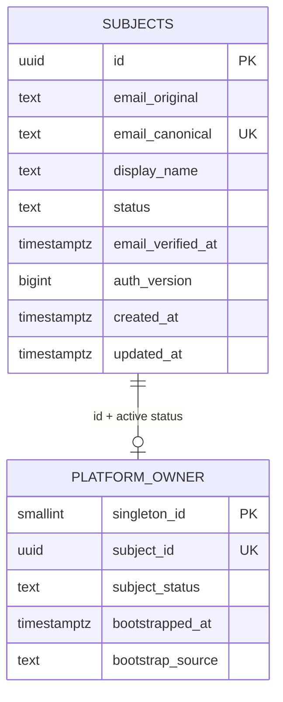

# Реализованное хранилище аккаунтов — AUTH-002

**Актуальный AUTH-011 runtime:** core0.4.0/current0005_challenges,11 domain/security tables; verification/reset existing UUID и mock-only email transport. [API/SQL/ограничения](EMAIL_CHALLENGES.md), [evidence](../reports/QUB-AUTH-011.md). Identity-v2 partial AUTH-009/010/011; email-2FA contract-only, registration/policy/native/UI/provider/deploy отдельно. Снимки прошлых задач ниже исторические.

**Актуальное AUTH-01013.10.2026:** core0.3.0/current0004_oauth, [OAuth adapters/explicit link/unlink](OAUTH_IDENTITY.md), [report](../reports/QUB-AUTH-010.md). Identity-v2 partial runtime AUTH-009/010, текущих core tables10, metadata readonly readiness/old password sessions проверяются. Реальные provider keys/network/deploy/UI не использованы; снимки AUTH-002/009 и legacy audit ниже исторические. Policy/native/registration/reset/keys/services ещё отдельные задачи.

**Текущее исполнение AUTH-00913.10.2026:** credentials/web sessions/CSRF/rate counters добавлены explicit0003; current схема0003_auth, core0.2.0. [Рабочий Auth/owner password CLI](WEB_AUTH.md), [report](../reports/QUB-AUTH-009.md). Поля0002 ниже сохранены; прежние указания «пароль следующей задачей» описывают момент AUTH-002, сейчас initial getpass команда и web login реализованы. Настоящий owner постоянной среды ещё не создавался.

13.10.2026. Fresh identity из [ADR-0013](decisions/0013-fresh-identity-and-unified-login.md). Реализованы PostgreSQL subjects/singleton owner, внутреннее создание pending account и explicit local bootstrap. Это срез AUTH-002: passwords/login/session добавлены в AUTH-009/0003; OAuth и разрешения модулей остаются отдельными задачами. Не создан пользовательский owner в постоянной среде: тестовые аккаунты живут в disposable DB и удаляются вместе с ней.

## SQL и связи

[0002_identity.sql](../../core/qubite/sql/0002_identity.sql) применяется существующим explicit migration runner после неизменной0001. Транзакция DDL+checksum ledger, advisory lock, exact history prefix. Повтор current apply без изменений; partial DDL/ledger при SQL failure откатывается. В старую SQLite не обращаемся.



| Ограничение | Фактический результат |
|---|---|
| subjects.id UUID PK, uuid4 создаёт Python writer | client/legacy integer ID не задаёт identity |
| canonical email NOT NULL UNIQUE COLLATE C | единственный точно нормализованный mailbox; account conflict не upsert |
| original email 3..320 chars, canonical3..254 UTF8 bytes; no whitespace/control | ограниченные metadata, без plaintext credential |
| status pending/active/blocked NOT NULL DEFAULT pending; auth_version>=1 | обычный новый account не owner; будущие credential-version checks |
| optional display_name1..160 chars, email_verified_at nullable | школа/класс/ФИО/login alias не требуются; существование почты не доказано |
| timestamps timestamptz; updated_at>=created_at | времена initial insert, будущие mutations обновляют updated_at явно |
| singleton_id PK CHECK=1, subject UUID NOT NULL UNIQUE | максимум один owner |
| subject_status CHECK=active + composite FK subjects(id,status), RESTRICT update/delete | нельзя привязать pending/blocked/nonexistent account, случайно заблокировать/удалить active owner |
| owner bootstrapped_at + source=local_operator | metadata локального назначения; не полный неизменяемый audit log |

UNIQUE(id,status) дополнительный индекс subjects нужен composite FK для active-owner invariant. UUID PK/canonical unique и owner unique обеспечивают быстрые key lookups; никаких session/history/grants/budget таблиц в этой миграции. FK/constraints enforced независимо от Python writer. Canonicalization выполняется общим Python normalizer; привилегированные direct SQL operators обязаны использовать то же правило, SQL не реализует Unicode casefold/всю RFC email грамматику.

## Email и account writer

`core/qubite/identity/accounts.py`: create_subject(settings,email,display_name=...) вставляет новый UUID/pending/unverified/auth_version1 и ничего не назначает. DTO Subject не выводит email/name в repr. Parameterized SQL; errors не содержат DB URL, SQL, driver DETAIL или исходную почту.

Email — обычный unquoted mailbox, Unicode letters/marks/numbers в local part допустимы, quoted/literal/localhost/whitespace/control/format characters отклоняются. Trim внешних пробелов, local casefold, домен IDNA2008/UTS46 nontransitional + lowercase. Локальная часть до64 UTF8 bytes до/после casefold; canonical total<=254 bytes. Точки/+метки не удаляются. Значение хранится original+canonical; email_verified_at остаётся NULL. Реальная deliverability/подтверждение и email change в AUTH-009/011. idna3.20 уже находится в lock, requirements.in теперь явно указывает прямое использование, новые пакеты не устанавливались.

## Local owner bootstrap

```sh
# Dedicated core DB URL уже задан приватно; никаких passwords/email в argv.
PYTHONPATH=core core/.venv/bin/python -m qubite.migrations check
PYTHONPATH=core core/.venv/bin/python -m qubite.migrations apply
PYTHONPATH=core core/.venv/bin/python -m qubite.identity bootstrap-owner
```

CLI спрашивает email и точное CREATE OWNER. Email/password options отсутствуют; неправильные аргументы отклоняются без вывода их значений. В одной transaction: общий migration/identity advisory lock → проверить current history/schema → owner существует? отказ → создать active subject → вставить singleton owner → commit. Возврат Subject/печать UUID только после successful commit. Email не печатается программой; terminal echo ввода может быть виден оператору. Password вводить сейчас не требуется, usable login AUTH-009.

Повтор bootstrap, в том числе с другой почтой, отказывает. Existing pending account с той же canonical почтой не усыновляется/не повышается. Owner не возникает из публичной регистрации, среды INITIAL_OWNER_EMAIL, users.role или Telegram ID. Никаких HTTP bootstrap endpoints; API startup/import не пишет БД/аккаунты и не выполняет migration. Ошибка после subject insert откатывает account+owner; при connection/commit failure результат не объявляется подтверждённым и нет автоматического retry/repair. Оператор проверяет состояние перед дальнейшими действиями; команда не перезаписывает owner даже при повторе.

Metadata owner row сохраняет дату/источник создания. Отдельный операторский recovery/password setup/Auth audit создаются последующими задачами; никакой обычный profile edit не переназначает owner. Singleton допускает ноль записей до bootstrap; storage readiness200 не означает готовый login/Owner Console.

## Readiness и DB privileges

Read-only check/readiness проверяет checksum/version prefix, namespace и реальные subjects/platform_owner tables через public pg catalogs. Отсутствующая таблица даёт503/not_ready, bootstrap/apply отказывают вместо неявного восстановления. Это existence/type gate, **не semantic fingerprint всех columns/constraints и не migration repair**. Read-only health role не требует чтения строк subjects/owner.

Local bootstrap требует доверенных DB privileges. Проверка доказывает: account writer с INSERT subjects и SELECT metadata/owner **без INSERT platform_owner** может создать только pending account; bootstrap fails и новый subject откатывается. Real installer должен выдать отдельные migration/operator/runtime credentials, не делать API runtime superuser и не выдавать INSERT/UPDATE/DELETE platform_owner обычным account writers. Provisioning реальных ролей/secret storage относится к deploy задаче, здесь только disposable role fixture.

Module/model grants и AI budgets не назначаются регистрацией или owner. Storage schema не authorization engine; Owner Console/default deny реализуются AUTH-003/004/001. Нет автоматических provider/network/Telegram вызовов.

## Проверки и откат

[Отчёт AUTH-002](../reports/QUB-AUTH-002.md): real temporary PostgreSQL, migrations upgrade/failure/idempotency, email collision, owner/account race, DB constraints, direct owner deactivation/deletion, rollback after partial bootstrap, limited SQL role, real CLI process, canceled EOF и отсутствие HTTP bootstrap. Existing foundation tests требуют schema0002, OpenAPI не менялся.

Rollback code не удаляет subjects/owner или ledger0002. Старая core версия с историей0001 откажет ready при ahead0002; использовать compatible forward recovery/approved release, retain новых UUID/data. Не drop/down/restore legacy SQLite поверх новых accounts. Первый deploy отдельно; старые runtime/БД/env/ShadeAI не изменяются.

Инженерные основания: [PostgreSQL constraints](https://www.postgresql.org/docs/16/ddl-constraints.html) для PK/UNIQUE/composite FK, [transaction advisory locks](https://www.postgresql.org/docs/16/explicit-locking.html), [Psycopg transactions](https://www.psycopg.org/psycopg3/docs/basic/transactions.html), [IDNA2008/UTS46](https://github.com/kjd/idna). Первичные источники проверены13.10.2026, фактические SQL/runtime результаты отдельно в report.
