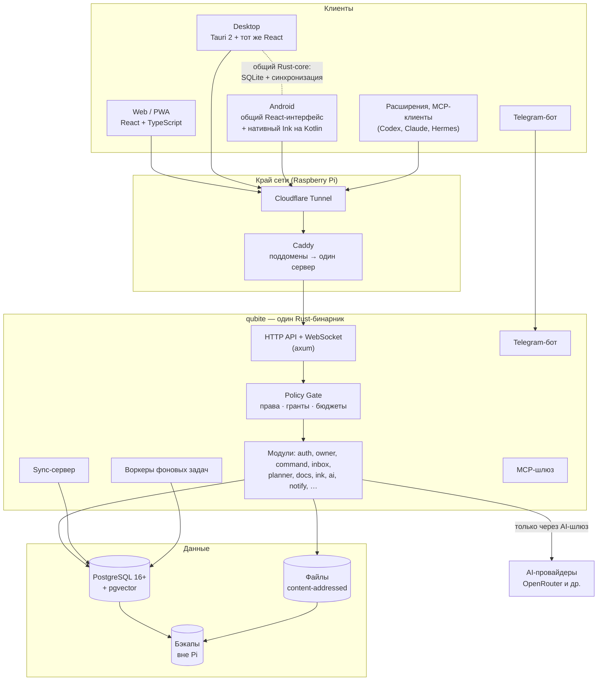
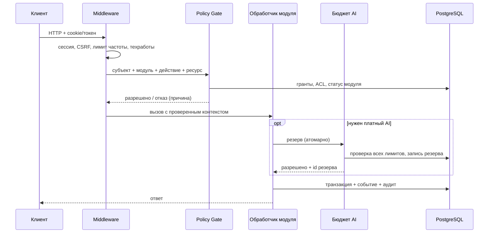

# Целевая архитектура Qubite 2.0

**Статус документа:** проект архитектуры. Метки решений: **CONFIRMED** — утвердил владелец; **RECOMMENDED** — предложение агента, можно менять без пересогласования, если появятся доводы (с записью в ADR); **OPEN** — решается прототипом или вопросом владельцу.

## 1. Одной картинкой



## 2. Стек

| Слой | Выбор | Статус | Почему |
|---|---|---|---|
| Сервер | **Rust** | CONFIRMED [D-003](../product/DECISIONS.md) | Долгий горизонт, много модулей, мало памяти на Pi, один язык для сервера, desktop и общего ядра на устройствах |
| HTTP-фреймворк | **axum** + tokio + tower | RECOMMENDED | Стандарт экосистемы, хорошая композиция middleware (права, лимиты) |
| Доступ к БД | **sqlx** (проверка SQL при компиляции) + миграции sqlx | RECOMMENDED | Честный SQL без тяжёлой ORM, ошибки ловятся при сборке |
| Серверная БД | **PostgreSQL + pgvector** | CONFIRMED [D-004](../product/DECISIONS.md) | Транзакции для бюджетов и прав, полнотекст, векторный поиск, много пользователей |
| БД на устройствах | **SQLite** (через Rust-core) | CONFIRMED [D-004](../product/DECISIONS.md) | Офлайн, надёжность, FTS5 |
| Описание API | **OpenAPI** из кода (utoipa) → сгенерированный TS-клиент | RECOMMENDED | Фронт и бэк не расходятся |
| Фоновые задачи | Очередь в PostgreSQL (`FOR UPDATE SKIP LOCKED`) | RECOMMENDED | Не нужен Redis/Kafka на Pi |
| Web | **React + TypeScript**, Vite, TanStack Router + Query | CONFIRMED (React/TS) / RECOMMENDED (остальное) | — |
| Анимации | Своя физика пружин на `transform`/`opacity` + Motion (motion.dev) для layout-переходов | RECOMMENDED, проверяется в задаче DS-002 | Главное требование — плавность на слабом телефоне |
| Стили | CSS-переменные (токены) + CSS Modules | RECOMMENDED | Без рантайма, тема меняется переменными |
| Desktop | **Tauri 2** | CONFIRMED [D-003](../product/DECISIONS.md) | Rust + тот же React; маленький размер |
| Android | Общий React-интерфейс в оболочке + **нативный Ink на Kotlin** (Jetpack Compose + Jetpack Ink) | CONFIRMED [D-003](../product/DECISIONS.md) | Перо требует нативной задержки; остальное — один дизайн везде |
| Оболочка Android | Tauri 2 Mobile **или** своя Kotlin-оболочка с WebView | OPEN → задача APP-002 | Решаем прототипом: задержка Ink, жесты, размер APK |
| Общее ядро на устройствах | Rust crate `qubite-local` (SQLite, очередь синхронизации, CRDT): в Tauri — напрямую, в Kotlin — через UniFFI | RECOMMENDED | Одна логика синхронизации на всех платформах |
| Офлайн в web | IndexedDB-очередь (MVP) → SQLite WASM на OPFS (позже) | OPEN → задача FND-005 | Браузеры ограничивают хранилище |
| CRDT для текста | **yrs** (Rust-порт Yjs) или **Loro** | OPEN → задача DOC-001 | Оба на Rust; сравнить в прототипе |
| Telegram | teloxide (Bot API); для пользовательских сессий (лиды Kwork) — grammers (MTProto) | RECOMMENDED | Замена Python/Telethon |
| Почта | SMTP через lettre | RECOMMENDED | Любой провайдер |
| Пароли | Argon2id | RECOMMENDED | Стандарт |
| Тесты | `cargo test` (+ временный PostgreSQL), Vitest, Playwright, тесты Kotlin | RECOMMENDED | См. [TEST_STRATEGY](../engineering/TEST_STRATEGY.md) |
| Пакеты JS | pnpm workspaces | RECOMMENDED | Монорепозиторий |

Названия crate'ов и библиотек выбраны как наиболее вероятные. Перед подключением агент проверяет актуальность, лицензию и поддержку и фиксирует выбор в ADR.

## 3. Рассмотренные варианты

| Вариант | Плюсы | Минусы | Итог |
|---|---|---|---|
| **A. Новое ядро на Rust с нуля, legacy заморожен и переписывается модулями** | Чистая архитектура, один язык для сервера и клиентов, мало памяти | Дольше до первой пользы; старые сервисы нужно переписать | **Выбран** ([ADR-0001](decisions/0001-rust-core-and-clean-start.md)) |
| B. Strangler: постепенно вырезать модули из старого Node-монолита | Быстрее польза от старого | Старые глобальные роли и монолиты `server.js`/`db.js` тянутся годами; владелец хочет Rust | Отклонён |
| C. Продолжить FastAPI-ядро Codex | Код уже есть (вход, права, бюджеты) | Владелец выбрал Rust; Python-ядро не переиспользуется в Tauri/Android | Отклонён ([D-001](../product/DECISIONS.md)) |
| D. Микросервисы на каждый модуль | Независимый деплой | Слишком тяжело для одного человека и Pi | Отклонён |

## 4. Структура репозитория (целевая)

```text
qubite/
├── Cargo.toml                 # Rust workspace
├── package.json               # pnpm workspace
├── crates/                    # Rust
│   ├── qubite-server/         # бинарник `qubite`: serve | worker | bot | migrate | owner | backup
│   ├── qubite-kernel/         # конфиг, ошибки, ID, время, общие типы
│   ├── qubite-db/             # пул PostgreSQL, миграции, транзакции
│   ├── qubite-policy/         # Policy Gate: привилегии, гранты, ACL, делегирование
│   ├── qubite-auth/           # аккаунты, сессии, OAuth, приглашения, почта
│   ├── qubite-owner/          # Owner Console API, тумблеры платформы
│   ├── qubite-ai/             # AI-шлюз: провайдеры, бюджеты, диспетчер, журнал
│   ├── qubite-objects/        # конверт объекта, связи, события, файлы
│   ├── qubite-sync/           # протокол синхронизации (общий для сервера и клиентов)
│   ├── qubite-local/          # локальное ядро устройств: SQLite + очередь + CRDT (Tauri, Android/UniFFI)
│   ├── qubite-mod-command/    # модули: command, inbox, planner, docs, ink, notify, …
│   ├── qubite-mod-planner/
│   ├── qubite-mod-docs/
│   └── qubite-telegram/
├── apps/
│   ├── web/                   # React + TS (Vite): лендинг, Auth, приложение
│   ├── desktop/               # Tauri 2 (подключает apps/web)
│   └── android/               # оболочка + нативный Ink (Kotlin)
├── packages/                  # общий TypeScript
│   ├── ui/                    # дизайн-система: токены, материал «Поток», компоненты, иконки
│   ├── motion/                # физика пружин, жесты
│   ├── companions/            # помощники-питомцы (SVG + анимация)
│   └── api-client/            # сгенерированный из OpenAPI клиент
├── deploy/                    # новый установщик, Caddy, systemd, бэкапы
├── docs/                      # документация (этот каталог)
├── legacy/                    # старый код, только для справки и запуска старой версии
└── .github/workflows/         # CI
```

Правило ([D-022](../product/DECISIONS.md)): новый код **никогда** не импортирует ничего из `legacy/`. Старый код — только образец для чтения.

## 5. Как устроен сервер

### 5.1. Один бинарник, несколько ролей

`qubite serve` (API + WebSocket), `qubite worker` (фоновые задачи), `qubite bot` (Telegram), `qubite migrate`, `qubite owner create|reset-password`, `qubite backup|restore`. На Pi по умолчанию `serve` и `worker` работают в одном процессе; при нагрузке их разносят на два systemd-юнита.

### 5.2. Путь запроса



Обработчик модуля **не может** получить доступ к данным без контекста, выданного Policy Gate: тип `Authorized<Action>` создаётся только им (проверка на уровне типов Rust).

### 5.3. Модули

Каждый модуль — crate с:
- `manifest` (id, название, права, настройки, поддомен);
- миграциями своих таблиц (префикс `mod_<id>_`);
- маршрутами под `/api/v1/<module>/…`;
- обработчиками событий и фоновыми задачами;
- публичным API (трейт) для других модулей. Прямые запросы к чужим таблицам запрещены.

## 6. Домены и поддомены

CONFIRMED: модули на поддоменах ([D-035](../product/DECISIONS.md)), домен — настройка установщика ([D-009](../product/DECISIONS.md)).

RECOMMENDED схема:

| Хост | Что отдаёт |
|---|---|
| `<domain>` | Лендинг для гостя, приложение после входа |
| `auth.<domain>` | Qubite Auth: вход, регистрация, подтверждения, OAuth callback |
| `plan.`, `docs.`, `search.`, … `<domain>` | То же web-приложение, стартующее в нужном модуле |
| любой хост `/api/*` | Проксируется Caddy на `qubite serve` (тот же origin → без CORS) |
| `mcp.<domain>` | MCP-шлюз для внешних агентов (P2) |

Сессионная cookie выставляется на родительский домен (`Domain=.<domain>`), CSRF-токен — на каждый запрос. Нативные приложения не используют cookie: они получают токен устройства через PKCE ([AUTH-08](../product/REQUIREMENTS.md)).

## 7. Клиенты

Подробно — [CLIENTS.md](CLIENTS.md). Коротко:

- Один React-интерфейс для web, desktop и Android; адаптивные раскладки под телефон, планшет и ПК.
- На устройствах — `qubite-local` (Rust): SQLite, очередь изменений, синхронизация, поиск FTS5.
- Ink — отдельный нативный экран на Kotlin; конспекты синхронизируются через тот же протокол.

## 8. Нефункциональные цели (проверяются замерами)

| Цель | Значение (стартовое, уточняется замером) |
|---|---|
| Память сервера в простое (MVP-модули) | ≤ 300 МБ; весь базовый набор с PostgreSQL — в 2 ГБ RAM ([D-110](../product/DECISIONS.md)) |
| Ответ API на простые запросы (на Raspberry Pi 5) | p95 ≤ 150 мс |
| Захват мысли в Command | сохранено локально ≤ 50 мс, даже офлайн |
| Анимации | 60 к/с на **Redmi 12 в Firefox** (эталон слабого устройства, [D-114](../product/DECISIONS.md)); ни одной анимации `width/height/top/left` |
| Задержка пера Ink | цель — субъективно незаметная; цифры фиксируются после замера (INK-001) |
| Потеря данных | 0 при закрытии приложения, обрыве сети, падении сервера |

## 9. Связанные документы

- [DATA_MODEL.md](DATA_MODEL.md) — сущности и таблицы
- [AUTH_AND_PERMISSIONS.md](AUTH_AND_PERMISSIONS.md) — права
- [AI_COST_GUARD.md](AI_COST_GUARD.md) — бюджеты AI
- [SYNC_AND_HISTORY.md](SYNC_AND_HISTORY.md) — офлайн и история
- [AI_AGENTS_MEMORY_SKILLS.md](AI_AGENTS_MEMORY_SKILLS.md) — агенты
- [PLUGINS_AND_MCP.md](PLUGINS_AND_MCP.md) — расширения
- [CLIENTS.md](CLIENTS.md) — клиенты
- [decisions/](decisions/) — ADR
