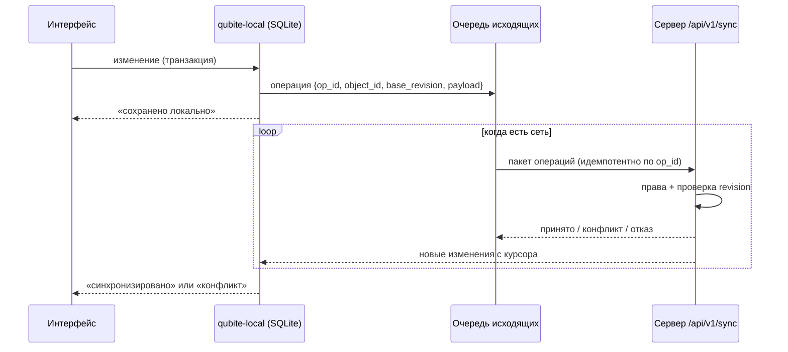

# Офлайн, синхронизация и история

Принцип ([MC §3](../context/QUBITE_MASTER_CONTEXT.md)): **local-first**. Действие пользователя сначала записывается локально, потом уходит на сервер. Отсутствие интернета никогда не означает потерю мысли, штриха или правки.

## 1. Схема

## 2. Типы данных — разные стратегии

| Данные | Стратегия |
|---|---|
| Простые объекты (задача, элемент Inbox, проект) | Операции «поле = значение» с `base_revision`. Разные поля сливаются автоматически; одно поле изменено на двух устройствах → конфликт, понятный экран выбора |
| Текст документов | CRDT (yrs или Loro): слияние без конфликтов, работает офлайн |
| Штрихи Ink | Операции над штрихами (добавить/удалить/переместить) с ID штриха; порядок по (время устройства, ID устройства) |
| Права, гранты, бюджеты, удаление навсегда, финансы | **Только онлайн**, транзакционно на сервере. Офлайн можно создать черновик, но не применить |

## 3. Честные статусы

Интерфейс показывает статусы: «сохранено на устройстве», «синхронизировано», «синхронизация…», «конфликт», «ошибка», «ждёт загрузки файла». Пока сервер не подтвердил, нельзя писать «сохранено в облаке».

## 4. Протокол (черновик)

- `POST /api/v1/sync/push` — пакет операций; каждая с `op_id` (UUIDv7). Повтор того же `op_id` не применяется дважды.
- `GET /api/v1/sync/pull?cursor=…` — изменения после курсора, только доступные пользователю.
- WebSocket-канал уведомляет «есть новое», клиент делает `pull`.
- Отзыв доступа → сервер присылает удаление объекта из локальной копии устройства.

Общий код протокола — crate `qubite-sync`, используется сервером и `qubite-local`.

## 5. История

| Механизм | Для чего | Хранение |
|---|---|---|
| Undo/Redo | Быстрая отмена в редакторе | Память клиента, сессия |
| Ревизии | История версий объекта, сравнение, восстановление | `object_revisions` / снимки CRDT |
| События | Что произошло в системе (Timeline) | `events` (append-only) |
| Аудит | Кто изменил права, бюджеты, настройки | `audit_log` (неизменяемый) |
| Ink Replay | Покадровая запись штрихов с временем | Бинарные блоки штрихов |

У каждого механизма своя политика хранения. Восстановление старой версии создаёт **новую** ревизию, а не стирает последующие.

## 6. Ink: формат штрихов (черновик)

Штрих: `stroke_id`, `tool`, `color`, `width`, `t0` (время начала) и серия точек `(dx, dy, dt, pressure?, tilt?)` в дельтах, квантованная и сжатая. Блоки по ~64 КБ с контрольными снимками страницы для быстрой перемотки реплея. Исходные точки сохраняются, чтобы стабилизацию можно было пересчитать.

## 7. Handoff (P2)

Отдельно от данных синхронизируется лёгкое «состояние сессии»: открытый объект, позиция курсора, прокрутка, инструмент. На другом устройстве — предложение «Продолжить». Автопереход отключаем.

## 8. Бэкапы и восстановление

См. [engineering/DEPLOYMENT.md](../engineering/DEPLOYMENT.md): ежедневный `pg_dump` + файлы, шифрование, копия **вне** Raspberry Pi, регулярная проверка восстановления.
