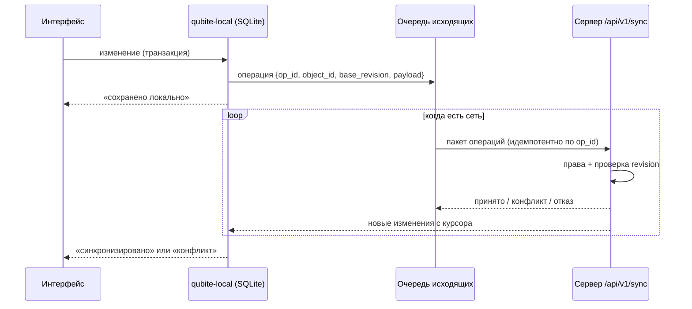

# Офлайн, синхронизация и история

> **Реализовано (FND-005, 17.10.2026):** протокол `crates/qubite-sync` (операции create/set_title/delete/restore, образцы JSON в `fixtures/`), сервер `crates/qubite-sync-server` (`push`/`pull`, журнал `sync_ops`, миграция 0003), клиент `packages/sync-client` (IndexedDB, очередь, статусы, «проблемы»). HTTP-адреса — в CMD-001. Решение — [ADR-0008](decisions/0008-web-local-storage-indexeddb.md).

Принцип ([MC §3](../context/QUBITE_MASTER_CONTEXT.md)): **local-first**. Действие пользователя сначала записывается локально, потом уходит на сервер. Отсутствие интернета никогда не означает потерю мысли, штриха или правки.

## 1. Схема

## 2. Типы данных — разные стратегии

| Данные | Стратегия |
|---|---|
| Простые объекты (задача, элемент Inbox, проект) | Операции «поле = значение» с `base_revision`. Разные поля сливаются автоматически; одно поле изменено на двух устройствах → конфликт, понятный экран выбора |
| Текст документов | CRDT: Yjs в браузере, yrs на сервере ([ADR-0009](decisions/0009-docs-editor-prototypes.md)); слияние без конфликтов, работает офлайн |
| Штрихи Ink | Операции над штрихами (добавить/удалить/переместить) с ID штриха; порядок по (время устройства, ID устройства) |
| Права, гранты, бюджеты, удаление навсегда, финансы | **Только онлайн**, транзакционно на сервере. Офлайн можно создать черновик, но не применить |

## 3. Честные статусы

Интерфейс показывает статусы: «сохранено на устройстве», «синхронизировано», «синхронизация…», «конфликт», «ошибка», «ждёт загрузки файла». Пока сервер не подтвердил, нельзя писать «сохранено в облаке».

## 4. Протокол (работает с CMD-001, [D-192, D-193](../product/DECISIONS.md))

- `POST /api/v1/sync/push` — пакет операций; каждая с `op_id` (UUIDv7). Повтор того же `op_id` не применяется дважды. Операции: `create` (с `fields` модуля), `set_title`, `delete`, `restore`, `patch` (поля модуля). Модуль без права `write` → `rejected: forbidden`.
- `GET /api/v1/sync/pull?cursor=…` — изменения после курсора, только из модулей с правом `read`; снимок несёт `fields` модуля.
- Через HTTP синхронизируются только типы, у которых модуль зарегистрировал обработчик полей (`TypeFields`), сейчас `inbox.item`.
- WebSocket `/api/v1/sync/ws` уведомляет «есть новое» (`{"type":"changed"}`, без данных), клиент делает `pull`. Источник — триггер на `events` → `pg_notify('qubite_changes', владелец)` → один `LISTEN` на сервер. Права — перед каждым сообщением и раз в 30 с, отзыв → закрытие 4403; браузеру — только со своего сайта.
- Отзыв доступа → сервер присылает удаление объекта из локальной копии устройства (ещё не сделано; сейчас `pull` просто перестаёт отдавать модуль).

Общий код протокола — crate `qubite-sync`, используется сервером и `qubite-local`.

### Переименование документа после обмена текстом (DOC-002e2, #153)

Решил так, можно откатить: `objects::rename` для `docs.page` принимает старую
`base_revision`, если каждая промежуточная ревизия записана в `events` как
`object.updated` с непустым списком полей только из `body`/`ystate`. Это позволяет
применить офлайн-переименование, даже если обмен Yjs завершился раньше очереди
операций. Блокировка строки объекта держится от чтения истории до записи названия;
другое переименование, удаление/восстановление, неизвестные поля или пропуск
ревизии сохраняют обычный конфликт. Для остальных типов правила не меняются.

`bump` продолжает поднимать общую ревизию и писать событие: снимок текста для
превью, курсор `pull` и уведомления `qubite_changes` сохраняют прежний контракт.
Формат `/y` не меняется. В базе этой задачи (main) ещё нет `ydoc.rs` из
`task/DOC-002`: Rust-тест воспроизводит его запись снимка и `bump(body, ystate)`
одной транзакцией, затем отправляет сохранённый `set_title` через `push`.
Полный сценарий с HTTP POST `/y` нужно проверить вместе с базой DOC-002.

## 5. История

| Механизм | Для чего | Хранение |
|---|---|---|
| Undo/Redo | Быстрая отмена в редакторе | Память клиента, сессия |
| Ревизии | История версий объекта, сравнение, восстановление | `object_revisions` / снимки CRDT |
| События | Что произошло в системе (Timeline) | `events` (append-only) |
| Аудит | Кто изменил права, бюджеты, настройки | `audit_log` (неизменяемый) |
| Ink Replay | Покадровая запись штрихов с временем | Бинарные блоки штрихов |

У каждого механизма своя политика хранения. Восстановление старой версии создаёт **новую** ревизию, а не стирает последующие.

## 6. Ink: формат штрихов (черновик)

Штрих: `stroke_id`, `tool`, `color`, `width`, `t0` (время начала) и серия точек `(dx, dy, dt, pressure?, tilt?)` в дельтах, квантованная и сжатая. Блоки по ~64 КБ с контрольными снимками страницы для быстрой перемотки реплея. Исходные точки сохраняются, чтобы стабилизацию можно было пересчитать.

## 7. Handoff (P2)

Отдельно от данных синхронизируется лёгкое «состояние сессии»: открытый объект, позиция курсора, прокрутка, инструмент. На другом устройстве — предложение «Продолжить». Автопереход отключаем.

## 8. Бэкапы и восстановление

См. [engineering/DEPLOYMENT.md](../engineering/DEPLOYMENT.md): ежедневный `pg_dump` + файлы, шифрование, копия **вне** Raspberry Pi, регулярная проверка восстановления.
