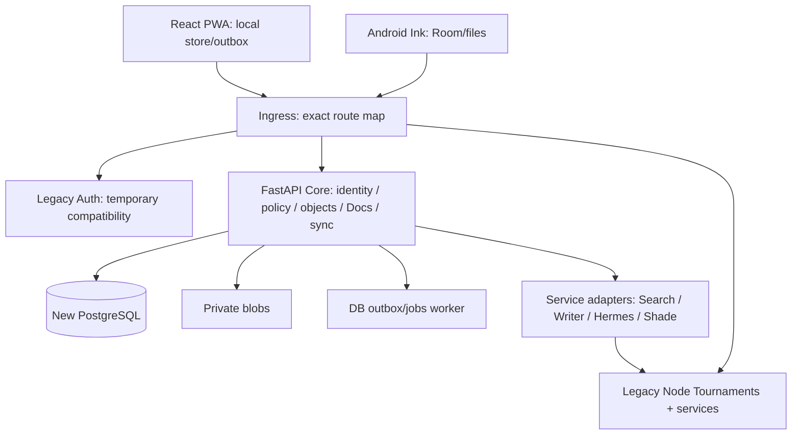

# Целевая архитектура: согласованный стек и поэтапная реализация

Стек CONFIRMED 12.10.2026: Python/FastAPI + React/TS + новый PostgreSQL, SQLite турниров сохраняется. Механика отдельных модулей требует task-level проверки; foundation ядра реализован в QUB-CORE-001; identity/policy/domain/UI ещё не реализованы. CONFIRMED: Tournaments отдельный модуль, обычная главная owner, default deny, независимые budgets, сохранение legacy, ShadeAI read-only.

## Два пути

| Путь | Достоинства | Цена/риск | Обратимость |
|---|---|---|---|
| A. Выделять новые пакеты в Express/SQLite, новая React оболочка поверх текущего API | Одна auth/БД, меньше runtime RAM и процессов, простой старт | Разделение глобальных ролей в 10k/9k монолитах; SQLite и синхронизация требуют аккуратного роста; Python предпочтение реализуется отдельными workers | Переключить оболочку/фичу назад, additive schema |
| B. Новый Python/FastAPI modular core + React/TS, legacy за адаптером | Чистые boundaries, typed contracts, независимые миграции и полноценный permission/budget engine | Два runtime/хранилища в переходе; auth bridge и legacy grants сложнее; ресурсы целевого сервера проверить перед деплоем | Старые routes/data остаются; gateway меняет routing feature-by-feature |

Выбран B в strangler-режиме: отдельное ядро не означает переписать legacy. Один новый modular monolith и небольшой worker; старые Node Auth/platform/control bot и отдельные сервисы сохраняются. Identity сначала остается единственным authority в legacy Auth. Новый core проверяет opaque session через приватный adapter, получает stable mapped subject и подтверждённый owner; не читает users.role как полный набор глобальных capabilities. Не копируем пароли/сессии в первую итерацию.

По решению владельца от 12.10.2026 выбор хостинга отложен: возможен VPS, ограничения Raspberry Pi не определяют выбор архитектуры и не блокируют локальную разработку. Вариант B/Postgres согласован ответами владельца 12.10.2026. Оценка ресурсов выбранного сервера и backup/restore проверки выполняются перед миграцией и деплоем.

## Предлагаемая схема

Предлагаемые paths: apps/web, core/qubite/{identity,policy,objects,docs,sync,history,ai,integrations}, clients/android-ink, contracts, scripts/engineering. Эти каталоги пока не создаются как заглушки. Legacy back/front/app сохраняют названия. New API /api/v2, legacy /api/* прежний. Нет catch-all proxy, который смешивает cookie/token origin или обходит paused workspace.

Postgres для нового core с versioned migrations; SQLite legacy не заменяется. FTS/typed relations сначала, pgvector позже только после ACL/embedding POC. Никаких Kafka/Kubernetes/Redis по умолчанию. DB jobs и outbox с leases, bounded worker; тяжёлый ASR/OCR вне API и при необходимости на отдельном worker-хосте. React/TS UI, Kotlin Ink исследовать отдельно; выбор Docs engine через POC, не финальный dependency list.

Наблюдаемость: request/job/invocation ID, latency, queue age, deny reasons, reserve/spent/unknown, migration version, sync conflicts; без private content. Failure isolation: unavailable module даёт status/degraded, не ломает Today/auth. Rollout — capability/route flag, legacy routes immutable до compatibility acceptance.

Проверены первоисточники 12.10.2026: [Postgres locking](https://www.postgresql.org/docs/current/explicit-locking.html), [backup](https://www.postgresql.org/docs/current/backup.html), [pgvector](https://github.com/pgvector/pgvector), [Android Ink](https://developer.android.com/develop/ui/compose/touch-input/stylus-input/about-ink-api). Row locks позволяют сериализовать budget reservations; поддержка библиотек не доказывает производительность выбранного сервера/планшета. Версии/лицензии остальных кандидатов проверять в отдельных POC до фиксации.

Клиенты: сайт, Android и desktop Linux с будущими Windows/macOS. Общий React UI сайта/desktop, Tauri POC; Android native Ink + общие contracts. Auth переиспользуется временно, новые дизайн/регистрация/code-entry removal и отдельный identity cutover: [ADR-0005](decisions/0005-identity-transition.md), [ADR-0006](decisions/0006-clients-and-deployment.md).

Обновление 12.10.2026 (ADR-0007): необходимые общие legacy возможности, включая identity/settings/support/analytics, реализуем на FastAPI. Legacy Auth в схеме — временный compatibility authority до tested cutover, а не backend нового продукта навсегда. Специфический tournament engine Node/SQLite остаётся отдельным optional модулем. Telegram automatic capture/voice и единые event links — подтверждённый scope.

Уточнение UI scope 12.10.2026: собственные интерфейсы включённых сервисов VPN/Writing/Search и всех прочих частей нового Qubite переписываются на React/TS с новым дизайном, не только landing shell. Qubite Tournaments сохраняет текущий Vanilla UI/Node/SQLite. Platform APIs FastAPI; рабочие native engines через adapters. [ADR-0008](decisions/0008-react-service-surfaces.md).

Реальный foundation: [CORE_FOUNDATION](CORE_FOUNDATION.md), `core/qubite`, [OpenAPI contract](../../contracts/core-v1.json); explicit migrations/native isolated PG tests. Это не rollout shared services и не новая Auth.
