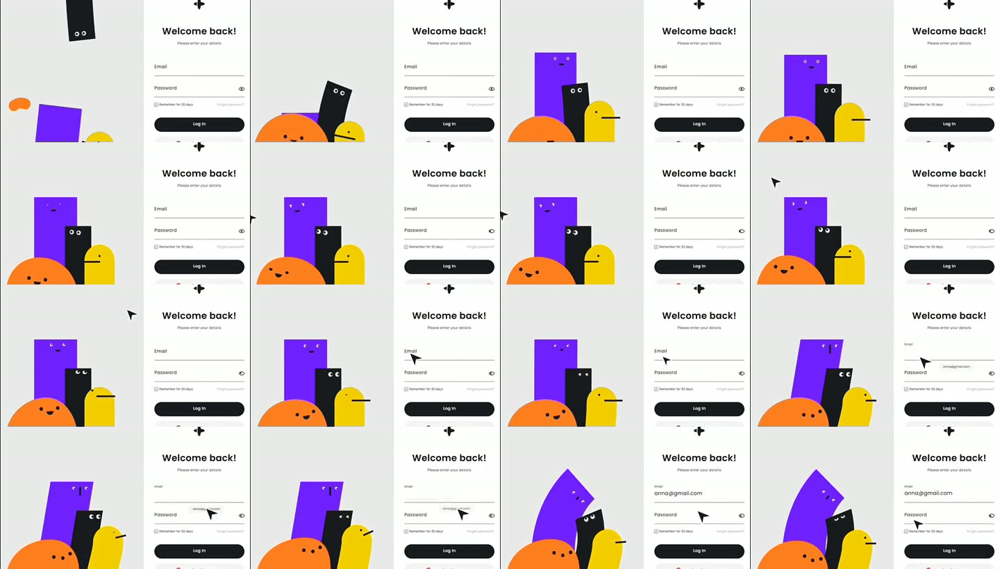
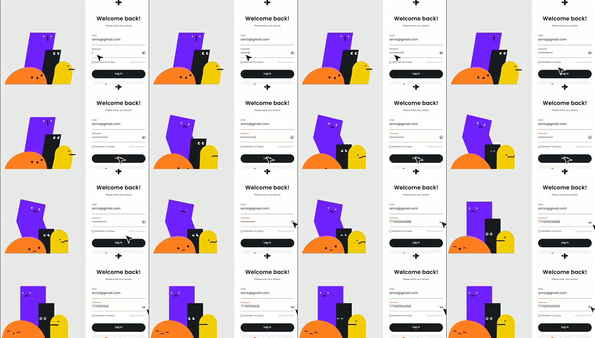

# Помощники-питомцы

Помощники — лица AI-агентов Qubite. Они живут в интерфейсе, замечают, что делает человек, и реагируют в своём характере: подсказывают, радуются, переживают за ошибку и признают свои промахи ([D-038](../product/DECISIONS.md), [D-039](../product/DECISIONS.md)).

## 1. Эталон: видео, которое прислал владелец

Видео: [youtu.be/3IKcKhHNo-A](https://youtu.be/3IKcKhHNo-A) — страница входа с четырьмя персонажами. Раскадровка (4 кадра в секунду):

### Что именно делает их живыми

| Наблюдение | Как это сделано | Что берём |
|---|---|---|
| Персонажи — **плоские фигуры** без обводки и теней: высокий прямоугольник, низкий прямоугольник, полукруг, «столбик» со скруглённым верхом | Простая геометрия, сплошной цвет | Да: простые формы, но с **мягкими** углами (владелец не любит острые) |
| Лицо — две точки-глаза и чёрточка (рот или клюв) | Минимум деталей → эмоции читаются по положению | Да |
| **Изгиб от основания**, а не поворот: высокий персонаж наклоняется к полю ввода, как желе | Сдвиг (skew) + смещение верха, низ стоит на месте | **Главный приём** |
| Глаза следят за курсором и за кареткой ввода | Зрачки смещаются в сторону цели в пределах глаза | Да, плюс касания на телефоне |
| Печать email — все поворачиваются к полю, высокий тянется к форме | Цель взгляда = поле в фокусе | Да |
| Ввод пароля — высокий наклоняется ещё сильнее, «подсматривает» | Сильный наклон | Обыгрываем деликатно: при пароле **отворачиваются** |
| Неверный пароль — грустные рты (дуга вниз), высокий поникает, тёмный **проседает вниз** | Смена рта + опускание фигуры | Да |
| «Показать пароль» — все отворачиваются и закрывают глаза (`^ ^`), тактично | Глаза-дуги, взгляд в сторону | Да, это очень в духе приватности Qubite |
| Появление — фигуры **падают сверху** с отскоком и сжатием | Пружина + squash & stretch | Да |
| Лёгкое «дыхание» в покое | Медленное масштабирование по высоте | Да, но цикл останавливается, когда вкладка неактивна |

## 2. Наши четыре помощника

Цвета — из «Игрушечной» палитры, без фиолетового ([D-093](../product/DECISIONS.md)). Имена и характеры — черновые от прошлой итерации, **подтвердить с владельцем** в задаче DS-006.

| Помощник | Область | Характер | Форма (предложение) | Цвет |
|---|---|---|---|---|
| **Луми** | Личная жизнь, Life | Заботливый, успокаивает | Полукруг-«холмик», как оранжевый в видео | Оранжевый `--plastic-action` |
| **Кип** | Проекты, Planner | Собранный практик, говорит по делу | Высокий прямоугольник со скруглением, «стойка» | Тёмный `--ink` |
| **Пип** | Заметки, Inbox, Docs | Любопытный, ищет другой ход | Столбик со скруглённым верхом и клювом-чёрточкой, как жёлтый в видео | Жёлтый `--plastic-idea` |
| **Сэйдж** | Дневник, учёба | Вдумчивый, не спешит с выводами | Высокий прямоугольник с очками, в руке блокнот | Небесный `--plastic-select` |

## 3. Состояния

| Состояние | Когда | Тело | Лицо |
|---|---|---|---|
| Покой | Ничего не происходит | Медленное дыхание | Иногда моргает, смотрит на курсор |
| Внимание | Пользователь печатает, наводит | Тянется к цели | Глаза на каретку/курсор |
| Слушает | Голосовой ввод | Наклон к микрофону, покачивание в такт | Глаза широко |
| Думает | Ждём ответа AI | Медленный перекат с ноги на ногу | Глаза вверх-в сторону |
| Радость | Успех, задача выполнена | Подпрыгивание со сжатием | Улыбка-дуга |
| Ошибка пользователя | Неверный ввод | Поникает/проседает | Грустный рот |
| Своя ошибка | AI ошибся | Своя реакция по характеру + предложение исправить | Смущение |
| Приватность | Показан пароль, открыт дневник | Отворачивается | Глаза закрыты `^ ^` |
| Отдых | Долго нет активности | Садится/сплющивается | Глаза закрыты |

## 4. Где они появляются

Из решения [D-039](../product/DECISIONS.md), конкретные места выбираются при разработке экранов:

- выглядывают **из края экрана** (сначала глаза, потом тело);
- прячутся, оставляя маленький «язычок» у края — нажал, и помощник выходит;
- появляются рядом с элементом, к которому относится подсказка;
- на экране входа — как в видео, группой;
- **никогда не закрывают** поля ввода и кнопки; на телефоне подсказка занимает своё место в потоке страницы, а не висит поверх.

## 5. Как говорят

Три уровня: маленький значок рядом с действием → короткая подсказка-облачко → диалог по нажатию. Можно отключить подсказки целиком или для конкретного помощника. Реплики в MVP сценарные, потом — от настоящих агентов через AI-шлюз (и с учётом бюджета).

## 6. Техника

- SVG-фигуры, анимация только через `transform` (skew/translate/scale), пружины из `packages/motion`.
- Изгиб — несколько сегментов тела с разной амплитудой сдвига (низ стоит, верх ведёт), а не один `rotate`.
- Глаза — отдельные слои; слежение ограничено радиусом глаза; на телефоне цель — последнее касание или фокус.
- Один общий цикл анимации на всех помощников; пауза, когда вкладка скрыта или включено «меньше движения» (тогда только смена выражения без движения).
- Пакет `packages/companions`, витрина в `/design/companions`.

## 7. Приёмка

Владелец смотрит помощников на телефоне и ПК и подтверждает, что они «ощущаются живыми, мягкими и не дёргаются». Это главный критерий, автотесты лишь страхуют от рывков и утечек цикла анимации.
