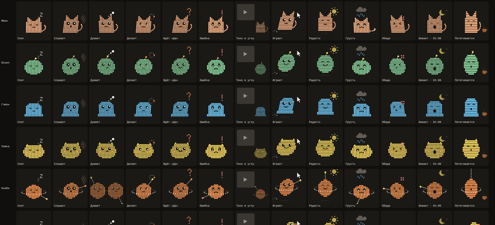
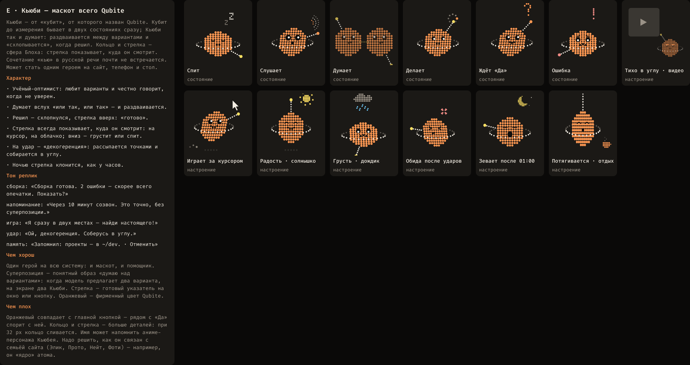
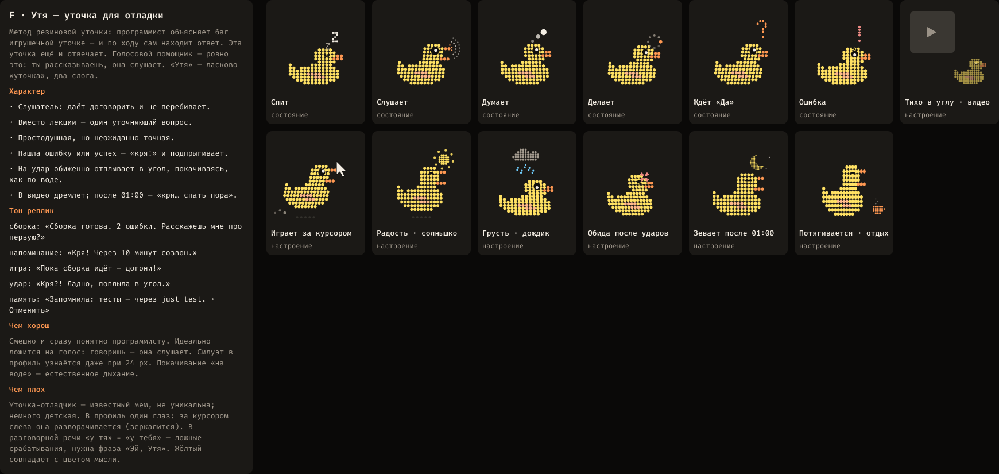
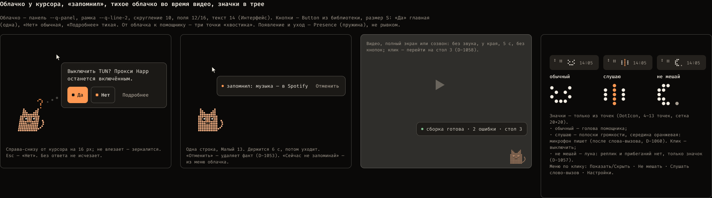
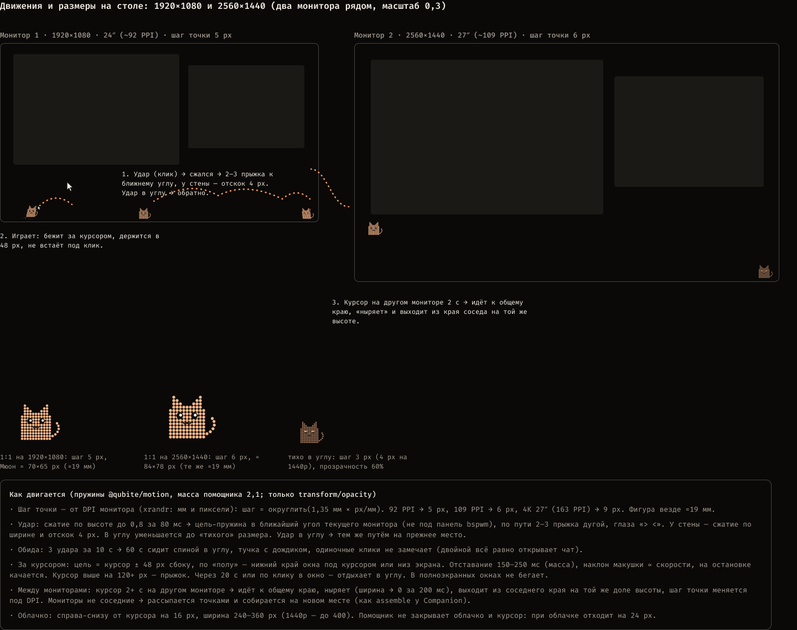

# Настольный помощник: облик и имя (DESK-001, этап 0)

Статус: **выбран F · Утя** (D-1062), 20.11.2026; E · Кьюби отложен на потом как маскот всего Qubite. Задача — issue #237, пункт 0. ТЗ — [DESKTOP_COMPANION.md](../architecture/DESKTOP_COMPANION.md) §2–2.3, решения D-883, D-1050…D-1061.

Шесть вариантов нового персонажа для рабочего стола: A–D — первая подборка, E · Кьюби и F · Утя — вторая (20.11, по просьбе владельца: один — маскот всего Qubite, другой — с приколом). Это не один из четырёх помощников сайта ([COMPANIONS.md](COMPANIONS.md)), но язык тот же: тело из точек по сетке, глаза — тёмные точки со светлым зрачком, изгиб от основания вместо поворота, «дыхание», пружины `@qubite/motion`.

## Где смотреть

| Что | Где |
|---|---|
| Всё в Figma | [«Новые модули» → «Настольный помощник»](https://www.figma.com/design/UZ5s8bNDVUfqK2yy80DAWR?node-id=78-5884) |
| A · Мюон | [узел 78:5893](https://www.figma.com/design/UZ5s8bNDVUfqK2yy80DAWR?node-id=78-5893) · [скриншот](screens/desk/a-muon.png) |
| B · Бозон | [узел 78:5915](https://www.figma.com/design/UZ5s8bNDVUfqK2yy80DAWR?node-id=78-5915) · [скриншот](screens/desk/b-bozon.png) |
| C · Глюон | [узел 78:5937](https://www.figma.com/design/UZ5s8bNDVUfqK2yy80DAWR?node-id=78-5937) · [скриншот](screens/desk/c-gluon.png) |
| D · Хомка | [узел 78:5959](https://www.figma.com/design/UZ5s8bNDVUfqK2yy80DAWR?node-id=78-5959) · [скриншот](screens/desk/d-homka.png) |
| E · Кьюби | [узел 83:5892](https://www.figma.com/design/UZ5s8bNDVUfqK2yy80DAWR?node-id=83-5892) · [скриншот](screens/desk/e-kyubi.png) |
| F · Утя | [узел 83:5966](https://www.figma.com/design/UZ5s8bNDVUfqK2yy80DAWR?node-id=83-5966) · [скриншот](screens/desk/f-utya.png) |
| Облачко, «запомнил», тихое облачко, трей | [узел 79:5884](https://www.figma.com/design/UZ5s8bNDVUfqK2yy80DAWR?node-id=79-5884) · [скриншот](screens/desk/bubble-tray.png) |
| Движения и размеры | [узел 80:5892](https://www.figma.com/design/UZ5s8bNDVUfqK2yy80DAWR?node-id=80-5892) · [скриншот](screens/desk/motion-sizes.png) |
| Все 78 кадров одним листом | [all-frames.png](screens/desk/all-frames.png) |
| Живая проба: дышат, смотрят на курсор, клик — обида | [explorations/2026-11-20-desk/index.html](explorations/2026-11-20-desk/index.html) (открыть через любой локальный сервер — модуль ES) |

## Как это рисуется

Фигура — только круги и дуги. Код — [`explorations/2026-11-20-desk/figures.mjs`](explorations/2026-11-20-desk/figures.mjs):

- `LOOKS` — шесть тел: клетки сетки (как `KINDS` в `packages/ui/src/dots/engine.ts`), где глаза и рот, масса и вязкость пружины;
- `FRAMES` — 13 кадров: поза (сжатие, наклон макушки, подскок), глаза, рот и значки вокруг (z, «?», «!», солнце, туча, луна, чашка) — тоже из точек;
- `frame()` собирает список примитивов, `paintCanvas()` рисует его в Canvas (так будет в `apps/desktop`), `toSvg()` — в SVG (для Figma и скриншотов).

Без камеры и 3D. На DESK-003 форму выбранного варианта перенести в `KINDS` движка точек, кадры — в `Mood` (сейчас там `idle · happy · sad · shut · listen · think · talk · angry`; добавятся `sleep · doing · confirm · error · quiet · play · hurt · yawn · stretch`).

## Как выбирали имя

Имя — это и слово-вызов (D-1060), поэтому:

- **2–3 слога**, ударный слог с заметным согласным (б, г, м, з), а не тихим (х, ф, с);
- **не частое слово** и не похоже на частое — иначе ложные срабатывания;
- не «Алиса», «Маруся», «Джарвис» и не имена семьи сайта (Элик, Прото, Нейт, Фоти, Shade);
- объясняется идеей Qubite (правило D-117), как имена семьи «Атом Qubite».

Честно о длине: детекторы одного слова (openWakeWord и похожие) надёжнее на 3–4 слогах. У всех имён по 2 слога; выручают проверка голоса владельца (D-1060) и запасная фраза из 3 слогов «Эй, <имя>» — её можно включить в настройках, если будут ложные срабатывания.

## A · Мюон — кот-частица (персиковый)

**Почему имя.** Мюон — частица, которая пролетает сквозь стены и даже сквозь толщу земли. Так и он ходит сквозь окна и между мониторами. В имени слышится «мяу». Он из семьи «Атом Qubite»: частица, которая вылетела из атома к тебе на стол. Сочетание «мю» в русской речи почти не встречается.

**Характер.**
- Кот, который работает: независимый, но всегда рядом.
- Говорит коротко и сдержанно, иногда начинает с «мрр».
- Любит тепло: от успеха жмурится, хвост трубой.
- На удар не злится — обижается, уходит в угол, через минуту возвращается.
- В видео сидит в углу, после 01:00 зевает, через 2 часа потягивается.
- Когда скучно — ловит курсор.

**Тон реплик.**
- сборка: «Сборка готова. 2 ошибки — показать?»
- напоминание: «Мрр. Через 10 минут созвон.»
- игра: «Поймал! …почти.»
- удар: «Ай. Посижу в углу.»
- память: «Запомнил: музыка — в Spotify, не в браузере.» · Отменить

**Чем хорош.** Каждое настроение из D-1056/D-1059 — знакомое кошачье поведение (сидит в углу, потягивается, гонится за курсором, дуется), его понимают без подписи. Хвост — ещё один канал эмоций: трубой, опущен, машет. Набросок владельца «Desktop AI Companion 🐈» начинался с кота.

**Чем плох.** Кот — частый образ, меньше «своего». Имя созвучно «мильон». Уши и хвост — фигура шире на 3 клетки (14 против 11).

## B · Бозон — шарик-курьер с антенной (зелёный)

**Почему имя.** Бозоны — частицы-переносчики: через них другие частицы «разговаривают» (фотон несёт свет, глюон держит кварки вместе). Бозон переносит твои слова компьютеру и ответ обратно. Звонкие «б» и «з» хорошо слышны в шуме.

**Характер.**
- Исполнительный курьер: принял — сделал — доложил.
- Бодрый, говорит чётко, с цифрами.
- Огонёк на антенне — его состояние: жёлтый — ждёт, оранжевый — работает или слушает, красный — ошибка.
- Гордится сделанным, любит короткие отчёты.
- Удар принимает спортивно: откатывается мячиком.
- После 01:00: «смена окончена», предлагает закругляться.

**Тон реплик.**
- сборка: «Готово за 3 мин 12 с. Ошибок: 2. Открыть?»
- напоминание: «Напоминаю: созвон в 15:00, через 10 минут.»
- игра: «Задач нет. Кинешь курсор?»
- удар: «Принял. Откатываюсь в угол.»
- память: «Записал: VPN включаешь утром.» · Отменить

**Чем хорош.** Самый простой силуэт — круг: читается даже при 32 px и проще всех в коде. Огонёк на антенне — знак состояния, понятный в любом размере, из него же значок трея. Мяч естественно катится и отскакивает на пружинах.

**Чем плох.** Скорее инструмент, чем друг. Зелёный — это цвет успеха (`--q-green`): радость и «успех» сливаются. Созвучно «сезон», «газон»; звучит по-учёному.

## C · Глюон — желе-шутник (небесный)

**Почему имя.** Глюон «склеивает» кварки (glue — клей). Этот склеивает компьютер и Qubite, окна и столы. Сочетание «глю» в речи редкое. Форма — родня Прото и Нейту: прямоугольник с мягким верхом, но с «подолом» желе.

**Характер.**
- Весёлый, немного ироничный.
- Желе: тянется к курсору и качается дольше всех (вязкость пружины 11 против 18–22 у других).
- Над ошибками шутит, но потом честно говорит, что не так.
- Любопытный, всё трогает.
- На удар расплющивается и стекает в угол.
- Ночью растекается и зевает.

**Тон реплик.**
- сборка: «Сборка готова. 2 ошибки — и это не я глючу.»
- напоминание: «Эй, через 10 минут созвон. Я предупредил!»
- игра: «Догони! А, нет, это я догоняю.»
- удар: «Шлёп. Ладно-ладно, я в углу.»
- память: «Приклеил к памяти: проекты — в ~/dev.» · Отменить

**Чем хорош.** Самый живой: главный приём сайта — изгиб от основания — тут виден сильнее всего. Шутки запоминаются. Ближе всех по форме к семье сайта.

**Чем плох.** Шутки быстро надоедают; ползунок навязчивости помогает лишь отчасти. «Глюк» в имени — плохой знак для того, кто выполняет команды. На неподвижном скриншоте выглядит проще остальных — вся прелесть в движении.

## D · Хомка — хомяк-хранитель памяти (жёлтый)

**Почему имя.** `~` в терминале — домашняя папка (`$HOME`). Там он живёт и туда складывает свою память (`~/.local/share/qubite/companion/memory`, D-1051). Хомяк прячет запасы за щёки — Хомка «прячет за щёку» то, что запомнил: при «запомнил: …» щёки надуваются, «Отменить» — выплюнул.

**Характер.**
- Хозяйственный, заботливый, домашний.
- Всё помнит и с гордостью показывает запасы.
- Мягко ворчит, если ты отвлёкся.
- Перед удалением переспрашивает — боится потерять.
- После 01:00 зевает первым и гонит спать.
- После удара прячется в «норку» в углу и выглядывает.

**Тон реплик.**
- сборка: «Сборка готова. Две ошибки — сложил в список.»
- напоминание: «Не забудь: созвон через 10 минут. Я помню!»
- игра: «А что у тебя тут? Давай поиграем.»
- удар: «Ой! В норку…»
- память: «Спрятал за щёку: принтер — на втором столе.» · Отменить

**Чем хорош.** У памяти (D-1050…D-1053) — самой новой и непривычной части — появляется понятный образ. Самый уютный. Широкий низкий силуэт хорошо сидит у края экрана.

**Чем плох.** Детский образ. Щёки — второй цвет (оранжевый на жёлтом), на светлых обоях хуже видно. «Х» в начале слова тихий — детектор ловит его хуже, чем «б», «г», «м».

## E · Кьюби — маскот всего Qubite (оранжевый)

**Почему имя.** От «кубит», от которого назван Qubite. Кубит до измерения бывает в двух состояниях сразу — Кьюби так и думает: раздваивается между вариантами и «схлопывается», когда решил. Кольцо и стрелка — сфера Блоха (так рисуют состояние кубита): стрелка показывает, куда он смотрит. Сочетание «кью» в русской речи почти не встречается. Может стать одним героем на сайт, телефон и стол.

**Как устроен в коде.** Тело — круг из точек; кольцо-экватор рисуется в два приёма: задняя половина до тела (тусклая), передняя — поверх. Стрелка — 6 точек от края тела и жёлтый кончик; её направление задано для каждого кадра (`ARROW` в `figures.mjs`): вверх — «да» и радость, вниз — сон и грусть, к курсору — слушает, крутится — делает. Кончик оранжевый, когда слушает или ждёт «Да», красный — при ошибке. «Думает» — суперпозиция: два полупрозрачных Кьюби без колец, стрелки в разные стороны, между ними — пунктир «или».

**Характер.**
- Учёный-оптимист: любит варианты и честно говорит, когда не уверен.
- Думает вслух «или так, или так» — и раздваивается.
- Решил — схлопнулся, стрелка вверх: «готово».
- Стрелка всегда показывает, куда он смотрит: на курсор, на облачко; вниз — грустит или спит.
- На удар — «декогеренция»: рассыпается точками и собирается в углу.
- Ночью стрелка клонится, как у часов.

**Тон реплик.**
- сборка: «Сборка готова. 2 ошибки — скорее всего опечатки. Показать?»
- напоминание: «Через 10 минут созвон. Это точно, без суперпозиции.»
- игра: «Я сразу в двух местах — найди настоящего!»
- удар: «Ой, декогеренция. Соберусь в углу.»
- память: «Запомнил: проекты — в ~/dev.» · Отменить

**Чем хорош.** Один герой на всю систему: и маскот, и помощник. Суперпозиция — понятный образ «думаю над вариантами»: когда модель предлагает два варианта, на экране два Кьюби. Стрелка — готовый указатель на окно или кнопку («вот здесь»). Оранжевый — фирменный цвет Qubite.

**Чем плох.** Оранжевый совпадает с главной кнопкой: рядом с «Да» спорит с ней. Кольцо и стрелка — больше деталей, при 32 px кольцо сливается (в трее — без кольца). Имя может напомнить аниме-персонажа Кьюбея. Надо решить, как он связан с семьёй сайта (Элик, Прото, Нейт, Фоти) — например, он «ядро» атома, вокруг которого они летают.

## F · Утя — уточка для отладки (жёлтый)

**Почему имя.** Метод резиновой уточки: программист объясняет баг игрушечной уточке — и по ходу сам находит ответ. Эта уточка ещё и отвечает. Голосовой помощник — ровно это: ты рассказываешь, она слушает. «Утя» — ласково «уточка».

**Как устроен в коде.** Уточка в профиль, смотрит вправо; клетки трёх цветов (тело, клюв, крыло). Рта нет — вместо него клюв: открывается, когда она говорит, радуется («кря!») и зевает. Глаз один; когда курсор слева, в приложении фигура должна зеркалиться (в пробе этого пока нет).

**Характер.**
- Слушатель: даёт договорить и не перебивает.
- Вместо лекции — один уточняющий вопрос.
- Простодушная, но неожиданно точная.
- Нашла ошибку или успех — «кря!» и подпрыгивает.
- На удар обиженно отплывает в угол, покачиваясь, как по воде.
- В видео дремлет; после 01:00 — «кря… спать пора».

**Тон реплик.**
- сборка: «Сборка готова. 2 ошибки. Расскажешь мне про первую?»
- напоминание: «Кря! Через 10 минут созвон.»
- игра: «Пока сборка идёт — догони!»
- удар: «Кря?! Ладно, поплыла в угол.»
- память: «Запомнила: тесты — через just test.» · Отменить

**Чем хорош.** Смешно и сразу понятно программисту. Идеально ложится на голос: говоришь — она слушает. Силуэт в профиль узнаётся даже при 24 px. Покачивание «на воде» — естественное дыхание.

**Чем плох.** Уточка-отладчик — известный мем, не уникальна; немного детская. В профиль один глаз, поэтому за курсором слева она разворачивается. В разговорной речи «у тя» = «у тебя» — ложные срабатывания, нужна фраза «Эй, Утя». Жёлтый совпадает с цветом мысли (`--q-yellow`).

## Кадры (у всех одинаковые)

| Кадр | Что видно |
|---|---|
| Спит | Сплющен, глаза-дуги вниз, «z» из точек |
| Слушает | Наклон к курсору, глаза шире, рот «о», звуковые дуги; первая дуга оранжевая — микрофон пишет |
| Думает | Взгляд вверх, рот в сторону, три точки-мысли |
| Делает | Сосредоточен, кольцо из 8 точек, ведущая — оранжевая (как кольцо дела в DS) |
| Ждёт «Да» | Тянется к облачку, оранжевый «?» |
| Ошибка | Осел, брови домиком, красный «!» |
| Тихо в углу (видео) | Шаг точки 3–4 px, прозрачность 60%, полуприкрытые глаза, смотрит на видео |
| Играет за курсором | Сильный наклон, подскок с тенью, пыль позади |
| Радость | Подскок, глаза `^ ^`, улыбка, солнце |
| Грусть | Осел, взгляд вниз, туча с дождиком |
| Обида после ударов | Отвернулся, глаза `> <`, красная «жилка» |
| Зевает после 01:00 | Рот широко, глаза-щёлки, месяц |
| Потягивается | Вытянулся вверх, глаза `^ ^`, чашка с паром — «пора отдохнуть» |

## Облачко и трей

- **Облачко у курсора**: панель `--q-panel`, рамка `--q-line-2`, скругление 10, поля 12/16, текст 14. Кнопки — `Button` размера S: «Да» главная (одна), «Нет» обычная, «Подробнее» тихая. Справа-снизу от курсора на 16 px, не влезает — зеркалится. От облачка к помощнику — три точки «хвостика». Esc — «Нет». Появление и уход — `Presence`.
- **«запомнил: …» · Отменить**: одна строка 13 px, оранжевая точка, тихая кнопка «Отменить», 6 с (D-1053).
- **Тихое облачко у края** (видео, полный экран, созвон): у правого края, прозрачность 85%, без звука и кнопок, 5 с; клик — перейти на тот стол (D-1058).
- **Трей** — значки только из точек (сетка 20×20, 4–13 точек):
  - обычный — голова помощника (9 точек);
  - **слушаю** — полоски громкости, середина оранжевая: микрофон пишет после слова-вызова (D-1060); клик — выключить;
  - **не мешай** — месяц: реплик и прибеганий нет, только значок (D-1057).
  - Меню по клику: Показать/Скрыть · Не мешать · Слушать слово-вызов · Настройки.

## Движения и размеры

**Размер — от DPI монитора, а не от разрешения.** Шаг точки = округлить(1,35 мм × px/мм), DPI берём из xrandr (мм и пиксели). Тогда фигура везде около 19 мм:

| Монитор | PPI | Шаг точки | Мюон на столе | Тихо в углу |
|---|---|---|---|---|
| 1920×1080, 24″ | ~92 | 5 px | ≈70×65 px | шаг 3 px, ≈42 px |
| 2560×1440, 27″ | ~109 | 6 px | ≈84×78 px | шаг 4 px, ≈56 px |
| 3840×2160, 27″ | ~163 | 9 px | ≈126×117 px | шаг 5 px |

Облачко: ширина 240–360 px (на 1440p — до 400). При открытом облачке помощник отходит на 24 px, чтобы не закрывать его и курсор.

Все движения — пружины `@qubite/motion` (жёсткость 220, масса помощника 2,1, вязкость — из варианта) и только `transform`/`opacity` в окне-оверлее.

- **Удар → в угол.** Сжатие по высоте до 0,8 за 80 мс, глаза `> <`. Цель-пружина — ближайший угол текущего монитора (не под панелью bspwm), по пути 2–3 прыжка дугой. У стены — сжатие по ширине и отскок 4 px. В углу уменьшается до «тихого» размера. Удар в углу — тем же путём на прежнее место (D-1054).
- **Обида.** 3 удара за 10 с — 60 с сидит спиной в углу, туча с дождиком, одиночные клики не замечает (двойной всё равно открывает чат).
- **Бег за курсором** (игривое настроение). Цель — курсор ± 48 px сбоку; «пол» — нижний край окна под курсором или низ экрана. Отстаёт на 150–250 мс (масса), макушка наклонена по скорости, на остановке качается. Курсор выше на 120+ px — прыжок. Через 20 с или по клику в окно — отдыхает в углу. В полноэкранных окнах не бегает.
- **Между мониторами** (D-1059). Курсор 2+ с на другом мониторе — идёт к общему краю, «ныряет» (ширина → 0 за 200 мс) и выходит из соседнего края на той же доле высоты; шаг точки на ходу меняется под DPI. Мониторы не соседние — рассыпается точками и собирается на новом месте, как `assemble` у `Companion`.

## Что советую

**Если нужен один герой на весь Qubite — E · Кьюби.** Только у него и облик, и поведение (раздвоиться, схлопнуться, показать стрелкой) выросли из названия продукта. Его можно поставить на вход сайта, в пустые экраны, в телефон и на стол — это уже маскот, а не только помощник.

**Если помощник только для стола — A · Мюон.** Все настроения из D-1056 и D-1059 — то, что кошки и так делают (сидят в углу, спят, потягиваются, гоняются за курсором, обижаются), язык персонажа учить не надо. Хвост показывает эмоции без лишних значков.

**F · Утя** — самый весёлый и самый «программистский»; хорош, если важнее улыбка, чем уникальность. **B · Бозон** — если важнее простота кода и значка в трее.

Владелец выбирает вариант (можно смешать: форма одного, имя другого). После выбора: записать решение в decisions, перенести форму в `KINDS` и кадры в `Mood` (DESK-003), временную фигуру из ТЗ §2 заменить. Облачко, трей и движения в Figma нарисованы с Мюоном, но одинаковы для любого варианта.
