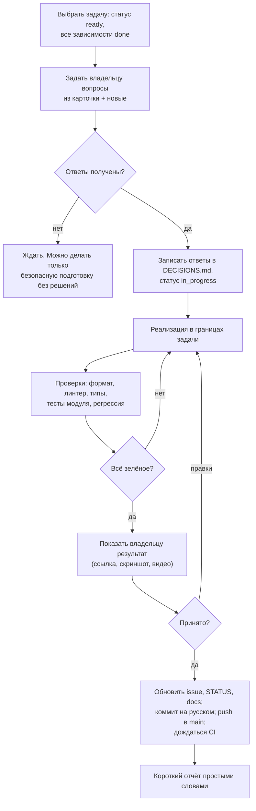

# Как агент (Claude/Codex) работает над Qubite

Это рабочий цикл, по которому любой AI-агент продолжает проект без пересказа контекста. Основано на решениях [D-008, D-020, D-021, D-022](../product/DECISIONS.md) и [ADR-0007](../architecture/decisions/0007-agent-workflow-main-branch.md).

## 1. При старте сессии прочитать

1. [`AGENTS.md`](../../AGENTS.md) — правила репозитория.
2. [`docs/project/STATUS.md`](../project/STATUS.md) — короткая сводка (≤ 80 строк): что идёт, очередь, что ждёт владельца.
3. [`docs/product/DECISIONS.md`](../product/DECISIONS.md) — индекс решений; только grep по номеру, полный текст — `docs/product/decisions/NN.md`.
4. Issue своей задачи в GitHub (как устроены — [`docs/plan/TASKS.md`](../plan/TASKS.md)).
5. Документы, на которые ссылается карточка (архитектура, дизайн, требования).

Полное видение ([context/QUBITE_MASTER_CONTEXT.md](../context/QUBITE_MASTER_CONTEXT.md)) читается, когда задача касается нового модуля или спорного требования.

## 2. Цикл одной задачи



Правила:

- **Одна основная задача за цикл.** Если по ходу нашлась другая проблема — новый issue, а не тихое расширение задачи.
- **Вопросы до кода** ([D-020](../product/DECISIONS.md)). Вопросы — только те, что меняют результат; с рекомендацией агента; без вопросов, ответы на которые уже есть в DECISIONS.
- **Архитектурное отклонение** (новая технология, смена границы модуля, изменение схемы прав) — остановиться, предложить ADR, спросить владельца.
- **UI-задача не готова**, пока владелец не посмотрел её на телефоне/ПК. Для этого агент поднимает превью и даёт ссылку или скриншоты.
- **Не пушить красное.** Задача с упавшими проверками остаётся `in_progress` или `blocked`.

## 3. Состояния задач

`backlog` → `ready` (зависимости выполнены, вопросы понятны) → `in_progress` → `review` (ждёт приёмки владельца) → `done`. Плюс `blocked` (с причиной).

## 4. Отчёт после задачи

Простыми словами, без потока терминов ([D-021](../product/DECISIONS.md)):

```text
Задача: <ID — название>
Что теперь умеет Qubite: <1–3 предложения для человека>
Как посмотреть: <ссылка / команда / скриншот>
Что проверено: <какие проверки и где; реальные результаты>
Что НЕ сделано и почему: <честно>
Риски: <если есть>
Коммит: <sha>
Следующая задача: <ID — название> и вопросы к ней
```

## 5. Защита от поломок

- `git status` до и после работы; посторонние изменения не коммитить.
- Нельзя: `push --force`, `reset --hard`, удаление веток/тегов `codex`, `tournaments`, `qubite-v1.0`, удаление БД, коммит секретов и `.env`.
- Перед миграцией данных — бэкап и описанный откат.
- Ничего из `legacy/` не удалять и не импортировать в новый код.
- Не трогать production (Raspberry Pi) без явного разрешения владельца: `git push` ≠ деплой.
- Не запускать реальные платные AI-вызовы в тестах; внешние API — только mock.
- Не тратить деньги, не публиковать, не отправлять сообщения от имени владельца без подтверждения.

## 6. Коммиты

- На русском, без `feat:`/`fix:`, первая строка — что изменилось для проекта.
- Маленькие осмысленные коммиты; один коммит не смешивает несвязанные изменения.
- После коммита — `git push origin main` ([D-008](../product/DECISIONS.md)), затем проверить CI.

## 7. Definition of Done

Задача `done`, только если всё применимое выполнено:

1. Результат соответствует критериям приёмки карточки и связанным требованиям из [REQUIREMENTS](../product/REQUIREMENTS.md).
2. Код отформатирован, линтеры и проверка типов чистые.
3. Есть тесты на успешные **и** ошибочные сценарии; для прав — негативные тесты.
4. Регрессия зелёная локально и в CI.
5. Данные не теряются при закрытии, обрыве сети, конфликте (если задача касается данных).
6. UI проверен на 360 px, 768 px, 1440 px, в светлой и тёмной теме, с reduced motion; анимации плавные.
7. Нет секретов в коде, логах, скриншотах.
8. Документация обновлена: issue (метка/закрыт), STATUS (≤ 80 строк), затронутые docs, DECISIONS (новые ответы), ADR (если было решение).
9. Владелец посмотрел и принял (для пользовательских функций).
10. Коммит запушен, CI зелёный.

## 8. Когда агенту остановиться и спросить

- Нужна новая зависимость с неочевидной лицензией или тяжёлая для Pi.
- Задача требует решения, которого нет в DECISIONS.
- Тесты падают по причине, не связанной с задачей.
- Нужно действие вне репозитория: сервер, DNS, оплата, публикация, реальные ключи.
