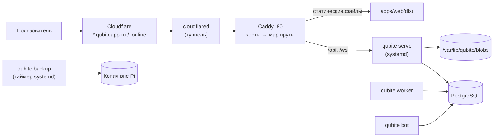

# Развёртывание, домены и бэкапы

**Состояние на 24.10.2026:** новый Qubite 2.0 стоит на Raspberry Pi владельца (`qubiteapp.online`, `auth.qubiteapp.online`) и обновляется сам после зелёного CI в `main` — см. [§7](#7-raspberry-pi-владельца-ops-005). Старый вход Qubite (служба `qubite-auth`) переехал на `gate.qubiteapp.online` и по-прежнему закрывает siyuan, memos, vikunja и регистрацию в AliasVault.

> ⚠️ В папке старого Qubite на Pi (`~/services/qubite-platform`) **не делать `git pull` ветки `main`**: файлы переехали в `legacy/qubite-v1/`. Новый Qubite ставится не из git, а из готовой сборки CI.

## 0. Где может жить Qubite

Qubite **не привязан к Raspberry Pi** ([D-110](../product/DECISIONS.md)): VPS, свой сервер, домашний ПК или Raspberry Pi 5 (4 ГБ) владельца — для личного и тестового использования. Ресурсами не ограничиваемся, но оптимизируем: базовый набор (ядро + MVP-модули + PostgreSQL) должен помещаться в **2 ГБ RAM**. Архитектуры: `x86_64` и `aarch64`.

Сейчас Pi недоступен по SSH (не отвечает и через Tailscale, [D-111](../product/DECISIONS.md)), поэтому первый деплой, скорее всего, будет на VPS или ПК.

## 1. Целевая схема (пример — один сервер)



- Всё нативно через systemd, без Docker (меньше памяти). Rust-бинарники **собираются в CI** под `x86_64` и `aarch64`: на сервере не нужен компилятор Rust, установщик скачивает готовый релиз.
- PostgreSQL по умолчанию ставится **на тот же сервер** и настраивается под объём памяти. Можно указать **внешнюю БД** (`DATABASE_URL` с адресом купленного сервера БД) — тогда локальный PostgreSQL не ставится ([D-113](../product/DECISIONS.md)).
- Каждый модуль — поддомен ([ADR-0006](../architecture/decisions/0006-subdomains-and-shared-session.md)); Cloudflare Tunnel и Caddy получают wildcard-маршрут.

## 2. Новый установщик (задачи OPS-001…OPS-003)

> **Готово (OPS-003, 18.10.2026):** архивы релиза. Локально: `just release` (или `just release aarch64-unknown-linux-gnu` при наличии кросс-компилятора) → `dist/release/qubite-<версия>-<цель>.tar.gz` и `.sha256`. В CI — workflow `release`: на каждый push в main архивы под x86_64 и aarch64 в артефактах запуска, по тегу `v*` — черновик GitHub Release ([D-178](../product/DECISIONS.md)). Внутри: `bin/qubite`, `web/`, `qubite.env.example`, `RELEASE.txt`. Установщик, который их скачивает, — OPS-001.

**Одна команда** ([D-112](../product/DECISIONS.md)), например:

```bash
curl -fsSL https://<домен-или-github>/install.sh | sudo bash
```

`deploy/install.sh` — интерактивный, с режимом без вопросов по конфигу ([D-105](../product/DECISIONS.md)). Он сам скачивает релиз, ставит зависимости и всё настраивает:

1. Проверка системы (ОС, архитектура, память, диск).
2. Домен(ы) и поддомены; Cloudflare Tunnel (токен вводится и не сохраняется в git).
3. Выбор модулей (MVP: core, auth, command/inbox, planner, docs; позже — остальные).
4. PostgreSQL: установить локально **или** подключиться к внешнему (адрес/строка подключения); создать БД и роли с минимальными правами.
5. Секреты → `/etc/qubite/qubite.env` (права 600).
6. Миграции.
7. **Создание owner:** `qubite owner create --email …` (пароль вводится интерактивно).
8. systemd-юниты, Caddy, проверка здоровья.
9. Настройка бэкапов.

Режим `--plan` показывает, что будет сделано, ничего не меняя. Повторный запуск безопасен (идемпотентен). `qubite update` обновляет сервер и модули (с бэкапом до обновления). Позже модули можно ставить из Owner Console.

Рядом с установщиком — понятная инструкция для человека: что ставится, какие сервисы (systemd-юниты) запускаются, где лежат конфиги и данные, как обновить, откатить и удалить.

**Qubite Home** ставится **отдельным установщиком** на сервер у дома (Home Assistant + Shade AI) и подключается к Qubite как модуль ([D-122](../product/DECISIONS.md)).

## 3. Переход со старого Qubite на новый

Старые аккаунты не переносятся ([D-050](../product/DECISIONS.md)). План (уточняется в задаче OPS-004):

1. Бэкап старой SQLite и `.env` (уже есть в `legacy/qubite-v1/`).
2. Новый Qubite ставится рядом на другой порт/поддомен (например, `qubiteapp.ru`), старый продолжает работать на `.online`.
3. Владелец проверяет новый Qubite.
4. Старые сервисы (Search, VPN, Writing…) выключаются по одному, когда их модуль переписан.
5. Старый Qubite выключается отдельным решением владельца.

## 4. Бэкапы

- Ежедневно: `pg_dump` (сжатый) + каталог файлов (дедупликация, например restic) + конфиг без секретов.
- Шифрование, хранение **вне** Pi (внешний диск, другой сервер или облако — **OPEN**, спросить владельца в OPS-002).
- Перед каждой миграцией — внеочередной бэкап.
- Раз в месяц — автоматическое тестовое восстановление в временную БД с проверкой.
- Owner видит в Console время и статус последнего бэкапа и проверки.

## 5. Секреты

- Только в `/etc/qubite/qubite.env` и в зашифрованном хранилище секретов в БД (ключи провайдеров, вводимые через Console).
- В git — только `.env.example` без значений.
- Логи не содержат токенов, паролей, ключей, текстов приватных записей.

## 6. Обновления

`qubite` обновляется заменой бинарника и статики + миграции, с бэкапом до и возможностью откатить. На Pi владельца это делает автодеплой ([D-566](../product/DECISIONS.md), §7); на других серверах — `deploy/pi/update.sh` вручную или установщик OPS-001.

## 7. Raspberry Pi владельца (OPS-005)

Pi 5, 4 ГБ, Debian 13. Рядом работают сервисы владельца (AliasVault, поиск, LanguageTool, Quark Parser, старый бот, siyuan, memos, vikunja) — их не трогаем.

**Что где:**

| Что | Где |
|---|---|
| Версии | `/opt/qubite/releases/<коммит>/` (последние 3), текущая — ссылка `/opt/qubite/current` |
| Секреты владельца | `/etc/qubite/qubite.env` (kirill:qubite, 640 — владелец правит без sudo, служба только читает) и ссылка `/etc/qubite/.env` — её читает сам `qubite` |
| Адреса и база этого сервера | `/etc/qubite/pi.env` — пишет `install.sh`, его значения сильнее `.env` |
| Данные | `/var/lib/qubite` |
| База | PostgreSQL 17 (общий на Pi), роль и база `qubite`, `work_mem` 4 МБ, до 12 соединений |
| Бэкапы перед обновлением | `/var/backups/qubite/*.dump` (последние 7) |
| Службы | `qubite-serve` (порт 9300), `qubite-bot`, таймер `qubite-update` — в `qubite.slice` |
| Caddy | `/etc/caddy/qubite.caddy` (копия `deploy/pi/qubite.caddy`), порт 9284: сайт + `/api/*` |
| Туннель | `~/.cloudflared/config.yml`: `qubiteapp.online` и `auth.` → 9284, `gate.` → 9289 (старый вход) |

**Приоритет ([D-567](../product/DECISIONS.md)).** Tailscale и SSH — в `access.slice` (вес 1000, Nice −5), это не трогаем. Qubite — в `qubite.slice`: вес CPU/IO 30, вся группа не больше 900 МБ (мягкий потолок 700 МБ), Nice 10–15, `OOMScoreAdjust` 500–700 — при нехватке памяти система выключает Qubite первым.

**Автодеплой.** CI (`release.yml`) после сборки `main` обновляет пред-релиз `edge`: архивы и `edge.json` с коммитом. Таймер раз в 5 минут запускает `qubite-update`:

1. Pi нагружена (load average > 2,5 или свободно < 400 МБ) — откладывает до следующего раза.
2. Берёт `edge.json`; коммит уже стоит или эта сборка уже падала — ничего не делает.
3. Ждёт, пока **все** проверки коммита в GitHub закончатся зелёными (публичный API, токен не нужен).
4. Скачивает архив `aarch64`, проверяет сумму, бэкап базы (`pg_dump`), переключает `current`, `qubite migrate`, перезапускает службы.
5. Ждёт `/api/ready` до 90 секунд. Нет — откат: прошлая версия и база из бэкапа.
6. Сообщение в Telegram через нового бота (`qubite notify deploy …`).

**Команды:**

```bash
sudo /opt/qubite/bin/qubite-update --status     # что стоит
sudo /opt/qubite/bin/qubite-update --force      # обновиться сейчас (не ждать, даже если Pi нагружена)
sudo /opt/qubite/bin/qubite-update --rollback   # вернуть прошлую версию и базу до последнего обновления
sudo systemctl stop qubite-update.timer         # выключить автодеплой (включить — start)
journalctl -u qubite-serve -u qubite-bot -u qubite-update -f   # логи
```

**Заметки по Pi:**
- Caddy после перезагрузки однажды упал по таймауту запуска. Теперь `/etc/systemd/system/caddy.service.d/90-autorestart.conf`: 5 минут на запуск и перезапуск при сбое.
- Сообщения бота (в том числе об обновлении) приходят, когда к аккаунту owner привязан Telegram (Профиль → входы). До этого они ждут в очереди.
- ChatGPT по подписке: Настройки → AI → ChatGPT → «Войти через ChatGPT». После входа браузер откроет `127.0.0.1:1455/…` и скажет «не удаётся подключиться»: это нормально, адрес из строки браузера вставить в поле на сайте. До OpenAI Pi ходит напрямую (через системный VPN), `QUBITE_PROXY` не нужен.

- Голос (ElevenLabs) — через отдельный VPN: служба `qubite-elevenlabs-proxy` (xray, вход `127.0.0.1:10890`, конфиг `/etc/qubite/elevenlabs-xray.json` из VLESS-ключа владельца), в `.env` — `QUBITE_ELEVENLABS_PROXY=http://127.0.0.1:10890`. Через системный VPN (Таллин) ElevenLabs не пускал, поэтому только этот xray (пользователь `qubite-el`) идёт мимо sing-box: правило `ip rule … uidrange … lookup main` (приоритет 8990) ставит и убирает сама служба. Остальной трафик Pi — через системный VPN, как раньше. Выключить: `sudo systemctl stop qubite-elevenlabs-proxy` (правило уйдёт).

**Установка с нуля:** склонировать репозиторий, положить `.env` владельца в `/etc/qubite/qubite.env`, `sudo deploy/pi/install.sh`, затем создать owner (команду печатает `install.sh`), подключить `qubite.caddy` в Caddy и маршруты в туннеле.
