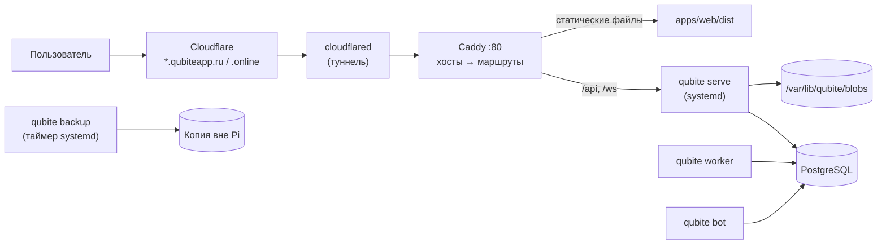

# Развёртывание, домены и бэкапы

**Состояние на 17.10.2026:** новый Qubite ещё не развёрнут нигде. На Raspberry Pi работает **старый** Qubite (`qubiteapp.online` через Cloudflare Tunnel). Его установщик — [`legacy/qubite-v1/deploy/`](../../legacy/qubite-v1/deploy/).

> ⚠️ На сервере со старым Qubite **не делать `git pull` ветки `main`**: файлы переехали в `legacy/qubite-v1/`. Сервер остаётся на ветке `tournaments` / теге `qubite-v1.0`.

## 1. Целевая схема на Raspberry Pi

- Всё нативно через systemd, без Docker (меньше памяти на Pi). Rust-бинарник собирается под `aarch64` в CI.
- PostgreSQL настраивается под малую память.
- Каждый модуль — поддомен ([ADR-0006](../architecture/decisions/0006-subdomains-and-shared-session.md)); Cloudflare Tunnel и Caddy получают wildcard-маршрут.

## 2. Новый установщик (задачи OPS-001…OPS-003)

`deploy/install.sh` — интерактивный, с режимом без вопросов по конфигу ([D-105](../product/DECISIONS.md)):

1. Проверка системы (ОС, архитектура, память, диск).
2. Домен(ы) и поддомены; Cloudflare Tunnel (токен вводится и не сохраняется в git).
3. Выбор модулей (MVP: core, auth, command/inbox, planner, docs; позже — остальные).
4. PostgreSQL: установка/подключение, создание БД и ролей с минимальными правами.
5. Секреты → `/etc/qubite/qubite.env` (права 600).
6. Миграции.
7. **Создание owner:** `qubite owner create --email …` (пароль вводится интерактивно).
8. systemd-юниты, Caddy, проверка здоровья.
9. Настройка бэкапов.

Режим `--plan` показывает, что будет сделано, ничего не меняя. Повторный запуск безопасен (идемпотентен). Позже модули можно ставить из Owner Console.

## 3. Переход со старого Qubite на новый

Старые аккаунты не переносятся ([D-050](../product/DECISIONS.md)). План (уточняется в задаче OPS-004):

1. Бэкап старой SQLite и `.env` (уже есть в `legacy/qubite-v1/`).
2. Новый Qubite ставится рядом на другой порт/поддомен (например, `qubiteapp.ru`), старый продолжает работать на `.online`.
3. Владелец проверяет новый Qubite.
4. Старые сервисы (Search, VPN, Writing…) выключаются по одному, когда их модуль переписан.
5. Старый Qubite выключается отдельным решением владельца.

## 4. Бэкапы

- Ежедневно: `pg_dump` (сжатый) + каталог файлов (дедупликация, например restic) + конфиг без секретов.
- Шифрование, хранение **вне** Pi (внешний диск, другой сервер или облако — **OPEN**, спросить владельца в OPS-002).
- Перед каждой миграцией — внеочередной бэкап.
- Раз в месяц — автоматическое тестовое восстановление в временную БД с проверкой.
- Owner видит в Console время и статус последнего бэкапа и проверки.

## 5. Секреты

- Только в `/etc/qubite/qubite.env` и в зашифрованном хранилище секретов в БД (ключи провайдеров, вводимые через Console).
- В git — только `.env.example` без значений.
- Логи не содержат токенов, паролей, ключей, текстов приватных записей.

## 6. Обновления

`qubite` обновляется заменой бинарника и статики + миграции, с бэкапом до и возможностью откатить бинарник. Автодеплоя из CI на Pi нет: обновление запускает владелец (или агент — только с явного разрешения).
