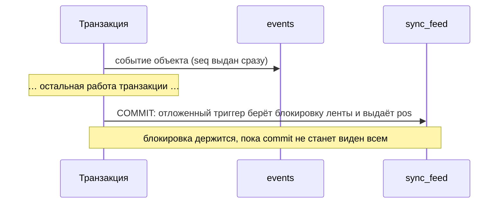

# Протокол синхронизации объектов

Как устройство и сервер обмениваются изменениями простых объектов (мысли, дела, проекты, метаданные документов). Текст документов идёт отдельно — [DOCS_SYNC.md](DOCS_SYNC.md). Общая картина и стратегии по типам данных — [SYNC_AND_HISTORY.md](../architecture/SYNC_AND_HISTORY.md).

Код: протокол — `crates/qubite-sync`, сервер — `crates/qubite-sync-server` и `crates/qubite-server/src/sync.rs`, клиент — `packages/sync-client`. Решения — D-192, D-193, D-891…D-893 ([91.md](../product/decisions/91.md)).

## 1. Отправка: `POST /api/v1/sync/push`

Устройство шлёт пакет операций из своей очереди. У каждой операции свой `op_id`; повтор того же `op_id` ничего не применяет второй раз и возвращает прежний результат. Правка существующего объекта несёт `base_revision` — версию, от которой отталкивалось устройство.

Ответ по каждой операции:

| Статус | Что значит | Что делает устройство |
|---|---|---|
| `applied` | Применено | Убирает операцию из очереди |
| `conflict` | На сервере уже другая версия; в ответе — текущее состояние | Показывает серверную версию, правку кладёт в «проблемы» |
| `rejected` | Отклонено навсегда (`not_found`, `invalid`, `forbidden`) | Убирает операцию, кладёт в «проблемы» |

## 2. Получение: `GET /api/v1/sync/pull?cursor=…&limit=…`

Сервер отдаёт снимки объектов, изменившихся после курсора, — по одному на объект, в порядке последнего изменения, только из модулей с правом `read`. В ответе новый курсор и `has_more` (есть ещё — сразу запросить следующую страницу).

Снимок — это текущее состояние объекта целиком. Получить один и тот же снимок дважды безвредно: устройство берёт его, если у объекта нет неотправленных правок и локальная версия не новее.

## 3. Курсор

### 3.1. Что видит устройство

Курсор — **непрозрачная строка**. Устройство хранит её и возвращает серверу как есть; разбирать её не нужно. Без курсора или `0` — «с начала».

Формат (для отладки): `2.<модуль>-<позиция>.<модуль>-<позиция>…`, например `2.docs-17.inbox-40`. Только буквы, цифры, `_`, `-`, `.` — в адрес подставляется без кодирования.

### 3.2. Позиции выдаются в порядке commit (D-891)

Курсор «всё до позиции N получено» безопасен, только если изменение с меньшей позицией никогда не появляется позже изменения с большей. Номер события `events.seq` этого не гарантирует: он выдаётся при вставке, а транзакции заканчиваются в другом порядке.

Поэтому сервер ведёт ленту `sync_feed` (миграция 0049): одна строка на объект с позицией `pos` его последнего изменения.

- Позицию выдаёт **отложенный** триггер на `events` — в самом конце транзакции, прямо перед commit.
- Перед этим он берёт одну блокировку на всю базу (`pg_advisory_xact_lock`), которая отпускается только после того, как commit стал виден. Следующая транзакция получит позицию уже после этого.
- Значит, всё, что устройству ещё не видно, получит позицию больше любой видимой. Курсор не может «перешагнуть» незаконченную транзакцию.
- Блокировка держится только на время commit. Её владелец в это время ничего не ждёт: у ленты нет внешних ключей, а её строки меняются только под этой блокировкой. Взаимной блокировки со строками объектов быть не может.
- Журнал `events` остаётся «только добавление»; лента — отдельная таблица.

Повторное изменение объекта не добавляет строку, а переносит его в конец ленты. Размер ленты равен числу объектов.

### 3.3. Своя позиция у каждого модуля (D-892)

В курсоре записано, до какой позиции получен **каждый модуль**. Модуля в курсоре нет — он забирается с начала.

| Что произошло | Что получит устройство следующим `pull` |
|---|---|
| Выдали доступ к модулю | Все объекты этого модуля, включая старые; остальные модули не повторяются |
| В новой версии сервера появился новый синхронизируемый модуль | То же |
| Доступ отозвали | Модуль перестаёт приходить; его позиция в курсоре остаётся |
| Доступ вернули | Модуль продолжает с того места, где остановился |

После страницы, закончившейся позицией N, у всех читаемых сейчас модулей позиция становится N: страница отсортирована по `pos`, поэтому у каждого из них всё до N либо пришло, либо отсутствует. Модули без права чтения не трогаются.

### 3.4. Совместимость (D-893)

| Курсор в запросе | Как понимает сервер |
|---|---|
| Число (`cursor=57`) — формат до SYNC-007, номер события | «С начала»: устройство один раз забирает всё заново. Заодно возвращается то, что оно могло пропустить раньше |
| Мусор, чужой формат | «С начала» |
| Позиция больше, чем лента когда-либо выдавала (база восстановлена из копии) | «С начала» |

Открытые вкладки со старым кодом продолжают работать: они тоже хранят и возвращают курсор как есть.

Откат сервера на версию до SYNC-007 строковый курсор не поймёт и ответит 400. Данные на устройстве при этом целы (очередь отправки работает), но входящие изменения не придут, пока сервер не обновят обратно или не очистят хранилище сайта на устройстве.

## 4. «Есть новое»: WebSocket `/api/v1/sync/ws`

Сервер шлёт `{"type":"changed"}` без данных, устройство делает `pull`. Источник — триггер на `events` → `pg_notify('qubite_changes', владелец)`; уведомление уходит в момент commit, когда строка ленты уже записана. Права проверяются перед каждым сообщением и раз в 30 секунд; отзыв → закрытие с кодом 4403.

## 5. Что проверяют тесты

- `crates/qubite-sync-server/tests/cursor.rs` — медленная транзакция не теряется; модуль после выдачи доступа догружается (в том числе постранично); старый числовой курсор; курсор «из будущего»; параллельные commit вперемешку; перенос старых данных миграцией.
- `crates/qubite-server/tests/inbox.rs` — то же через HTTP с настоящими грантами.
- `packages/sync-client/src/client.test.ts` — клиент хранит и возвращает курсор как есть.

## 6. Известные ограничения

- Удаление объекта навсегда устройству не сообщается: строка ленты остаётся, объект при выдаче пропускается.
- После отзыва доступа устройство не стирает уже полученные объекты модуля.
- Поля модулей читаются по одному объекту (сами объекты страницы — одним запросом).
- Сторож журнала аудита в боте (`audit.seq`) читает по номеру вставки и подвержен той же гонке порядка commit; лента синхронизации его не покрывает.
