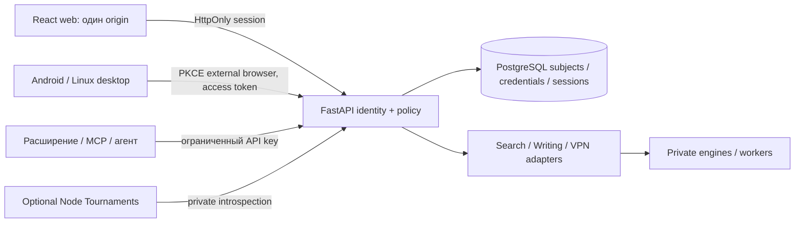

# AUTH-008 — единый вход Qubite, fresh-install

**Исполнение13.10.2026:** AUTH-002 реализует [subjects/platform_owner/local bootstrap](../architecture/IDENTITY_SCHEMA.md), current migration0002. HTTP identity-v2 routes пока planned/runtime_implemented=false; следующий password/session API AUTH-009. Owner настоящий не bootstraped в постоянной среде, real CLI проверен на disposable accounts.

13.10.2026. **Это спецификация, не работающий Auth.** Уточнение владельца: нет существующих аккаунтов для переноса, старый owner допускается создать заново, текущего деплоя нет. Разрешён новый вход/API в собственных сервисах. Это основание fresh-install, а не результат проверки удалённых units/данных. [ADR-0013](../architecture/decisions/0013-fresh-identity-and-unified-login.md) имеет приоритет над прежним планом dual-runtime перехода.

Результат этой задачи: карта consumers, модель данных, контракт login/session/revoke/native/API keys, последовательность реализации и executable protocol vectors. Никаких real passwords, env credentials, внешних OAuth exchanges, paid calls, production DB mutations или перезапусков. `contracts/identity-v2.json` явно status=specification/runtime_implemented=false; не подменяет рабочий `core-v1.json` OpenAPI.

## Один сценарий для собственных сервисов

Пользователь входит один раз в Qubite. Search, Writing, VPN и Docs открываются внутри React-оболочки на том же origin; их API доступны под `/api/v1/...`. Cookie не нужно делить между субдоменами. Веб-клиент не хранит bearer в localStorage и не передаёт session через URL. При отключённом модуле оболочка продолжает работать, API отказывает до выполнения операции.

Один subject UUID не означает один универсальный секрет. Browser cookie, native device session и ключ агента можно отзывать независимо. У всех одинаковая проверка active account и актуальных grants. Подтверждённая сессия устанавливает личность; доступ к модулю, объекту и AI-расходам проверяется отдельным policy/budget gate.

## Проверенная карта старого кода → целевой consumer

Исходники прочитаны локально; ни один существующий endpoint не заменён в AUTH-008.

| Consumer / source | Фактический старый вход | Новая authority / действие | Проверка при реализации |
|---|---|---|---|
| Web, `back/server.js:attachAuth`, `front/js/api.js` | qb_session, sessions/users SQLite, global roles | React + FastAPI web session, UUID, scoped policy; старые пароли/сессии не принимаются | login/logout/blocked/revoke/CSRF, malformed cookie без500, обычная home owner |
| Search, `services/search/app.py:access/login` | private proxy secret+user header; qb_session→Node `/internal/services/session`; отдельная __Host-qubite_search; standalone BasicAuth через9181 | UI в React/core origin; private engine не создаёт browser account и не выполняет BasicAuth login. Core разрешает запрос/историю/AI по UUID | прямой engine endpoint закрыт; без поддельных forwarded user; соседняя history/job недоступна; deny до engine/provider |
| Search agent API, `back/src/service-api.js`, `services/search/agent_api.py` | qbs_* key, Node key authorize, local request cap | qbt_k_* key одного core subject, audience search; отдельные search.query/fetch/history/ai scopes | history без grant403; revoked/expired/key cap; пересечение прав ключа и аккаунта |
| Writing, `back/src/writing.js`, `back/public/writing.*` | req.auth SQLite, owner auto AI; own key verification | FastAPI module API, web session или scoped key; writing.check отдельно от writing.ai | texts не логируются; grammar не требует AI grant; paid deny/provider counter0; UTF16/cancel сохраняются |
| Firefox Writer, `integrations/qubite-writing/firefox/background.js` | серверные `/api/writing/*`, сохранённый API credential в extension storage | явный новый scoped key; настройки расширения проверяют core me/check; browser cookie не копируется | не передавать секрет content scripts/страницам; no cookie permission; подпись Firefox отдельный этап |
| VPN app, `app/qubite_vpn/lib/services/api_client.dart` | persisted cookie jar, `/api/auth/app/login/register`, embedded X-App-Token | новый native auth code/PKCE и secure storage; API sessions не VPN-node credentials | внешняя browser авторизация, точный callback, rotate/revoke; VPN credentials отдельно/owner bypass убрать |
| VPN nodes/subscription URLs, `back/src/proxy/routes.js` | node Bearer, выдаваемые device/network credentials, token URL подписки | node identities отдельные от людей; выдача контролируется core subject+vpn.use | node secret не получает platform-owner; subscription URL узкий secret, не login/token; не менять сетевой протокол вместе с Auth |
| Optional Tournaments, `back/server.js`, `back/src/db.js` | users/teams/roles/passwords SQLite | Node engine оставляем; когда включается, local participant связывается с core UUID, core introspection audience tournaments; scoped роли внутри модуля | core role не берётся из users.role; отрицательный tournament→owner; старое отдельное Auth не маршрутизируется в новый core |
| Control Telegram, `back/src/telegram-bot.js`, `back/src/telegram/access.js` | TELEGRAM_OWNER_ID/moderator whitelist+local grants | подтверждённая привязка Telegram ID к core subject; отдельные support/command grants | Telegram moderator не platform owner; each mutation reauthorized; один polling |
| AliasVault, `vault-integration.js` | Qubite enrollment gate + собственный native account/master-password | core gate с единой identity; vault native credential и master-key отдельно | master-password не проходит через Qubite/AI; public gate и upstream grants; не обещать заменить vault cryptography на общий пароль |
| Memos/Vikunja/SiYuan, `knowledge-api.js`, `auth-surface.js`, `siyuan.js` | Qubite gate + native Bearer/cookie/OAuth/enrollment | optional external adapters по core grant; upstream identities при необходимости отдельно. Собственные Docs/Planner не построены на них | никаких header-only обещаний SSO для upstream; existing native auth не импортируется; enable только после adapter tests |
| Kwork/Brief/leads/listener | личная Telegram session, bot owner ID, приглашения интервью; не platform account | будущие ограниченные connectors; их service credentials не пользовательский Auth | не создавать второй listener/polling, не менять реальные external sessions; guest interview не становится owner |
| Hermes/MCP/плагины/worker | отдельные ограниченные ключи и внешние runtimes | core scoped keys/service principals + actor subject, intersection, recheck before work | token не даёт сверх прав инициатора; личный дневник не доступен автоматически; AI cost gate отдельно |
| ShadeAI | независимый проект / будущий connector | только будущая делегированная интеграция | read-only source сейчас, no merge/secrets/actions |

Для каждого included сервиса один новый interactive login. Upstream master-password, provider OAuth grants, машинные node credentials и интервью клиентов не сливаются в пользовательские сессии.

## Данные identity и owner

Только целевая логическая схема; SQL создаётся AUTH-002/009 explicit migrations, не при startup.

| Таблица qubite_core | Ключи и инварианты | Slice |
|---|---|---|
| subjects | UUID PK; email_original/email_canonical unique; display_name nullable; status pending/active/blocked; email_verified_at nullable; auth_version bigint>=1; timestamps | AUTH-002 |
| platform_owner | singleton_id PK CHECK=1; subject_id UNIQUE FK subjects; NOT NULL; один owner, изменение отдельно | AUTH-002 |
| password_credentials | subject_id PK/FK; Argon2id PHC hash, credential_version, updated_at; нет plaintext/encrypted password | AUTH-009 |
| sessions | UUID, subject FK, kind web/native, device_label, token_hash unique для web; created/last_seen/expires/absolute_expires/revoked/auth_version; auth_version сравнивается с subject | AUTH-009/012 |
| native_tokens | UUID, session FK, kind access/refresh, hash unique, client/audience/scopes/expiry, used_at/replaced_by; consumed refresh hashes до family expiry | AUTH-012 |
| auth_requests/codes | hashed one-use code, subject/client/redirect/PKCE S256/scopes/state/expiry; consume atomic; не code-entry account login | AUTH-012 |
| api_keys | UUID, subject FK, digest unique, name/prefix/audience/scopes, expires/revoked/quota; plaintext только при выдаче | AUTH-013 |
| oauth_identities/challenges | UNIQUE(provider,issuer,subject); state/nonce/PKCE/challenge hash/expiry/one-use; separate secret reference | AUTH-010/011 |

UUID4 генерируется сервером; нет legacy_instance/legacy_id, обязательного login alias, миграции хешей/старых сессий. Если optional tournament требует внутренний integer participant ID, он локален этому модулю и явно связан с core_subject_id, не определяет identity.

Email canonical: trim внешних пробелов, домен IDNA/lowercase, local part casefold как явное продуктовое правило; не удалять точки/plus-сегменты и не объединять по правилам Gmail. Оригинал отдельно. Уникальность и collision tests до записи. Password12..256 Unicode codepoints, exact UTF8 без trim/casefold/нормализации/усечения; max1024 UTF8 bytes. Argon2id PHC, минимум m=19456KiB,t=2,p=1; конкретная library/lock и benchmark выполняются AUTH-009. Не использовать SHA256 для passwords: он здесь только для high-entropy opaque tokens.

Owner bootstrap — будущая explicit local operator CLI, не публичный HTTP endpoint, не «первый зарегистрировавшийся». Atomic transaction создаёт subject + singleton row; unique constraints/lock и concurrency test гарантируют максимум одного. AUTH-002 создаёт identity и owner binding; password setup и usable login — AUTH-009. Повтор отказывает без изменения owner/пароля. Почта/Telegram/старый role slug не доказательство owner. Password вводится интерактивно trusted operator, не в Git, argv, чат или env из примера. Recovery — отдельная локальная операторская команда с аудитом, отзывом сессий/ключей и сохранением того же UUID; ordinary profile edit не меняет владельца. Email_verified_at не выставляется только из совпадения owner email; reset/email-link требуют actual proof.

Новый пользователь по умолчанию имеет собственный профиль/пустую оболочку/управление своими сессиями. Регистрация сначала disabled или invite/manual; public mode конфигурируется owner отдельно. Grants Docs/Search/AI не выдаются регистрацией или самим фактом owner. Владелец может выдать себе доступ явно из Console, бюджеты обязательны.

## Web session API

Полный перечень planned методов/путей — [identity-v2.json](../../contracts/identity-v2.json). AUTH-009: csrf bootstrap, POST auth/session(email/password), GET me, own sessions, logout/logout-all/revoke. AUTH-006 registration; AUTH-010 configured OAuth; AUTH-011 verify/reset; AUTH-012 native token exchange; AUTH-013 API keys; AUTH-014 private introspection.

- Web session: qbt_s_ +32 CSPRNG bytes base64url без padding; в БД SHA256 exact ASCII включая prefix. Cookie __Host-qubite_session, Secure/HttpOnly/SameSite=Lax/Path=/, Domain отсутствует. Session idle7d/absolute30d, reauth5min для Console security/keys/logout-all; значения конфигурируются в пределах contract tests. В JS нет cookie token/hash.
- Локальная разработка: отдельная конфигурация для loopback без production Secure cookie, отдельное имя cookie. Production конфигурация не допускает insecure/domain cookie. Local mode не выводить на публичный hostname.
- Login имеет предварительный анонимный CSRF bootstrap: отдельный __Host-qubite_preauth, TTL5min, random challenge, ограниченная частота; это не пользовательская сессия и не может пройти module/auth introspection. Сервер возвращает связанный CSRF nonce по same-origin запросу. POST login/registration требует exact configured Origin+nonce; после успеха challenge consumed, anonymous cookie cleared, выдаётся новый session token.
- Cookie mutations: Origin должен совпасть с настроенным public origin и X-CSRF-Token быть связан с текущей session. missing/null/foreign origin — отказ; SameSite не единственная защита. GET не выдаёт гранты/не подтверждает OAuth/native consent. Server trusted proxy allowlist, не брать origin из произвольного X-Forwarded-Host.
- Cookie + Authorization одновременно —400; refresh token никогда не обычный Bearer; API key нельзя представить browser cookie. Legacy qb_session/__Host-qubite_search/qbs_* не принимаются как новая identity. malformed/percent/oversized credentials — controlled401/400, не500. Empty/invalid login generic401, counter/throttle по IP и canonical identifier, bounded Argon2 concurrency.
- Logout текущего native session отзывает family/access; logout-all отзывает browser/native sessions и increments auth_version. API keys отзываются отдельно в собственном списке; block/reset/offline recovery отзывает все credentials. Нельзя обещать очистить ранее скачанные offline данные.
- Authentication response no-store, tokens/passwords/CSRF/body не пишутся в logs. 401 identity failure,403 permissions/CSRF,429 throttle,503 authority unavailable. Exception/DSN/provider body не выдаётся пользователю.

## Native, расширения и агенты

Android/Linux desktop: стандартный authorization-code flow через внешний браузер + PKCE S256, без embedded static X-App-Token, password grant, implicit grant или native client secret. Только заранее зарегистрированные first-party client_id/redirect URI; actual application IDs/domains остаются installer/client configuration, synthetic example.test — не реальный endpoint. GET authorize показывает login/consent, POST approval требует web session+CSRF; одноразовый code60s связан с client/redirect/challenge/state/scopes. Exchange POST token проверяет все bindings до atomic consume. В callback только code+state, никогда bearer. Native сохраняет секрет в системном secure storage, UI webview не получает refresh token.

Access token10min и rotating refresh idle7d/absolute30d принадлежат device session. На каждом refresh/account/API-запросе subject active/auth_version/grants проверяются актуально; scope не расширяется. Consume refresh + issue replacement atomic: два конкурентных запроса не выдают две ветки. Replay старого refresh отзывает всю family и access tokens; клиент serializes refresh, при потере ответа проходит авторизацию заново, не повторяет старый token бесконечно. Эти race/DB checks — AUTH-012, текущие vectors их реализацию не доказывают.

Расширения/локальные MCP получают qbt_k_* ключ через reauthenticated owner/user UI. Один audience, явный subset scopes, срок<=90d, separate request cap; нельзя создавать за другого пользователя или превышать текущие grants. Return once, hash storage, list только metadata. search.history.* отдельно от search.query/fetch; writing.check отдельно от writing.ai. Нет wildcard owner/admin/master permission. MCP/tool budgets и object ACL обязательны независимо от ключа.

## Private service boundary

Предпочтительно новые собственные module APIs внутри modular FastAPI core проверяют тот же resolver напрямую. Пока engine/Node Tournaments отдельным процессом, AUTH-014 предоставляет POST /internal/v1/identity/introspect: authenticated per-service secret+private transport, body credential/audience, timeout2s, no positive cache. Каждый service credential разрешает только свой audience; forwarded user/owner headers и ответ от browser не authority. Ingress не публикует /internal; public access к engine закрыт, не только «секретный путь».

Ответ либо `{active:false}`, либо `{active:true,principal:{...}}`: UUID subject/credential/session, kind, active subject, expected audience, expiry, auth_version/policy_version и scope intersection. Не возвращаются password/hash/raw tokens, legacy role, личный текст или бюджеты «безлимит owner». Unknown/expired/revoked credential inactive; unavailable/invalid service/invalid schema/timeout deny. Resolver проверяет revoke текущей session/key, token kind, actual subject status/version и current grants; no stale positive result. API keys не имеют browser session_id.

Это authentication context; отдельная проверка module installed/enabled, grant/action/resource ACL и budget reservation до operation остаётся обязательной. Recheck job/stream boundary; уже отправленный платный запрос нельзя объявить отменённым. Cost/reservation contract создаётся AI-001/002, не маскируется полем principal.

## OAuth linking и известные старые дефекты

Сохраняются negative requirements AUTH-L01..03: неверный cookie без500; configured/provider switch перепроверяется в callback до exchange/session; email-only linking запрещён, особенно email_verified false/отсутствующий trusted claim. Provider issuer+subject — identity binding. Даже verified matching email не даёт автоматического захвата другого account: linking только из active authenticated account с recent reauth и успешным provider proof, unique pair collision — отказ. Эти проверки нужны и при fresh-install, когда будущие пользователи уже появятся.

Google/Yandex/VK/Telegram доступны только по настроенным секретам и разрешённой adapter реализации AUTH-010. Неконфигурированный provider disabled; Telegram message ID/username не login proof. Реальные upstream endpoints/contracts проверять по official docs в задаче адаптера; в AUTH-008 exchanges не выполняются.

## Последовательность, репетиция и откат

1. **AUTH-002**: explicit PostgreSQL subjects/owner schema, bootstrap, one-owner/unique email/transaction tests. Никакого legacy verifier/bridge. Следующая ready задача.
2. **AUTH-009**: credentials + actual login/session/revoke/cookie/CSRF/status tests на disposable PG. AUTH-003 policy теперь зависит от настоящего Auth, а не только mapping.
3. **AUTH-003 → AI-001/002 → UI-001 → AUTH-004/001**: server default deny/grants/mock caps, normal home, separate Console, owner E2E. Paid calls остаются mock.
4. **AUTH-005/006/010/011/007**: только новые minimal register/OAuth/reset/Auth UI; кодовый account login не включается. Нужные способы входа небольшими slices.
5. **AUTH-012/013/014**: native/agent/private service boundaries; Search/Writing/VPN подключаются по parity contracts и negative gates. У UI/API workers нет самостоятельной базы аккаунтов.
6. Первый deploy — отдельный fresh-install/installer/release цикл. Хостинг/DNS/units не менялись; bootstrap owner выполняет владелец в новом окружении. OPS backups относятся к новым накопленным данным/любому обнаруженному нужному источнику, не блокируют локальную разработку ради несуществующей live миграции.

Репетиция: disposable Postgres → apply metadata+identity migrations → bootstrap twice/concurrently → login owner/test user → module denied → explicit Docs-only grant → other services denied → session/key revoke → request counter0. Native code/refresh replay и upstream linking тестируются в своих slices. Откат перед накоплением данных — снять new routing/build, оставить архив; после новых записей — retain Postgres/экспорт и совместимая предыдущая версия, не restore старой SQLite поверх новых аккаунтов.

Из текущего плана исключены old-password vectors, old session mapping, staged reauthentication бывших пользователей, reconciliation двух identity writers, default legacy cookie/subdomain sharing. Если позже появятся данные для импорта — отдельная задача с inventory/backup/owner consent, не скрытый автоматический импорт.

## Проверки этой спецификации и первоисточники

`verify.py --suite identity` проверяет synthetic SHA256/PKCE vectors одинаково в Python/Node и test-only response oracle: expired/blocked/wrong audience/version/scope/role/secret/ambiguous credential. Это не работающий Auth, не PG concurrency тест, не проверка провайдеров. Full isolated regression включает прежние сервисы и29 native PG foundation tests. Scope/результаты в [отчёте](../reports/QUB-AUTH-008.md).

Аргон2-параметры основаны на [OWASP Password Storage](https://cheatsheetseries.owasp.org/cheatsheets/Password_Storage_Cheat_Sheet.html). Browser/PKCE native flow следует [RFC8252](https://www.rfc-editor.org/rfc/rfc8252); refresh rotation/replay правила — [RFC9700 §4.14](https://www.rfc-editor.org/rfc/rfc9700#section-4.14). Cookie mutations используют проверку Origin и CSRF token по [OWASP CSRF Prevention](https://cheatsheetseries.owasp.org/cheatsheets/Cross-Site_Request_Forgery_Prevention_Cheat_Sheet.html). Прочитаны13.10.2026; конкретная library и real client/provider acceptance ещё впереди.
