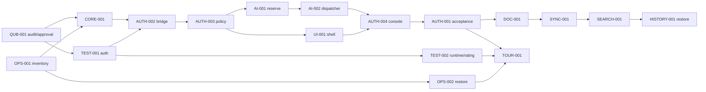

# Roadmap с зависимостями

Статус RECOMMENDED. Сначала owner/default-deny/mock cost guard, затем notes end-to-end. Архитектура не approved; ни одна product task не ready. [20 небольших задач](TASKS.md) и [machine state](tasks.json) — первый backlog, не всё долгосрочное видение.

INK-001 отдельный research track с аппаратным approval; после diagnosis — engine benchmark, adaptive filter, notebook/PDF, web viewer/sync, replay/audio. Он не ждёт всех notes features, но невозможен без реального устройства.

После первого daily-use slice: editor engine POC/Docs beta; Planner shared task model→Kanban/calendar→dependencies/Gantt/recurrence; School manual importer→homework→audio consent/storage→ASR benchmark→ink time binding→study citations/FSRS/math→thermal print. Платные функции после cost guard и отдельного provider acceptance.

Поздние релизы: Teams ACL/share→comments→CRDT→team replay; AI memory inspector→skill proposal sandbox→Hermes; Pulse deterministic dry-run→bounded execution; Plugin SDK/MCP project capsule→marketplace позже; Life key recovery/E2EE→reflection; Finance balanced ledger→Kwork reports; Focus timer→consent Guardian/device POC; Studio/performance animation; open-source dependency/license audit. Все 48 идей и дополнения представлены [требованиями](../product/REQUIREMENTS.md), без удаления.

Не назначаем сроки по числу сгенерированных файлов. Каждая поздняя capability перед реализацией дробится на bounded cycle карточки с файлами/acceptance/командами. Состояния feature backlog не считать ready coding task. Milestone проходит при интегрированном сценарии/проверке данных/UX acceptance, а не закрытых checklist строках.
