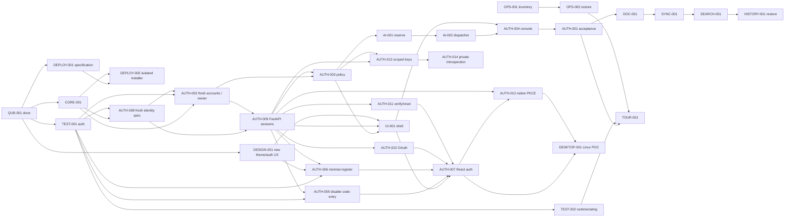
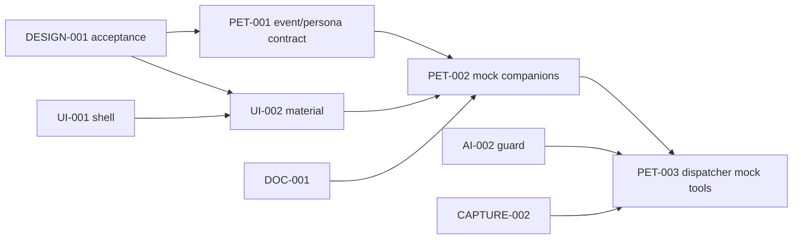

# Roadmap с зависимостями

Базовый стек согласован12.10.2026;13.10 владелец разрешил fresh единый identity/API без переноса аккаунтов/bridge, текущего деплоя нет по его сообщению. [ADR-0013](../architecture/decisions/0013-fresh-identity-and-unified-login.md). Audit/TEST/CORE/DESIGN/AUTH-008 завершены; реестр56:6done/3ready/47backlog; AUTH-002 PG accounts/local owner bootstrap завершена (477 local+CI checks), следующая ready AUTH-009 password/session API. [56 задач](TASKS.md) и [machine state](tasks.json) — текущий backlog, не всё долгосрочное видение.

INK-001 отдельный research track с аппаратным approval; после diagnosis — engine benchmark, adaptive filter, notebook/PDF, web viewer/sync, replay/audio. Он не ждёт всех notes features, но невозможен без реального устройства.

После первого daily-use slice: editor engine POC/Docs beta; Planner shared task model→Kanban/calendar→dependencies/Gantt/recurrence; School manual importer→homework→audio consent/storage→ASR benchmark→ink time binding→study citations/FSRS/math→thermal print. Платные функции после cost guard и отдельного provider acceptance.

Поздние релизы: Teams ACL/share→comments→CRDT→team replay; AI memory inspector→skill proposal sandbox→Hermes; Pulse deterministic dry-run→bounded execution; Plugin SDK/MCP project capsule→marketplace позже; Life key recovery/E2EE→reflection; Finance balanced ledger→Kwork reports; Focus timer→consent Guardian/device POC; Studio/performance animation; open-source dependency/license audit. Все 48 идей и дополнения представлены [требованиями](../product/REQUIREMENTS.md), без удаления.

Не назначаем сроки по числу сгенерированных файлов. Каждая поздняя capability перед реализацией дробится на bounded cycle карточки с файлами/acceptance/командами. Состояния feature backlog не считать ready coding task. Milestone проходит при интегрированном сценарии/проверке данных/UX acceptance, а не закрытых checklist строках.

Клиентский scope утверждён: сайт и общий React desktop UI, Linux release первым; Windows/macOS packaging/sign/tests позже. Android native Ink track развивается параллельно, остальные экраны/hybrid после POC. Новый deploy/qubite2 не заменяет legacy installer до compatibility проверки. Сервер и backup destination отложены до live этапа.

Telegram/observability track: TG-001 parity/questions → TG-002 read-only worker → TG-003 mutations/cutover plan. CORE-001 → OBS-001 contract/collector → ANALYTICS-001 Console/graphs/module split. TG-001 + AUTH-003 → SUPPORT-001. TG ответы получены; готовые specification tracks сохраняются, одна primary задача за цикл. Реальные credentials нужны только отдельному integration acceptance, не проектированию/fixtures.

Shared extraction: fresh identity plan → PG accounts/local bootstrap → FastAPI password/sessions → policy + OAuth/verify/reset/minimal register → React Auth → scoped keys/private introspection/native PKCE → tested consumers. Live account import отсутствует; первый deploy/backup новых данных отдельным release. CORE-002 general/module settings на target core. Полный tournament engine rewrite исключён из текущего roadmap. Capture: TG-002 → CAPTURE-001 durable text → CAPTURE-002 AI routing (после AI guard/Docs); CAPTURE-003 durable voice + STT parallel. Notifications: policy/TG-002 → NOTIFY-001 event/outbox/deep links → NOTIFY-002 daily/critical policies.

## Порядок начала реализации

1. QUB-TEST-001 — первая задача: isolated HTTP characterization старого Auth (register/login/logout/revoke/reset, OAuth mock, блокировки/CSRF). Фиксируем нужную совместимость перед переносом.
2. QUB-CORE-001 — изолированное FastAPI/Postgres ядро: запуск/health/versioned migration/contract checks, без real accounts или записи в legacy SQLite.
3. QUB-DESIGN-001 — visual direction и reviewable Auth/основной navigation UX; затем React shell по dependency gates. На этом шаге не рисовать сразу все поздние модули.
4. QUB-DEPLOY-001 и TG-001 — installer/service manifest specification и bot command/capability parity; доступные дополнительные tracks, без отвлечения от одной primary coding task.
5. Identity plan/protocol → FastAPI sessions/OAuth/reset/register → policy/settings/atomic mock budgets → React shell/Owner Console → целостная access acceptance.
6. Новые сервисы: SVC-SEARCH-001→002, SVC-WRITING-001→002, SVC-VPN-001→002. Каждый сначала contract/parity/API, затем React UI и отдельный tested switch. SEARCH-001 в knowledge track — внутренний поиск документов, другой сервис.
7. Docs/capture/sync/notifications вертикальными slices; desktop/Linux и Android Ink POC по готовым API/UX и device gates. Tournaments low-priority compatibility track, сохраняя старый UI.

QUB-TEST-001 реализована и локально проверена: 25 новых HTTP Auth cases, 357 checks в полном runner+harness. Evidence/commit/remote status: [отчёт](../reports/QUB-TEST-001.md), [handoff](../project/LAST_HANDOFF.md), tasks.json. CORE-001 foundation реализован и локально проверен; DESIGN-001 Material Lab создан, опубликован и принят владельцем13.10.2026: Поток/Игрушечная/Лента/Unbounded/Manrope. Ready означает разрешённую задачу, не готовую функцию; core foundation и account storage существуют, product UI/password/session API пока отсутствуют.

## Milo и помощники — уточнение 12.10.2026

Владелец выбрал пятый стиль Milo; живость нужна во всех controls и переходах, не только у фигур. [Спецификация](../design/MILO_MATERIAL_AND_COMPANIONS.md), [ADR-0011](../architecture/decisions/0011-milo-live-controls.md). DESIGN-001: пять физических вариантов в одной стилистике, strength 0–100, четыре независимых характера; review/testing до новой приёмки. Доступность предыдущей публикации подтверждена владельцем.

Четыре новые backlog карточки, без автоматического approval реализации. Сначала принять материал, затем bounded product UI по прежним policy/identity dependencies. Реальные модели и tool execution требуют отдельных проверок. Реестр56; точные done/ready/backlog в tasks.json. Проверки протокола не означают реализованный Auth.

## Поток и витрина — уточнение 13.10.2026

Flux selected; [компонентный контракт](../design/FLUX_DESIGN_SYSTEM.md), ADR-0012. DESIGN-001 завершён после просмотра версии4 и выбора владельцем Игрушечной, Ленты и Unbounded/Manrope. Production device checks остаются UI-002. AUTH-008 fresh identity specification, затем AUTH-002 accounts/bootstrap и AUTH-009 перед policy/React shell. PET-001/002 содержат edge peek/hidden/contextual appearance/retreat: места/условия выбираются при реализации экранов. Static prototype не финальная IA и не product implementation; UI/AI/deploy gates сохраняются.

13.10.2026, приёмка версии4: **Игрушечная**, DESIGN-001 done. AUTH-008 переработана по последнему сообщению: единый fresh Auth без legacy import/bridge. AUTH-002 — реальная PG identity schema/local owner bootstrap создана в отдельном cycle; далее AUTH-009 — password/login. Ранее review gates Milo — история; никакого server switch/Auth runtime в specification задаче.
