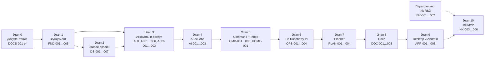

# Дорожная карта Qubite 2.0

Порядок согласован с владельцем ([D-007](../product/DECISIONS.md)): фундамент → живой дизайн → аккаунты и доступ → AI-основа → **Command + Inbox** (первый полезный модуль) → развёртывание → Planner → Docs → клиенты → Ink. Ink-исследование на планшете идёт параллельно с самого начала: перо — самый большой технический риск.

Карточки задач — в [TASKS.md](TASKS.md). Сроков в датах нет: темп зависит от сессий агента и приёмки владельцем.

## 1. Этапы MVP

| Этап | Результат для владельца | Задачи |
|---|---|---|
| **0. Документация** | Понятное ТЗ, план и правила работы | DOCS-001 |
| **1. Фундамент** | Сервер на Rust и web-приложение запускаются одной командой, CI проверяет каждый коммит, есть основа объектов и синхронизации | FND-001…005 |
| **2. Живой дизайн** | Витрина: настоящие живые кнопки, переключатели, ползунки, меню, тёмная тема, новые иконки и логотип, помощники. Оболочка приложения на этих компонентах | DS-001…007 |
| **3. Аккаунты и доступ** | Вход, регистрация по приглашениям, OAuth, права на модули, тумблеры, Owner Console | AUTH-001…006, ACC-001…003 |
| **4. AI-основа** | Подключён OpenRouter, бюджеты в долларах, журнал расходов | AI-001…003 |
| **5. Command + Inbox** | Пишешь или говоришь мысль в нижнее поле, в том числе из Telegram → она во «Входящих» → Qubite предлагает сделать из неё задачу или заметку. Работает офлайн | CMD-001…006, HOME-001 |
| **6. На Raspberry Pi** | Новый Qubite работает рядом со старым, установщик, бэкапы | OPS-001…004 |
| **7. Planner** | Проекты, задачи, Kanban, календарь недели, напоминания | PLAN-001…004 |
| **8. Docs** | Блочные документы, связи, версии, офлайн | DOC-001…005 |
| **9. Клиенты** | Desktop-приложение (Linux), Android-приложение | APP-001…003 |
| **10. Ink** | Рукописные конспекты на планшете с хорошим пером | INK-001…006 |

**MVP готов**, когда владелец неделю пользуется Command, Inbox, Planner, Docs и Ink каждый день и не возвращается к старым инструментам.

## 2. После MVP (P2)

Каждый пункт — эпик. Перед разбивкой на задачи — разговор с владельцем ([D-101](../product/DECISIONS.md)).

| Эпик | Что |
|---|---|
| EPIC-SEARCH | Переписать Search на Rust: веб-поиск с источниками, AI-ответы, интеграция в Command и Docs |
| EPIC-WRITER | Переписать Writer: LanguageTool + AI-правки, расширение браузера, интеграция в Docs |
| EPIC-VPN | Переписать VPN: ноды, подписки, клиент в приложении |
| EPIC-KWORK | Переписать Kwork/Brief/Leads/переговоры на Rust (teloxide + grammers), связать с Projects и Finance |
| EPIC-AGENTS | Настоящие агенты за помощниками: Context Resolver, инструменты, память, Memory Inspector, навыки, Hermes |
| EPIC-ATLAS | Поиск по смыслу (pgvector), граф знаний |
| EPIC-LEARN | Предметы, ДЗ, карточки FSRS, квизы; исследование «Моя школа» |
| EPIC-PULSE | Автоматизации, Automation Discovery, dry-run |
| EPIC-MCP | Собственный MCP-сервер, API-ключи, Context Capsules |
| EPIC-TODAY | Today: виджеты, AI-дайджест, пространства, Progress Digest |
| EPIC-PLANNER-2 | Гант, зависимости, таймтрекинг, Smart Scheduling, Project Autopilot |
| EPIC-DOCS-2 | Вставки Ink, AI-правки, шаблоны, базы данных |
| EPIC-INK-2 | PDF, инструменты, слои, Ink Replay |
| EPIC-CHATGPT | Вход через ChatGPT и личные лимиты (после проверки условий OpenAI) |
| EPIC-2FA | Двухфакторный вход, passkeys |
| EPIC-DESKTOP-2 | Windows, macOS |

## 3. Большие релизы (P3)

| Эпик | Что |
|---|---|
| EPIC-TOURNAMENTS | Переписать турниры модулем Qubite + учебные квизы в духе Quizlet ([D-006](../product/DECISIONS.md)) |
| EPIC-TEAMS | Команды, совместное редактирование, ссылки, гости, голосования |
| EPIC-LIFE | Приватный дневник с шифрованием, Reflection Companion, Time Machine и др. |
| EPIC-FINANCE | Двойная запись, бюджеты, Kwork-доходы, налоги |
| EPIC-FOCUS | Таймер, режим задачи, Guardian |
| EPIC-STUDIO | Рисование и анимация |
| EPIC-PLUGINS | Plugin SDK, песочница, Plugin Studio |
| EPIC-HANDWRITING | Персональный почерк, математика, Visual Math Lab |
| EPIC-AUDIO | Запись уроков, ASR, связь аудио и штрихов |
| EPIC-QUBITE-HOME | Qubite Home: умный дом на Home Assistant + Shade AI, Qubite как интерфейс и источник данных ([QUBITE_HOME](../product/QUBITE_HOME.md)) |
| EPIC-VAULT | Менеджер паролей |
| EPIC-OPENSOURCE | Лицензии, публичный релиз |

Полный перечень 48 идей и их место — [REQUIREMENTS](../product/REQUIREMENTS.md) (колонка «Источник», `I-NN`).
