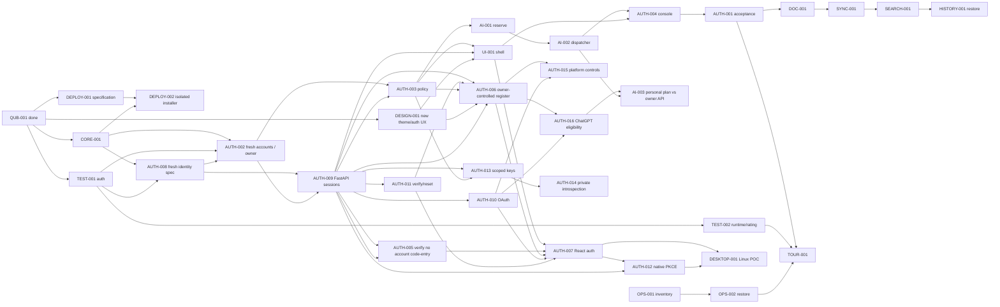
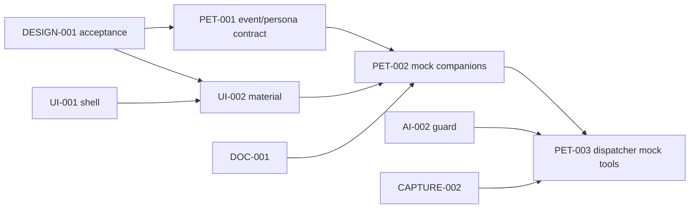

# Текущий цикл AI-001, 14.10.2026

Вопросы и ответы получены: USD/full caps/configurable timezone initially Екатеринбург. Реализуется internal mock accounting core0.8.0/0009; local61pass/regression1069pass, browser86pass; exact-SHA CI pending. Затем **AI-002** mock dispatcher/revoke/crash/fallback; затем **AUTH-004** Console users/grants/budgets. Новые вопросы перед каждой следующей задачей. [Report](../reports/QUB-AI-001.md)/[handoff](../project/LAST_HANDOFF.md). Старые snapshots ниже исторические.

# Следующий цикл после UI-003, 14.10.2026

apps/web0.4.0: выбранный Поток, отдельный Auth и server catalog/shared owner visibility. Core0.7.0/schema0008_catalog, no module/AI grant from visibility. [Отчёт](../reports/QUB-UI-003.md), [handoff](../project/LAST_HANDOFF.md), tasks.json содержат фактические проверки/CI.

Primary next **QUB-AI-001**: атомарный budget reservation только с synthetic/mock провайдерами, integer limits/idempotency/parallel cap. Затем **QUB-AI-002** crash/revoke/fallback, затем **AUTH-004** полная users/grants/budgets Owner Console, зависящая от UI-003 и AI-002. Вопросы перед каждым, текущий approval не разрешает следующий scope. До этого paid AI остаётся закрытым даже owner.

QUB-LEGAL-001 до публичной регистрации, AUTH-012/native POC, реальные SMTP/providers и ingress — отдельные задачи. DEPLOY-001→002 disposable dry-run без публичного запуска; production отложен до checks/backup/approval. Alternative ready CORE-002/AUTH-013/DEPLOY-001/TG-001 не стартуют автоматически.

## Исторические snapshots порядка задач

Дальнейшие датированные записи сохранены для истории; следующие задачи определяются верхним блоком и актуальным registry.

# Актуальный порядок13.10.2026

Завершён QUB-REPO-001: source relocation/legacy isolation/docs/env/harness, без переписи нового runtime. Затем **обсудить UI-001** shell и AUTH-007 auth screens. Не начинать следующую задачу без новых вопросов/ответов. Все зависимости/статусы в tasks.json; старые snapshots ниже исторические.

Service tracks: SVC-SEARCH-000→001→002, SVC-WRITING-000→001→002, SVC-VPN-000→001→002; Brief/Kwork/Knowledge каждый отдельное000 discovery с владельцем. Старый смысл — reference, сценарии/UI/API проектировать заново, общие Objects/Docs/Projects/Inbox/Command и core API. SiYuan excluded. Tournaments independent optional, без SSO/core integration, отдельный install/release после TEST-002 и DEPLOY-001. Поддомены всех модулей; core/shared React общие.

Deploy track DEPLOY-001→002: новые install.sh/selectable modules/subdomains/backup/rollback/explicit owner CLI; DEPLOY-003 после Console — restricted operator module installation. Legacy installer теперь только legacy/qubite-v1/deploy. Filled deploy/.env сохранён, новый root template separate. [Решение](../architecture/decisions/0021-repository-layout-and-standalone-tournaments.md).

# Roadmap с зависимостями

**AUTH-00613.10.2026 — done:** core0.6.0/current0007_registration; owner-controlled invite/default/public/disabled API, оба одноразовых invite, strict minimal enrollment/consents, pending→email verify→login, no module/AI grants. [Контракт](../architecture/REGISTRATION.md), [отчёт](../reports/QUB-AUTH-006.md), [ADR-0020](../architecture/decisions/0020-owner-controlled-registration.md). Вопросы заданы и ответы получены до реализации. React controls/mail/legal/deploy отдельно. AUTH-015 глобальные switches, AUTH-016 ChatGPT eligibility/identity, AI-003 personal plan vs owner API сохранены в backlog. Далее обсудить UI-001 shell, затем AUTH-007 auth UI; перед каждым task снова вопросы. Implementation2035e1e / CI38390796988 exact SHA success11:36:36UTC;969 local+CI checks. Current evidence в tasks.json/LAST_HANDOFF, milestones ниже исторические.

**AUTH-005, 13.10.2026 — done:** согласованная проверка существующего входа email/password без account code-entry. [Границы API](../architecture/ACCOUNT_LOGIN.md), [отчёт](../reports/QUB-AUTH-005.md), [ADR-0019](../architecture/decisions/0019-account-login-boundary.md). Core0.5.0/schema0006_policy и runtime без изменений; old routes404/strict DTO, email proofs отдельно, shared/personal tournament join сохранён. Local+CI all892+harness6=898pass; implementationcf302d9 / CI38385240872 completed-success10:47:23UTC. Далее AUTH-006 минимальная регистрация; сначала вопросы и ответы владельца. Предыдущие milestones ниже исторические, актуальный статус в tasks.json/LAST_HANDOFF.

**AUTH-00313.10.2026 — done:** core0.5.0/schema0006_policy; раздельные ручные module/action grants, workspace/resource intersection, owner-only metadata commands с If-Match/idempotency/reauth/audit. Общий REST/job/tool/WS gate, live revoke/session/expiry/version; paid AI закрыт до AI-001/002. [Контракт](../architecture/POLICY_GATE.md), [отчёт](../reports/QUB-AUTH-003.md). Только аккаунт до grants подтверждено владельцем; перед каждой будущей задачей сначала вопросы и ответы. UI/registration/real modules/installer/native/provider/deploy отдельно. Final local+CI all844+harness6=850pass; implementationd4c813e/CI38381905595 completed-success10:17:52UTC. Registry56:10done/4ready/42backlog, evidence в tasks.json/LAST_HANDOFF. Прежние snapshots ниже исторические.

**AUTH-01113.10.2026 done:** core0.4.0/schema0005 verify/reset и mock-only delivery; email-2FA contract-only, registration/policy/UI/native/deploy отдельные. [EMAIL_CHALLENGES](../architecture/EMAIL_CHALLENGES.md), [AUTH-011 report](../reports/QUB-AUTH-011.md), [ADR-0017](../architecture/decisions/0017-email-challenges-and-recovery.md). Final local+CI762 passed; implementationf3d4b6c/CI38373075395 success; прежние snapshots ниже исторические. Registry56:9done/2ready/45backlog. Далее ready DEPLOY-001/TG-001, не начинать новый task в том же cycle.

Базовый стек согласован12.10.2026, fresh единый identity/API13.10 по [ADR-0013](../architecture/decisions/0013-fresh-identity-and-unified-login.md). Завершены audit/TEST/CORE/DESIGN/AUTH-008/002/009, AUTH-010 OAuth done (implementationd93affa/CI38364255314 success/697 local+CI checks), реестр56:8done/3ready/45backlog; ready AUTH-011 verify/reset, DEPLOY-001/TG-001 альтернативные tracks. Core0.3.0/schema0004, [OAuth](../architecture/OAUTH_IDENTITY.md)/[evidence](../reports/QUB-AUTH-010.md); real providers/React/native/services/deploy отдельно. Точные56статусов/commits — [tasks.json](tasks.json), [карточки](TASKS.md), не всё долгосрочное видение.

INK-001 отдельный research track с аппаратным approval; после diagnosis — engine benchmark, adaptive filter, notebook/PDF, web viewer/sync, replay/audio. Он не ждёт всех notes features, но невозможен без реального устройства.

После первого daily-use slice: editor engine POC/Docs beta; Planner shared task model→Kanban/calendar→dependencies/Gantt/recurrence; School manual importer→homework→audio consent/storage→ASR benchmark→ink time binding→study citations/FSRS/math→thermal print. Платные функции после cost guard и отдельного provider acceptance.

Поздние релизы: Teams ACL/share→comments→CRDT→team replay; AI memory inspector→skill proposal sandbox→Hermes; Pulse deterministic dry-run→bounded execution; Plugin SDK/MCP project capsule→marketplace позже; Life key recovery/E2EE→reflection; Finance balanced ledger→Kwork reports; Focus timer→consent Guardian/device POC; Studio/performance animation; open-source dependency/license audit. Все 48 идей и дополнения представлены [требованиями](../product/REQUIREMENTS.md), без удаления.

Не назначаем сроки по числу сгенерированных файлов. Каждая поздняя capability перед реализацией дробится на bounded cycle карточки с файлами/acceptance/командами. Состояния feature backlog не считать ready coding task. Milestone проходит при интегрированном сценарии/проверке данных/UX acceptance, а не закрытых checklist строках.

Клиентский scope утверждён: сайт и общий React desktop UI, Linux release первым; Windows/macOS packaging/sign/tests позже. Android native Ink track развивается параллельно, остальные экраны/hybrid после POC. Новый deploy/qubite2 не заменяет legacy installer до compatibility проверки. Сервер и backup destination отложены до live этапа.

Telegram/observability track: TG-001 parity/questions → TG-002 read-only worker → TG-003 mutations/cutover plan. CORE-001 → OBS-001 contract/collector → ANALYTICS-001 Console/graphs/module split. TG-001 + AUTH-003 → SUPPORT-001. TG ответы получены; готовые specification tracks сохраняются, одна primary задача за цикл. Реальные credentials нужны только отдельному integration acceptance, не проектированию/fixtures.

Shared extraction: fresh identity plan → PG accounts/local bootstrap → FastAPI password/sessions → policy + OAuth/verify/reset/minimal register → React Auth → scoped keys/private introspection/native PKCE → tested consumers. Live account import отсутствует; первый deploy/backup новых данных отдельным release. CORE-002 general/module settings на target core. Полный tournament engine rewrite исключён из текущего roadmap. Capture: TG-002 → CAPTURE-001 durable text → CAPTURE-002 AI routing (после AI guard/Docs); CAPTURE-003 durable voice + STT parallel. Notifications: policy/TG-002 → NOTIFY-001 event/outbox/deep links → NOTIFY-002 daily/critical policies.

## Порядок начала реализации

1. QUB-TEST-001 — первая задача: isolated HTTP characterization старого Auth (register/login/logout/revoke/reset, OAuth mock, блокировки/CSRF). Фиксируем нужную совместимость перед переносом.
2. QUB-CORE-001 — изолированное FastAPI/Postgres ядро: запуск/health/versioned migration/contract checks, без real accounts или записи в legacy SQLite.
3. QUB-DESIGN-001 — visual direction и reviewable Auth/основной navigation UX; затем React shell по dependency gates. На этом шаге не рисовать сразу все поздние модули.
4. QUB-DEPLOY-001 и TG-001 — installer/service manifest specification и bot command/capability parity; доступные дополнительные tracks, без отвлечения от одной primary coding task.
5. Identity plan/protocol → FastAPI sessions/OAuth/reset/register → policy/settings/atomic mock budgets → React shell/Owner Console → целостная access acceptance.
6. Новые сервисы: SVC-SEARCH-001→002, SVC-WRITING-001→002, SVC-VPN-001→002. Каждый сначала contract/parity/API, затем React UI и отдельный tested switch. SEARCH-001 в knowledge track — внутренний поиск документов, другой сервис.
7. Docs/capture/sync/notifications вертикальными slices; desktop/Linux и Android Ink POC по готовым API/UX и device gates. Tournaments low-priority compatibility track, сохраняя старый UI.

QUB-TEST-001 реализована и локально проверена: 25 новых HTTP Auth cases, 357 checks в полном runner+harness. Evidence/commit/remote status: [отчёт](../reports/QUB-TEST-001.md), [handoff](../project/LAST_HANDOFF.md), tasks.json. CORE-001 foundation реализован и локально проверен; DESIGN-001 Material Lab создан, опубликован и принят владельцем13.10.2026: Поток/Игрушечная/Лента/Unbounded/Manrope. Ready означает разрешённую задачу, не готовую функцию; core foundation/account storage/Web Auth существуют; OAuth добавлен AUTH-010; product UI/reset/native/policy отдельными задачами.

## Milo и помощники — уточнение 12.10.2026

Владелец выбрал пятый стиль Milo; живость нужна во всех controls и переходах, не только у фигур. [Спецификация](../design/MILO_MATERIAL_AND_COMPANIONS.md), [ADR-0011](../architecture/decisions/0011-milo-live-controls.md). DESIGN-001: пять физических вариантов в одной стилистике, strength 0–100, четыре независимых характера; review/testing до новой приёмки. Доступность предыдущей публикации подтверждена владельцем.

Четыре новые backlog карточки, без автоматического approval реализации. Сначала принять материал, затем bounded product UI по прежним policy/identity dependencies. Реальные модели и tool execution требуют отдельных проверок. Реестр56; точные done/ready/backlog в tasks.json. Проверки протокола не означают реализованный Auth.

## Поток и витрина — уточнение 13.10.2026

Flux selected; [компонентный контракт](../design/FLUX_DESIGN_SYSTEM.md), ADR-0012. DESIGN-001 завершён после просмотра версии4 и выбора владельцем Игрушечной, Ленты и Unbounded/Manrope. Production device checks остаются UI-002. AUTH-008 fresh identity specification, затем AUTH-002 accounts/bootstrap и AUTH-009 перед policy/React shell. PET-001/002 содержат edge peek/hidden/contextual appearance/retreat: места/условия выбираются при реализации экранов. Static prototype не финальная IA и не product implementation; UI/AI/deploy gates сохраняются.

13.10.2026, приёмка версии4: **Игрушечная**, DESIGN-001 done. AUTH-008 переработана по последнему сообщению: единый fresh Auth без legacy import/bridge. AUTH-002 — реальная PG identity schema/local owner bootstrap создана в отдельном cycle; далее AUTH-009 — password/login. Ранее review gates Milo — история; никакого server switch/Auth runtime в specification задаче.
