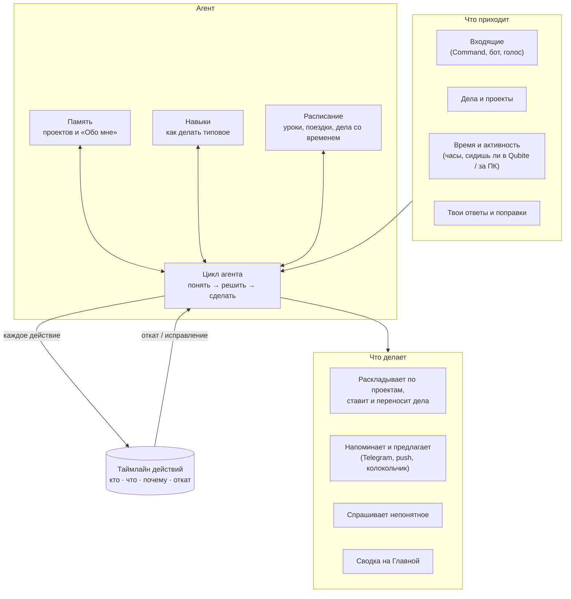
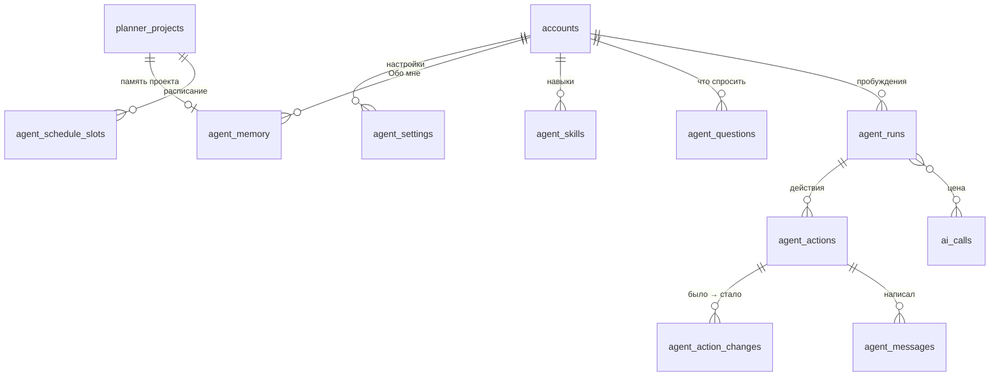

# Агент Qubite — «умный планер»

**Статус:** описание (AGT-000, 20.10.2026). Сделан таймлайн с откатом (AGT-002, [D-300…D-309](DECISIONS.md)); память, навыки и сам AI — дальше. Решения владельца — [D-290…D-299](DECISIONS.md), открытые вопросы — Q-63…Q-66 в [STATUS](../project/STATUS.md). Задачи — AGT-001…AGT-004 и связанные с ними в [TASKS](../plan/TASKS.md).

Этот документ уточняет [архитектуру агентов](../architecture/AI_AGENTS_MEMORY_SKILLS.md) для главного сценария Qubite. Где они расходятся, прав этот документ: владелец решил, что агент действует сам, без подтверждения, но каждое его действие можно откатить ([D-293](DECISIONS.md)).

## 1. Идея простыми словами

Qubite — не планер, который звенит в назначенное время. Это **помощник, который понимает записи** и сам решает, когда о чём напомнить.

| Ты пишешь | Обычный планер | Qubite |
|---|---|---|
| «Сделать свой язык программирования» (без срока) | Дело без даты теряется в списке | Никуда не ставит. Когда у тебя свободное время, вспоминает: «Помнишь, ты говорил про свой язык? Есть полчаса, давай разберём». |
| «Сходить в музей в субботу в 14:00» | Звонит в 14:00 | Знает, что дорога занимает около часа (или спросит), и пишет заранее: «Через 15 минут выходить в музей». |
| «ДЗ по русскому: упр. 145» | Срок «завтра» по умолчанию | Знает из памяти проекта «Русский», что следующий урок в четверг. В свободное время до урока предлагает: «Давай сделаем ДЗ по русскому, 20 минут». |
| «Русский — по вт и чт третьим уроком, учительница строгая к оформлению» | Некуда записать | Запоминает в память проекта «Русский». Расписание становится частью расчётов, а правило про оформление — частью подсказок. |

Чего агент не знает, он спрашивает сам: в утренней сводке на Главной или когда у тебя есть минута («Во сколько у тебя кончаются уроки по средам?»).

## 2. Из чего состоит



Агент — не отдельная постоянно работающая программа. Это задача в общей очереди сервера ([FND-004](../plan/TASKS.md), `jobs`), которая просыпается по событию и засыпает (§7). Все вызовы модели идут через готовый AI-шлюз с бюджетом (§10).

## 3. Память

> **Уточнено 20.10.2026 ([D-320…D-326](DECISIONS.md)):** память — это **папка файлов агента** у каждого человека: «Кто я» (ядро), «О тебе», «Память» (факты + оглавление), «Проекты», «Навыки» и свои файлы агента; расписание — файл «Расписание.md», а не отдельная таблица. Ниже — исходное описание; задача AGT-001 перепишет раздел.

Образец — Hermes Agent (§12): короткая память, которую агент **сам** пишет и чистит, плюс поиск по всей истории, когда нужно что-то старое.

### 3.1. Какие бывают

| Память | Где | Что внутри | Пример |
|---|---|---|---|
| **Обо мне** | одна на человека | Привычки, режим дня, дорога, город, как с тобой говорить | «Ложусь около 23:00. До школы 25 минут пешком. Не любит длинные сообщения». |
| **Память проекта** | своя у каждого проекта | Что за проект, правила, люди, расписание словами, итоги, открытые вопросы | «Русский: уроки вт и чт, 3-й урок. Учительница — Ирина Петровна, строгая к оформлению. ДЗ сдаём в тетради». |
| **Расписание** | строками в базе (не текстом) | Повторяющиеся слоты: день недели, время, длительность, место, проект | «вт 10:05–10:50, школа, Русский». Нужно, чтобы считать свободное время и «до следующего урока». |
| **История** | таймлайн и события ядра | Всё, что было сделано и сказано | Ищется по запросу («что я решил про олимпиаду в сентябре?»), в каждый запрос не попадает. |

### 3.2. Как устроена память проекта

- Это **Markdown-файл** (владелец: «MD-файлы»). Его можно открыть в проекте («Память»), прочитать, поправить руками, скачать как `.md`.
- Внутри разделы: `## Что это`, `## Расписание`, `## Правила и привычки`, `## Люди`, `## Итоги`, `## Не знаю — спросить`. Агент может добавлять свои разделы.
- **Короткая:** «Обо мне» — до ~2 000 знаков, проект — до ~3 000 (как у Hermes: 2 200 и 1 375). Короткая память целиком помещается в каждый запрос и стоит мало. Не хватает места — агент сам сжимает и убирает устаревшее. Старое не теряется: оно остаётся в таймлайне.
- Запись — небольшими правками («добавить строку», «заменить строку», «убрать строку»), не переписыванием файла целиком. Каждая правка — действие в таймлайне (§5), её видно и можно откатить.
- **Что запоминать:** то, что ты рассказал о себе и проектах; твои поправки («не ставь мне дела на воскресенье»); итоги («олимпиада: прошёл во второй тур»). **Что не запоминать:** то, что и так есть в делах и документах; одноразовое; пароли, коды, номера карт (агент их вычёркивает, §11).

### 3.3. Как агент узнаёт новое

1. **Ты рассказываешь** в Command, в боте или в ответ на вопрос: «русский — по вт и чт» → агент записывает в память «Русского» и добавляет слоты в расписание.
2. **Агент замечает сам** после разговора или дела, например «третий раз переносишь английский с понедельника». Тогда он записывает наблюдение с пометкой «заметил» и может спросить: «Перенести английский с понедельника насовсем?»
3. **Агент спрашивает.** Всё непонятное копится в разделе «Не знаю — спросить» и в общем списке вопросов (§8).

## 4. Навыки

Навык — это **записанный способ** делать типовое дело. Его агент пишет сам, по образцу Hermes ([D-292](DECISIONS.md)).

- **Пример.** Навык «ДЗ по русскому»: «1) посмотреть, когда следующий урок; 2) оценить время: упражнение — 20 мин, сочинение — 60; 3) предложить в свободное окно за день до урока, не в день урока; 4) напомнить про оформление (правило из памяти)».
- **Когда появляется:** (1) ты поправил агента («нет, ДЗ делаю вечером накануне, не утром»); (2) агент сделал многошаговое дело, и оно удалось; (3) одно и то же повторилось три раза.
- **Как уточняется:** при поправке агент правит **одну строку** навыка, а не переписывает его. Это видно в таймлайне: «Навык “ДЗ по русскому”: “утром” → “вечером накануне” — потому что ты поправил 20.10».
- **Формат:** Markdown с шапкой, совместимый с [SKILL.md](https://agentskills.io) (как у Hermes): `name`, `description`, `version`, `tools` (какими инструментами пользуется), дальше разделы «Когда», «Как», «Подводные камни», «Как проверить». Навыки можно выгрузить и загрузить.
- **Уборка («куратор»):** навык, которым не пользовались 30 дней, уходит в архив (не удаляется, возвращается одной кнопкой). Закреплённые навыки не трогаются.
- **Границы:** навык описывает, **как** пользоваться разрешёнными инструментами. Он не может дать агенту новый инструмент, право или доступ к чужим данным. Свои правила безопасности, права и код агент не меняет ([AI_AGENTS_MEMORY_SKILLS §5](../architecture/AI_AGENTS_MEMORY_SKILLS.md)).
- Навыки в каталоге: встроенные (пишем мы, проверены тестами), свои (написал агент для тебя). Чужие навыки из интернета — позже и только после проверки.

## 5. Таймлайн действий — как git

Владелец: «без “да” агент может всё, но каждое действие в таймлайне, как в git: видно, кто что сделал, любое можно откатить или исправить» ([D-293](DECISIONS.md)).

### 5.1. Что видно

Лента в Qubite («Что сделал агент»), у проекта и у дела — своя часть ленты:

```
20.10 08:12  Агент   Разложил мысль «упр. 145 по русскому» → дело в «Русский», срок чт      [Откатить] [Исправить]
                     почему: в памяти «Русский» урок по чт; навык «ДЗ по русскому»
20.10 08:12  Агент   Память «Русский»: + «ДЗ дают в тетради»                               [Откатить]
20.10 17:40  Агент   Написал в Telegram: «Есть 20 минут? Давай ДЗ по русскому»              —
20.10 17:41  Ты      Ответил «позже» → агент перенёс предложение на 19:00
20.10 21:05  Ты      Откатил: «Перенёс “Музей” на воскресенье»
```

- **Кто:** агент (с навыком, если он был), ты, система (повторение, бот).
- **Что:** понятной фразой и точными изменениями «было → стало» (для отката).
- **Почему:** одна строка, на что агент опирался (память, навык, расписание, твоя просьба). Ссылки ведут туда.
- **Цена:** сколько стоил AI-вызов (из AI-шлюза), если он был.

### 5.2. Откат и исправление

- **Откатить** — как `git revert`. Агент не стирает историю, а делает обратное действие. Оно тоже попадает в ленту («Ты откатил …»). Откатить можно и сам откат.
- **Конфликт.** Если после действия агента дело меняли (ты передвинул срок ещё раз), откат не затирает молча. Он показывает три значения (было, сделал агент, сейчас) и спрашивает, как в черновиках Owner Console ([D-233](DECISIONS.md)).
- **Пакет.** Одно решение агента может состоять из нескольких шагов (разложил мысль: создал дело + связь + правка памяти). Они откатываются вместе одной кнопкой.
- **Исправить** — поменять результат руками («не в чт, а в ср»). Это действие твоё, и для агента это **поправка**: он учится на ней (память или навык, §3–4).
- **Что откатить нельзя:** отправленное сообщение уже прочитано. Откат такого действия только отменяет то, что было запланировано следом («напомнить ещё раз»).

### 5.3. Что агенту нельзя без «да»

Всё перечисленное ниже агент только **предлагает**, а делаешь ты (список — ответ владельца на Q-66, [D-305](DECISIONS.md)):

- удалить навсегда (агент только кладёт в корзину, откуда достаётся);
- потратить деньги сверх лимитов AI-шлюза (это и так невозможно, D-173);
- написать **другому человеку** от твоего имени;
- менять права, Owner Console, тумблеры платформы, безопасность и вход;
- отметить дело «сделано» за тебя (он может спросить «сделал?» и отметить по ответу);
- делать что-то по просьбе, найденной **внутри** чужого текста (письмо, сайт, пересланное сообщение): такие тексты — данные, не команды (AI-002).

## 6. Свободное время

Агент предлагает дела, когда у тебя есть время, а не в назначенный час ([D-295](DECISIONS.md)).

1. **Расписание и дела.** Уроки и другие слоты из расписания, дела со временем, дорога (из памяти «Обо мне» или спросить). Между ними — окна.
2. **Активность.** Сидишь в Qubite (вкладка открыта и ты что-то делал за последние минуты), за ПК (позже, через Desktop — APP-001, вопрос Q-65), отвечаешь в боте. Это значит «на связи». Долгая тишина значит «занят или спит».
3. **Спросить.** Если окно похоже на свободное, агент спрашивает: «Есть 30 минут?» Кнопки: «Да» · «15 минут» · «Позже» · «Не сегодня». По ответу он предлагает подходящее дело или идею без срока (§1).
4. **Запоминает закономерности** в «Обо мне»: «по вторникам после 17:00 обычно свободен», «в воскресенье утром не трогать».

Что предложить в окно: сначала то, у чего ближе срок или следующий урок (ДЗ), потом важное, потом идеи без срока, которые давно не вспоминали. Длинное дело агент разбивает на шаг под размер окна.

## 7. Когда агент пишет первым

### 7.1. Сколько

Настройка «Как часто писать первым» ([D-294](DECISIONS.md)):

- **Число в день** (например, до 3);
- **«Сколько Qubite захочет»**: агент сам решает и учится по ответам («позже», «не сегодня» значат «реже»);
- **«Вообще не писать»**: только напоминания, которые ты поставил сам, сводка на Главной и колокольчик.

По умолчанию — «сколько Qubite захочет» (ответ на Q-63, [D-309](DECISIONS.md)). **Напоминания, которые ты попросил сам** («напомни в 7»), в этот лимит не входят и приходят всегда.

### 7.2. Тишина

Агент не пишет первым:

- **ночью** (часы — настройка, по умолчанию 23:00–08:00 — D-309);
- **на уроках** и в других слотах расписания с пометкой «не беспокоить» (урок, тренировка, сон);
- **в фокусе** (когда появится Focus);
- сразу после «не сегодня» — до завтра.

Что накопилось за время тишины, агент кладёт в колокольчик и в утреннюю сводку, а не присылает пачкой. Твоё напоминание со временем приходит и в тишину: ты сам его поставил.

### 7.3. Когда агент просыпается

Не постоянно, а по поводу (так дешевле):

- новая мысль во Входящих → разложить (CMD-004);
- утро → сводка на Главную и вопросы дня (HOME-001);
- приближается срок, урок или выход из дома → напоминание (PLAN-004);
- похоже на свободное окно (§6) → может спросить;
- ты ответил или поправил → обновить память или навык;
- раз в неделю → уборка памяти и навыков (§4).

## 8. Как и когда агент спрашивает

- Вопросы копятся в одном списке «Агент хочет знать» с пометкой, к какому проекту относятся.
- **Где задаёт:** в утренней сводке на Главной (1–3 вопроса), в свободное окно, к месту («Ты добавил “контрольная по алгебре” — это в четверг на уроке?»).
- Отвечать можно кнопкой, если вариантов немного, или словами в Command или боте. Ответ записывается в память и в таймлайн.
- Каждый вопрос задаётся не чаще раза в неделю. Пропущенный вопрос агент переформулирует или отпускает.
- Если без ответа никак (неясно, что за дело), агент делает самое безопасное: кладёт в «посмотри сам» во Входящих (D-199), а не угадывает.

## 9. Каналы

| Канал | Когда | Что есть |
|---|---|---|
| **Колокольчик в Qubite** | Всегда: всё, что агент написал или сделал, лежит здесь | Нужно сделать (центр уведомлений в web) |
| **Push в браузере** | Qubite закрыт или вкладка не видна | Нужно сделать: Web Push (service worker, ключи VAPID), разрешение браузера |
| **Telegram-бот** | Важное и напоминания, если push нет или ты не в Qubite; ответы кнопками прямо в чате | Бот есть (CMD-006): сейчас он принимает мысли и шлёт уведомления владельцу |

**Почты нет** ([D-296](DECISIONS.md)). Одно сообщение не дублируется в несколько каналов: если ты открыл его в одном, в другом оно гаснет. Какие каналы для чего — настройка: «напоминания — в Telegram», «предложения — только колокольчик».

## 10. Как это ложится на готовое

| Уже есть | Что агент берёт |
|---|---|
| **AI-шлюз** (AI-001/002/004) | Все вызовы модели: бюджет, резерв, повторы, `unknown`, модели по задачам (`ai use … --task agent.*`), защита от зацикливания (запросов в минуту на фоновую задачу). Для агента — свои задачи-модели: `agent.triage`, `agent.plan`, `agent.chat`, `agent.review` (уборка). |
| **ChatGPT по подписке** (AI-005) | На нём владелец тестирует агента ([D-299](DECISIONS.md)). Подписка — только для запросов самого владельца, а агент работает на владельца с его данными, это его запросы (D-219). У других людей агент работает на их лимитах AI. |
| **Бюджеты** (D-173, D-212) | У агента свой дневной потолок внутри лимита человека. Кончился — агент молчит и работает без AI: напоминания по времени и расписанию идут всё равно. |
| **Policy Gate** (ACC-001) | Агент действует **от имени человека** с правами не больше его прав и только через свои инструменты (§13). Модуль `agent` в каталоге: без гранта агента нет, а Qubite работает как обычный планер. В Console и в чужие данные агент не ходит. |
| **Входящие** (CMD-001/003/007) | Разбор без AI (CMD-003) — первый шаг, он бесплатный. Агент добавляет понимание: проект, связь с уроком, срок «до следующего урока», идея без срока. Разложенное сразу уходит на место, а во Входящих остаётся пометка «разложил → Русский · дело на чт» с кнопкой «Откатить». |
| **Дела и проекты** (PLAN-001) | Агент создаёт и меняет их через ту же синхронизацию, что и экраны (D-260). Поэтому всё сразу видно на всех устройствах и работает с офлайн-правками. |
| **Ядро объектов** (FND-004) | События (`events`) и аудит — основа таймлайна; связи `derived_from`, `part_of` — «почему». Память и навыки — объекты ядра, поэтому синхронизируются и ищутся. |
| **Бот** (CMD-006) | Канал «Telegram» и ответы кнопками. |

## 11. Схема данных

Названия черновые, точные — в задачах AGT-001…004. Уже есть (AGT-002, миграция `0023_agent.sql`): `agent_runs`, `agent_actions` (без `status`: «откачено» считается по `reverts`, D-303; плюс `corrects` — поправка), `agent_action_changes` (снимки объекта до и после, `project_ids` для ленты проекта).



| Таблица | Главное | Зачем |
|---|---|---|
| `agent_settings` | `account_id`, `initiative` (`per_day` + число / `auto` / `off`), тихие часы, каналы по видам, город, `enabled` | Настройки §7, §9 |
| `agent_memory` | объект ядра `agent.memory`: `scope` (`user` / `project`), `project_id`, `body_md`, `revision`, лимит знаков | «Обо мне» и память проекта (§3); история правок — через `events` |
| `agent_schedule_slots` | `project_id`, `weekday`, `starts_at`, `ends_at`, `place`, `do_not_disturb`, `valid_from` / `valid_to` (четверть, каникулы) | Расписание (§3.1, §6) |
| `agent_skills` | объект ядра `agent.skill`: `name`, `body_md` (формат SKILL.md), `version`, `origin` (`builtin` / `agent` / `import`), `pinned`, `last_used_at`, `uses`, `archived_at` | Навыки (§4) |
| `agent_questions` | `project_id`, `text`, `options`, `asked_at`, `asked_count`, `answered_at`, `answer` | «Агент хочет знать» (§8) |
| `agent_runs` | `id`, `trigger` (`inbox` / `morning` / `window` / `reply` / `review`), `started_at`, `finished_at`, `status`, `model`, ссылки на `ai_calls` | Одно пробуждение (§7.3), его цена |
| `agent_actions` | `id`, `run_id`, `actor` (`agent` / `owner` / `system`), `skill_id`, `tool`, `summary` (фраза), `reason`, `batch_id`, `status` (`applied` / `reverted` / `conflict`), `reverts` (id), `at` | Лента таймлайна (§5) |
| `agent_action_changes` | `action_id`, `object_id`, `before` (jsonb), `after` (jsonb), `object_revision` | Точный откат и проверка конфликта |
| `agent_messages` | `action_id`, `channel` (`bell` / `push` / `telegram`), `text`, `buttons`, `sent_at`, `seen_at`, `answer` | Что и куда агент написал, был ли ответ; дедупликация каналов (§9) |
| `push_subscriptions` | `account_id`, `endpoint`, ключи, устройство, `created_at` | Web Push (§9) |

Правила для всех таблиц:

- Всё — **по человеку** (`account_id`), за Policy Gate. Чужую память агент не видит.
- `agent_actions` и `agent_action_changes` — **только дописываются** (как `events` и `audit_log`). Откат — новая строка, а не правка старой.
- Перед записью в память агент вычёркивает пароли, коды, номера карт и т. п. Текст из Входящих в память попадает пересказом с пометкой источника, а не как команда.

## 12. Что взяли у Hermes Agent

[Hermes Agent](https://hermes-agent.nousresearch.com/docs) (Nous Research, открытый код) — агент, который учится на работе. Что берём и что меняем:

| У Hermes | В Qubite |
|---|---|
| Две короткие памяти: `MEMORY.md` (заметки агента, ~2 200 знаков) и `USER.md` (о человеке, ~1 375); целиком в каждом запросе | «Обо мне» + **своя память у каждого проекта** (владелец хочет MD на проект); в запрос попадают «Обо мне» и память нужного проекта, а не всех |
| Память пишется правками `add` / `patch` / `remove`, переполнение — ошибка, агент сам сжимает | Так же; каждая правка — строка в таймлайне с откатом |
| Фоновый «разбор» после разговора решает, что запомнить и какой навык обновить; может идти на дешёвой модели | Так же: задача `agent.review` на дешёвой модели, после разговора и раз в неделю |
| Навыки — `SKILL.md` (agentskills.io), появляются после сложного дела, тупика или **поправки человека**, правятся точечно (`patch`) | Так же, плюс наши границы: навык не даёт прав и инструментов |
| Куратор: неиспользуемые навыки — «устарел» через 14 дней, в архив через 30, закреплённые не трогает, перед слиянием — снимок и откат | Архив через 30 дней, закрепление, возврат одной кнопкой; слияние навыков — позже |
| Журнал изменений навыков с откатом одной записи | Обобщили на **все** действия агента — таймлайн (§5) |
| Поиск по всем прошлым разговорам (FTS) | Поиск по таймлайну и объектам ядра (FTS PostgreSQL, D-243) |
| Расписание (cron) с доставкой в мессенджеры, 20+ каналов | Свои поводы проснуться (§7.3) и три канала (§9); тишина и лимит «писать первым», которых у Hermes нет |
| Подтверждение записей в память — настройка, по умолчанию выключено | Подтверждения нет (D-293), вместо него — откат |

Что **не** берём: запуск команд на компьютере, доступ к файлам и терминалу, чужие навыки из интернета без проверки, собственное приложение и «личность» агента отдельно от Qubite. Hermes как внешний исполнитель задач — по-прежнему позже ([AI_AGENTS_MEMORY_SKILLS §6](../architecture/AI_AGENTS_MEMORY_SKILLS.md)).

## 13. Инструменты агента

Агент действует **только** этими инструментами. Каждый проверяет права (Policy Gate) и пишет действие в таймлайн. Читающие инструменты в таймлайн не пишут.

| Инструмент | Что делает | Пишет в таймлайн |
|---|---|---|
| `inbox.list`, `inbox.read` | Новые мысли и их разбор без AI (CMD-003) | — |
| `inbox.file` | Разложить мысль: в дело, заметку, проект, «идею без срока»; мысль — в архив | да |
| `inbox.needs_review` | Отложить в «посмотри сам» с вопросом | да |
| `project.list`, `project.get` | Проекты и их память | — |
| `project.create`, `project.update` | Новый проект («#физика» встретилась впервые), цвет, тег | да |
| `task.search`, `task.get` | Найти дела (FTS) | — |
| `task.create`, `task.update` | Название, срок, важность, шаги, повторение, проект | да |
| `task.reschedule` | Перенести срок (с причиной) | да |
| `task.trash` | В корзину (не навсегда) | да |
| `board.set_columns`, `task.move` | Колонки доски проекта и место карточки (§14) | да |
| `reminder.set`, `reminder.cancel` | Напоминание: время или «за N минут до», с запасом на дорогу | да |
| `schedule.list`, `schedule.set`, `schedule.remove` | Слоты расписания | да (кроме `list`) |
| `time.free_windows` | Свободные окна на сегодня и неделю (§6) | — |
| `presence.now` | На связи ли человек: Qubite открыт, активность, бот | — |
| `memory.read` | «Обо мне», память проекта | — |
| `memory.add`, `memory.patch`, `memory.remove` | Правка памяти строкой | да |
| `skill.list`, `skill.view` | Навыки: сначала список с описаниями, целиком — по запросу (как у Hermes) | — |
| `skill.create`, `skill.patch`, `skill.archive` | Свои навыки | да |
| `question.ask`, `question.close` | Добавить или закрыть вопрос «Агент хочет знать» | да |
| `notify.send` | Написать первым: текст, кнопки, вид, срочность; канал выбирают правила §9, лимит и тишина §7 проверяются здесь, а не моделью | да |
| `timeline.search` | Что делалось раньше («почему я перенёс…») | — |
| `home.digest.write` | Сводка на Главную (§15) | да |
| `weather.get`, `rates.get` | Погода и курсы для Главной: без ключей, через сервер (например, Open-Meteo и курсы ЦБ) | — |

Опасного в списке нет нарочно: удалить навсегда, написать другим, сменить права нечем (§5.3).

## 14. Kanban без жёстких колонок

Владелец: «Kanban и колонки подстраиваются сами» ([D-297](DECISIONS.md)).

- У дела остаётся простой статус «надо / в работе / сделано» (D-252): по нему считаются «Сегодня», повторения и прогресс.
- **Колонки** — свои у каждого проекта. Агент предлагает их по смыслу. Для «Олимпиады»: «Темы → Решаю → Разобрал». Для «Переезда»: «Купить → Заказано → Привезли». Для учёбы — по неделям. Набор колонок агент ставит сам (с записью в таймлайн), а ты можешь переименовать или перетащить.
- Каждая колонка привязана к статусу: перетащил в «Разобрал» — дело «сделано».
- Нет своих колонок — три обычные, как сейчас.

## 15. Главная

([D-298](DECISIONS.md), HOME-001.)

1. **Сводка от AI** сверху: важное на сегодня, что агент заметил, 1–3 вопроса (§8), новости по твоим темам — ИИ и технологии, программирование, олимпиады и учёба (D-309). Помечена «от AI» и отделена от фактов (HOME-03). Каждый её пункт ведёт к делу или к записи в таймлайне.
2. **Дела на сегодня** (как «Сегодня» сейчас).
3. **Новое во Входящих**: что пришло и что агент уже разложил.
4. **Ближайшие сроки**: неделя вперёд, плюс «до следующего урока».
5. **Курсы и погода**: город и валюты агент спросит сам.

Без гранта на агента или без AI-бюджета Главная показывает пункты 2–5, а сводки нет.

Сделано в HOME-001 ([D-340…D-346](DECISIONS.md)): раздел `/home`, сводку пишет `home.digest.write` (1–7 пунктов, у каждого ровно одна ссылка; сводка — строка ленты, откат убирает её с Главной), «пока было тихо» (D-319), погода Open-Meteo, курсы ЦБ, новости — RSS Хабра; город, валюты и темы — шестерёнкой у виджета. Город и валюты агент сам не спрашивает, пока нет живого AI; «до следующего урока» — с расписанием.

## 16. Порядок работ

Карточки — в [TASKS](../plan/TASKS.md). Коротко:

1. **AI-005** — вход в ChatGPT работает (на нём тестируем).
2. **AGT-002** — таймлайн с откатом: без него агенту нельзя ничего делать сам.
3. **AGT-001** — память проектов, «Обо мне», расписание, вопросы.
4. **CMD-004** — агент раскладывает Входящие (первое настоящее дело агента).
5. **PLAN-004** — напоминания и три канала (колокольчик, push, Telegram), тишина.
6. **AGT-004** — свободное время и «писать первым».
7. **HOME-001** — Главная со сводкой.
8. **AGT-003** — навыки и куратор.
9. **PLAN-002** — список и Kanban с колонками по проекту.
10. Дальше: CMD-005 (голос, все варианты на выбор), PLAN-003, DOC-001 (два прототипа редактора на выбор), APP-001 (Desktop — обёртка над сайтом, позже).
