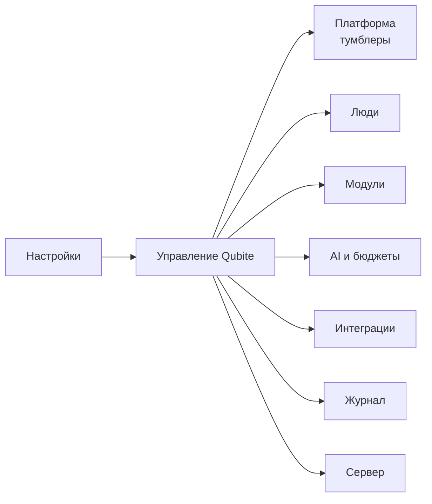

# Owner Console — управление Qubite

Owner Console — скрытый раздел **«Настройки → Управление Qubite»**. Его видит только владелец платформы. Остальным пользователям раздел не показывается, а его адреса и API возвращают `404`, а не `403`: так посторонние даже не узнают, что раздел существует.

Главная мысль ([D-031](DECISIONS.md)): владелец живёт в **обычном** интерфейсе Qubite. Console — это отдельная комната, а не стартовая страница.

## 1. Разделы

### 1.1. Платформа — тумблеры

Как в старом Qubite ([D-059](DECISIONS.md)), но в новом дизайне:

| Тумблер | Значения | По умолчанию | Что происходит |
|---|---|---|---|
| Регистрация | закрыта / по приглашениям / открыта | по приглашениям | Меняет форму регистрации и API сразу |
| Вход | включён / выключен | включён | Выключен — входить может только owner (через отдельный локальный путь, описан в DEPLOYMENT) |
| Режим техработ | выкл / вкл + текст | выкл | Пользователи видят страницу техработ; owner работает как обычно |
| Способы входа | по каждому: пароль, Google, Яндекс, VK, Telegram, (ChatGPT) | пароль вкл, остальные — если настроены ключи | Выключенный способ скрыт; начатый OAuth-вход тоже отклоняется |
| Почта | отправка вкл/выкл | вкл, если настроен SMTP | Без почты регистрация невозможна (подтверждение обязательно) |
| CAPTCHA | вкл/выкл, провайдер | вкл при открытой регистрации | — |
| Часовой пояс платформы | IANA-зона | `Asia/Yekaterinburg` | Используется для дневных/месячных лимитов |

Аварийные env-переключатели (`QUBITE_AUTH_*_ENABLED=false`) сильнее тумблеров: они нужны, если интерфейс недоступен.

### 1.2. Люди

- Список с поиском и фильтрами: активен / ждёт подтверждения почты / заблокирован.
- Карточка пользователя: профиль, способы входа, сессии и устройства, выданные модули, бюджеты, расход, история входов и действий.
- Действия: создать вручную, пригласить (на почту или общей ссылкой, срок, одноразовость), заблокировать/разблокировать, отозвать сессии, сбросить пароль (отправить ссылку), удалить по правилам хранения.
- Приглашения: список, статус, отзыв. Секретная ссылка показывается **один раз** при создании.
- Owner не может заблокировать себя и снять с себя owner через Console ([ACC-12](REQUIREMENTS.md)).

### 1.3. Модули

Для каждого модуля из [каталога](MODULES.md):

| Настройка | Значения |
|---|---|
| Установлен | да / нет (установка из Console — позже, [D-105](DECISIONS.md)) |
| Состояние | включён / выключен / техработы |
| Видимость без доступа | **с замком** (по умолчанию) / скрыт |
| Гранты пользователей | таблица: пользователь × `read` / `write` / `manage` / `ai` |
| Настройки модуля | своя форма (например, Search — движки, Writer — языки) |
| Бюджет модуля | лимиты AI для всего модуля |

Гранты выдаются **каждому вручную**, без сохранённых наборов ([D-062](DECISIONS.md)). Наборы прав («шаблоны ролей») — позже.

### 1.4. AI и бюджеты

- **Провайдеры:** OpenRouter и другие; ключ вводится один раз и больше не показывается; статус соединения.
- **Модели:** allowlist; по каждой модели — разрешённые типы (текст, vision, ASR, TTS, генерация), цена, контекст.
- **Лимиты** ([D-071](DECISIONS.md)): на пользователя, модуль, модель, провайдер. Сначала видны деньги за **день** и **месяц**, расход и резерв; остальное раскрывается: всё время, запросы/час/день/месяц, токены ([D-077](DECISIONS.md)).
- **Расход (AI Cost Center):** графики по дням, по пользователям, модулям и моделям; незавершённые резервы; заблокированные из-за превышения модели.
- Таймаут запроса (60 с по умолчанию), число повторов (до 3) — глобально.

### 1.5. Интеграции

Telegram-бот, почта (SMTP), CAPTCHA, OAuth-приложения провайдеров, Hermes, ShadeAI, школьный дневник и другие. У каждой — статус, ключи (вводятся, но не показываются), гранты пользователям, журнал ошибок. Секреты хранятся зашифрованными на сервере.

### 1.6. Журнал

Неизменяемая лента: кто, когда, что изменил, старое и новое значение (без секретов), с какого устройства. Фильтры по пользователю, модулю и типу. Отдельно — дорогие AI-вызовы и отказы доступа.

### 1.7. Сервер

Нагрузка (CPU, RAM, диск, температура Pi), состояние процессов и модулей, очередь фоновых задач, последний бэкап и его проверка, версия. Опасные действия (перезапуск модуля, бэкап сейчас) — с подтверждением пароля.

## 2. Как сохраняются изменения

Решение владельца [D-063](DECISIONS.md):

1. Владелец меняет переключатели и поля — это **черновик**. Ничего не применяется сразу.
2. Внизу появляется плашка «Изменено: 3» → по нажатию открывается **список изменений** «было → станет».
3. «Сохранить» отправляет **один атомарный пакет**: применяется всё или ничего.
4. Для защищённых действий спрашивается пароль, но не чаще раза в 5 минут.
5. Черновик хранится локально в браузере, привязан к аккаунту owner, **без паролей и секретов**. Он переживает перезагрузку, закрытие вкладки и потерю сети.
6. Перед сохранением сервер сверяет версии. Если кто-то (другая вкладка) изменил то же самое, Console показывает три значения: исходное, текущее на сервере и новое. Владелец выбирает.
7. Если ответ на «Сохранить» потерялся, повтор с тем же номером операции не применит пакет дважды.

## 3. Чего Console не делает

- Не управляет турнирами: настройки турниров — внутри модуля Tournaments, в разделе «Управление» с турнирными ролями.
- Не открывает платный AI сам: даже owner проходит те же проверки бюджета (свои лимиты он задаёт себе сам).
- Не показывает секреты: ключи провайдеров, токены приглашений после создания, пароли.

## 4. Связанные документы

- Модель прав: [architecture/AUTH_AND_PERMISSIONS.md](../architecture/AUTH_AND_PERMISSIONS.md)
- Бюджеты AI: [architecture/AI_COST_GUARD.md](../architecture/AI_COST_GUARD.md)
- Исходная политика: [context/QUBITE_ACCESS_AND_OWNER_CONSOLE.md](../context/QUBITE_ACCESS_AND_OWNER_CONSOLE.md)
