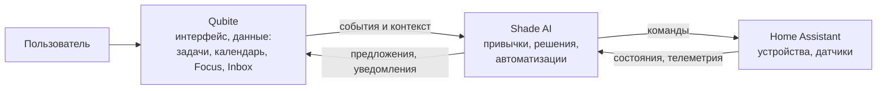

# Qubite Home и Shade AI (будущее)

**Статус:** идея и контекст владельца (17.10.2026). Не в MVP, детали обсуждаются перед началом эпика EPIC-QUBITE-HOME. Решения — [D-013, D-014](DECISIONS.md).

## 1. Идея

**Qubite Home** — модуль умного дома в Qubite:

- в основе **Home Assistant**: Qubite Home ставится на Raspberry Pi вместе с HA и управляет устройствами через его API;
- **Shade AI** идёт в комплекте как «мозг» дома: анализирует привычки, принимает решения и запускает автоматизации;
- **Qubite — интерфейс** для всего этого. Своего отдельного приложения у Shade AI не будет: Shade AI безинтерфейсный и **берёт данные из Qubite** (задачи, календарь, Focus, Inbox, уведомления), поэтому данные Qubite сразу становятся входом для автоматизаций дома.

Примеры: в календаре созвон → дом готовит свет и тишину; включён Focus → уведомления и свет в режиме концентрации; курьер написал «буду в 16:00» → Shade AI предлагает временный код замка (опасное действие — только с подтверждением).

## 2. Что есть в Shade AI сейчас

Проект: `~/programing/ShadeAI/` (отдельный репозиторий; начат на профильной смене Курчатовского центра). Состояние по его `docs/project-context.md` от 01.10.2026:

| Часть | Есть | Нет |
|---|---|---|
| Core (Python, FastAPI, SQLite) | health, приём/список уведомлений, временный `POST /ha/action`, ключ API | Миграций, полного API, развёртывания на Pi |
| LLM | Интерфейс и заглушка | Настоящей модели (планировалась локальная GGUF на Pi 5 4 ГБ) |
| Аналитика привычек | Описание | Алгоритма |
| HA-мост | REST-чтение состояний и вызов сервиса | Проверки на реальных устройствах |
| Android (Kotlin/Compose) | Перехват уведомлений, проверка на эмуляторе | Проверки на телефоне |
| Веб-дашборд (React) | Статус и уведомления | Управления |
| План | 27 задач, выполнены 2 | — |

Исходная идея — полностью локальная работа без облака. Владелец планирует **пересмотреть это**: AI может быть не только локальным, выбор за пользователем.

## 3. Как это ляжет на архитектуру Qubite

- Shade AI подключается к Qubite через **API и шину событий** с отдельным ограниченным ключом (как MCP/плагины): он видит только разрешённые данные, права — пересечение.
- Любые платные AI-вызовы Shade AI, если он пойдёт через облачные модели, проходят **AI-шлюз Qubite с бюджетом**.
- Опасные действия с домом (замки, сигнализация) — только с подтверждением в Qubite, с журналом.
- Перехват уведомлений телефона из Android-приложения Shade AI может переехать в Android-приложение Qubite (одно приложение вместо двух) — решить при проектировании.

## 4. Открытые вопросы (к началу эпика)

1. Язык Shade AI: оставить на Python или переписать на Rust, как остальные модули? Владелец пока склоняется оставить Python (D-014).
2. Где выполняется AI: локально на Pi, в облаке через шлюз Qubite или на выбор пользователя?
3. Qubite Home — отдельная установка (свой Pi с HA) или опциональный модуль общего установщика Qubite?
4. Какие данные Qubite Shade AI может читать по умолчанию и как пользователь это настраивает.
5. Перехват уведомлений телефона — в приложении Qubite или отдельно.
