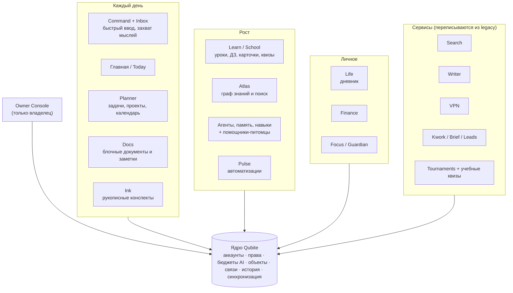

# Qubite — видение продукта

> **Qubite** — личная, а потом и командная цифровая среда для учёбы, конспектов, работы, задач, проектов, творчества, финансов, воспоминаний и автоматизации. Вся информация связана между собой и доступна в разных представлениях. С системой можно говорить как с AI, но всё важное можно сделать и руками. Данные и права остаются под контролем самого человека.

Этот документ — короткая, понятная выжимка. Полное исходное видение лежит в [docs/context/QUBITE_MASTER_CONTEXT.md](../context/QUBITE_MASTER_CONTEXT.md): там 48 одобренных идей, подробности по каждому модулю и ссылки на источники. Если документы расходятся, решения владельца из [DECISIONS.md](DECISIONS.md) важнее.

## 1. Откуда взялся проект

Всё началось с пера. Нужен был бесплатный аналог Notewise/GoodNotes для Android-планшета со стилусом: писать красивые конспекты по физике и математике с ощущением «как в Procreate». Затем идея выросла в единое пространство для всей жизни.

Старый Qubite (2025–2026) — платформа учебных турниров на Node.js и SQLite. Вокруг неё выросли сервисы: поиск, проверка текста, VPN, Telegram-боты, парсер Kwork. Этот код сохранён в [`legacy/qubite-v1/`](../../legacy/qubite-v1/) и постепенно переписывается модулями нового Qubite.

## 2. Для кого

| Кто | Что ему нужно |
|---|---|
| **Владелец** (сейчас главный и почти единственный пользователь) | Ежедневная работа: учёба в школе, конспекты, проекты, заказы Kwork, заметки, задачи, AI-помощник. Плюс полный контроль над платформой из Owner Console. |
| **Приглашённые пользователи** (друзья, одноклассники, коллеги) | Только те модули и тот бюджет AI, которые выдал владелец. |
| **Команды** (позже) | Совместные проекты, документы, холсты, обсуждения. |
| **Self-hosting сообщество** (далеко потом) | Открытый код, установка на свой сервер. |

## 3. Принципы, которые нельзя упрощать

1. **AI-first, но не AI-only.** Любое действие можно сделать руками. AI — удобный способ, а не единственный.
2. **Local-first.** Заметки, задачи и конспекты работают без интернета. Сервер не нужен для каждого нажатия.
3. **Одна информация — много представлений.** Задача — в списке, Kanban, календаре, на диаграмме Ганта.
4. **Всё связано.** Документы, задачи, проекты, люди, уроки и источники соединены типизированными связями, а не разложены по папкам.
5. **Качество ощущений важнее количества кнопок.** Свой живой материал интерфейса, плавные анимации, минимум шума.
6. **Каждый сервис — модуль.** Общие вход, права, поиск, события, история и синхронизация.
7. **Данные под контролем человека.** Экспорт, бэкапы, восстановление, журнал AI, приватные зоны, self-hosting.
8. **Личное отдельно от общего.** Дневник, личная память AI и ключи никогда не попадают в командный контекст сами.
9. **Проверяемость.** Крупные действия AI — с предпросмотром, правами, журналом и откатом.
10. **Деньги под замком.** Платный AI не включается сам: только по гранту владельца и в пределах бюджета.
11. **Плавный рост.** Старт — модульный монолит для одного человека на Raspberry Pi, но с заделом на много пользователей.
12. **Все устройства.** Web, Android (телефон и планшет), desktop. Это адаптивный интерфейс под каждое устройство, а не один экран, растянутый на все.

## 4. Из чего состоит Qubite

Подробный каталог модулей со статусами и поддоменами — в [MODULES.md](MODULES.md).

## 5. Что входит в MVP

MVP — это минимальный Qubite, которым владелец пользуется каждый день вместо старых инструментов. Порядок задан владельцем ([D-007](DECISIONS.md)):

1. **Фундамент**: Rust-ядро, web-клиент, CI, дизайн-система с живым материалом.
2. **Аккаунты и доступ**: вход, регистрация по приглашениям, права на модули, Owner Console, тумблеры платформы.
3. **AI-основа**: подключение провайдеров (OpenRouter), бюджеты, журнал расходов.
4. **Qubite Command + Inbox** — **первый полезный модуль**: одно поле внизу экрана. Пишешь или говоришь мысль, Qubite сохраняет её во «Входящие» и предлагает, куда её разложить: задача, заметка или проект. Работает офлайн, синхронизируется, принимает сообщения из Telegram.
5. **Planner**: задачи, проекты, сроки, список, Kanban, календарь недели.
6. **Docs**: блочный редактор, связи, версии, офлайн.
7. **Ink**: рукописные конспекты на Android-планшете, нативное перо.
8. **Развёртывание**: установщик на Raspberry Pi, поддомены, бэкапы.
9. **Клиенты**: desktop (Tauri) и Android-оболочка.

**Не входит в MVP** (будет потом): команды и совместное редактирование, Life/Finance/Focus, Studio, плагины и маркетплейс, полноценные агенты с памятью и навыками, переписанные Search/Writer/VPN/Kwork/турниры. Всё это есть в [ROADMAP](../plan/ROADMAP.md) и не теряется.

## 6. Что значит «готово»

Функция считается сделанной, только если (сокращённо из [MC §22]):

- запускается на чистой среде, миграции и зависимости описаны;
- проверены и успешные, и ошибочные сценарии; права проверены негативными тестами;
- данные не теряются при закрытии приложения, обрыве сети и конфликте;
- интерфейс проверен на телефоне, планшете и ПК, анимации плавные;
- нет секретов в логах, репозитории и AI-контексте;
- для AI видно, какие источники использованы и сколько стоил запрос;
- **владелец посмотрел и принял результат**.

Полный Definition of Done — в [engineering/AGENT_WORKFLOW.md](../engineering/AGENT_WORKFLOW.md).

## 7. Чего мы не обещаем

- что школьный сервис («Госуслуги Моя школа») имеет открытый API — это проверяется;
- что планшет поддерживает давление и наклон пера — проверяется на устройстве;
- что AI-провайдер гарантирует абсолютную приватность;
- что Android может полностью заблокировать другие приложения на обычном телефоне;
- что любая функция «работает», пока её не проверили на реальном устройстве.
